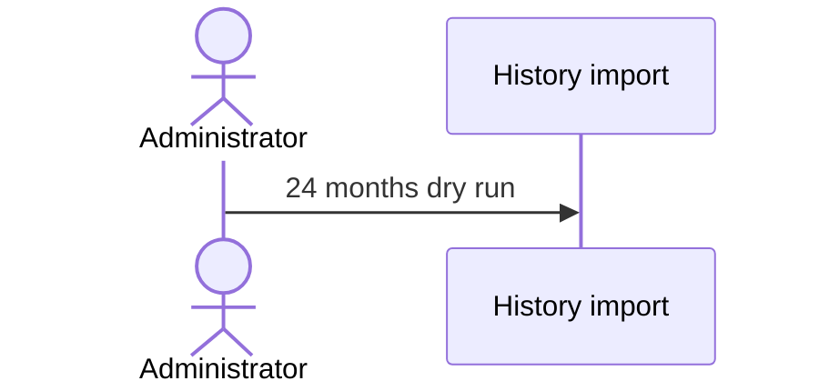

🏠 [Specs](../../../../README.md) › 🧩 [Functional capabilities](../../../README.md) ›
🔌 [F24 Integrations hub](../../README.md) › 📝 [Use cases](../README.md) ›
📝 [Use cases: FL-F24-03 CRM and ATS](README.md) › 📝 UC-F24-13 Import history once

# 📝 UC-F24-13 Import history once

**Status:** ✅ specified

## Summary

The administrator imports history once with a dry run.

## Personas

- [U07 Administrator](../../../../01-users/personas/u07-administrator.md)

## Goal

History in.

## Trigger

First sync.

## Frequency

Once.

## Preconditions

- Mapping.

## Postconditions

- Success: imported.
- Failure: errors.

## Main flow

1. Choose period (S-F24-13).
2. Dry run.
3. Import.
4. Log.

## Alternative flows

- 1a. All.

## Error flows

- 2e. Errors.
- Any step: a service does not answer; the call is retried first (BR-F3-32), then the message follows the error pattern
  (D122) and what was typed stays on the screen.

## Business rules

- [BR-F24-07 Two-way sync with an owner per field](../../business-rules/br-f24-07-two-way-sync-with-ownership.md)

## Entities

- [E-F24-06 Sync job](../../data/e-f24-06-sync-job.md)
- [E-F24-08 Sync log entry](../../data/e-f24-08-sync-log-entry.md)

## Permissions

Administrator.

## Notifications

- Done.

## Audit events

Imports.

## AI involvement

None.

## API, MCP and A2A exposure

Through T5 and T6 with the caller's rights (BR-F3-34).

## Screens

- [S-F24-13 History import](../../screens/03-crm-and-ats/s-f24-13-history-import.md)

## Flowchart

See [FL-F24-03 CRM and ATS](../../flows/fl-f24-03-crm-and-ats.md#flowchart).

## Sequence diagram

## Acceptance criteria

1. **Given** 24 months **when** dry run **then** counts.
2. **Given** errors **when** dry run **then** listed.
3. **Given** import **when** done **then** logged.

## Non-functional notes

D408's targets ([Performance](../../../../05-non-functional/performance.md)): 95 % of screens within 1 second; lists
paged on the server, the first page within 1 second; reports within 5 seconds or in the background.

## Regulatory references

Data rules of the France country pack that connectors follow:
[CR-FR-049 Processors and transfers outside the EU](../../../../10-country-packs/france/data-protection/cr-fr-049-processors-and-transfers.md),
[CR-FR-195 Candidates' personal data](../../../../10-country-packs/france/data-protection/cr-fr-195-candidate-data.md),
[CR-FR-063 Consent for email and SMS marketing](../../../../10-country-packs/france/consumer/cr-fr-063-electronic-marketing-consent.md),
[CR-FR-170 Switching between cloud services (Data Act)](../../../../10-country-packs/france/digital/cr-fr-170-data-act-switching.md),
[CR-FR-051 Access and erasure requests](../../../../10-country-packs/france/data-protection/cr-fr-051-access-and-erasure.md),
[CR-FR-052 Personal data kept no longer than needed](../../../../10-country-packs/france/data-protection/cr-fr-052-storage-limitation.md).

## Related use cases

- [UC-F24-23 Bring HR and payroll data from Silae, PayFit or Lucca](../06-business-tools/uc-f24-23-bring-hr-and-payroll-data-from-silae-payfit-or-lucca.md)

## Open questions

None.

---

⬅️ [UC-F24-12 Map fields and resolve conflicts](uc-f24-12-map-fields-and-resolve-conflicts.md) · ⬆️ [Up](README.md) ·
➡️ [UC-F24-14](../04-run-and-control/uc-f24-14-ask-the-assistant-to-act-in-a-connected-tool.md)
