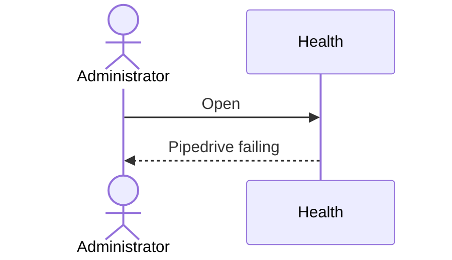

🏠 [Specs](../../../../README.md) › 🧩 [Functional capabilities](../../../README.md) ›
🔌 [F24 Integrations hub](../../README.md) › 📝 [Use cases](../README.md) ›
📝 [Use cases: FL-F24-04 Run and control](README.md) › 📝 UC-F24-15 Follow each connector's health and sync log

# 📝 UC-F24-15 Follow each connector's health and sync log

**Status:** ✅ specified

## Summary

The administrator follows each connector's health and sync log.

## Personas

- [U07 Administrator](../../../../01-users/personas/u07-administrator.md)

## Goal

Know what fails.

## Trigger

Daily.

## Frequency

Daily.

## Preconditions

- Connections.

## Postconditions

- Success: read.
- Failure: fixed.

## Main flow

1. Open (S-F24-15).
2. Read health with icons.
3. Read the log (BR-F24-09).
4. Fix.

## Alternative flows

- 3a. Retry.

## Error flows

- 4e. Incident.
- Any step: a service does not answer; the call is retried first (BR-F3-32), then the message follows the error pattern
  (D122) and what was typed stays on the screen.

## Business rules

- [BR-F24-09 Connector errors are visible and retried](../../business-rules/br-f24-09-connector-errors-visible.md)
- [BR-F24-16 Every integration shows its icon](../../business-rules/br-f24-16-every-integration-shows-its-icon.md)

## Entities

- [E-F24-08 Sync log entry](../../data/e-f24-08-sync-log-entry.md)
- [E-F24-10 Connector incident](../../data/e-f24-10-connector-incident.md)

## Permissions

Administrator.

## Notifications

- Failures.

## Audit events

Fixes.

## AI involvement

Explains.

## API, MCP and A2A exposure

Through T5 and T6 with the caller's rights (BR-F3-34).

## Screens

- [S-F24-15 Health](../../screens/04-run-and-control/s-f24-15-health.md)

## Flowchart

See [FL-F24-04 Run and control](../../flows/fl-f24-04-run-and-control.md#flowchart).

## Sequence diagram

## Acceptance criteria

1. **Given** failing **when** read **then** cause.
2. **Given** retried **when** fixed **then** ok.
3. **Given** each connection **when** listed **then** with its icon.

## Non-functional notes

D408's targets ([Performance](../../../../05-non-functional/performance.md)): 95 % of screens within 1 second; lists
paged on the server, the first page within 1 second; reports within 5 seconds or in the background.

## Regulatory references

Data rules of the France country pack that connectors follow:
[CR-FR-049 Processors and transfers outside the EU](../../../../10-country-packs/france/data-protection/cr-fr-049-processors-and-transfers.md),
[CR-FR-195 Candidates' personal data](../../../../10-country-packs/france/data-protection/cr-fr-195-candidate-data.md),
[CR-FR-063 Consent for email and SMS marketing](../../../../10-country-packs/france/consumer/cr-fr-063-electronic-marketing-consent.md),
[CR-FR-170 Switching between cloud services (Data Act)](../../../../10-country-packs/france/digital/cr-fr-170-data-act-switching.md),
[CR-FR-051 Access and erasure requests](../../../../10-country-packs/france/data-protection/cr-fr-051-access-and-erasure.md),
[CR-FR-052 Personal data kept no longer than needed](../../../../10-country-packs/france/data-protection/cr-fr-052-storage-limitation.md).

## Related use cases

- [UC-F24-16 Handle an outside API change or error](uc-f24-16-handle-an-outside-api-change-or-error.md)

## Open questions

None.

---

⬅️ [UC-F24-14](uc-f24-14-ask-the-assistant-to-act-in-a-connected-tool.md) · ⬆️ [Up](README.md) ·
➡️ [UC-F24-16 Handle an outside API change or error](uc-f24-16-handle-an-outside-api-change-or-error.md)
