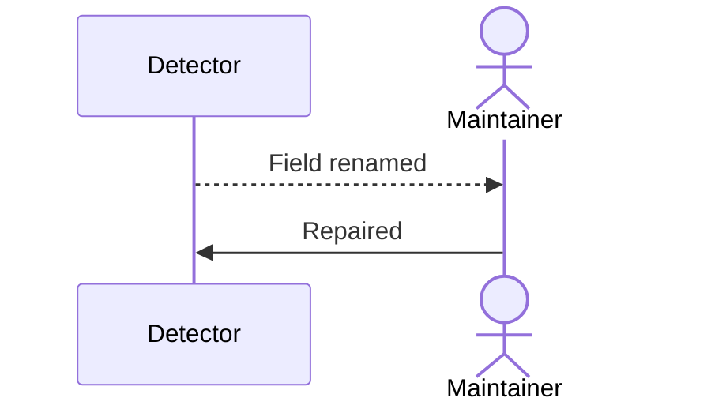

🏠 [Specs](../../../../README.md) › 🧩 [Functional capabilities](../../../README.md) ›
🔌 [F24 Integrations hub](../../README.md) › 📝 [Use cases](../README.md) ›
📝 [Use cases: FL-F24-04 Run and control](README.md) › 📝 UC-F24-16 Handle an outside API change or error

# 📝 UC-F24-16 Handle an outside API change or error

**Status:** ✅ specified

## Summary

An outside API change is detected, flagged and repaired by maintainers.

## Personas

- [U07 Administrator](../../../../01-users/personas/u07-administrator.md)
- [U47 simple-ERP maintainer](../../../../01-users/personas/u47-simple-erp-maintainer.md)

## Goal

Connectors keep working.

## Trigger

Change.

## Frequency

Rare.

## Preconditions

- Connection.

## Postconditions

- Success: repaired.
- Failure: incident.

## Main flow

1. Detected.
2. Flagged (S-F24-16).
3. Maintainer repairs.
4. Released.

## Alternative flows

- 3a. Workaround.

## Error flows

- 3e. Not repairable.
- Any step: a service does not answer; the call is retried first (BR-F3-32), then the message follows the error pattern
  (D122) and what was typed stays on the screen.

## Business rules

- [BR-F24-09 Connector errors are visible and retried](../../business-rules/br-f24-09-connector-errors-visible.md)

## Entities

- [E-F24-10 Connector incident](../../data/e-f24-10-connector-incident.md)

## Permissions

Administrator, maintainer.

## Notifications

- Administrator.

## Audit events

Incidents.

## AI involvement

Detects.

## API, MCP and A2A exposure

Through T5 and T6 with the caller's rights (BR-F3-34).

## Screens

- [S-F24-16 API changes](../../screens/04-run-and-control/s-f24-16-api-changes.md)

## Flowchart

See [FL-F24-04 Run and control](../../flows/fl-f24-04-run-and-control.md#flowchart).

## Sequence diagram

## Acceptance criteria

1. **Given** renamed field **when** detected **then** flagged.
2. **Given** repaired **when** released **then** ok.
3. **Given** not repairable **when** found **then** told.

## Non-functional notes

D408's targets ([Performance](../../../../05-non-functional/performance.md)): 95 % of screens within 1 second; lists
paged on the server, the first page within 1 second; reports within 5 seconds or in the background.

## Regulatory references

Data rules of the France country pack that connectors follow:
[CR-FR-049 Processors and transfers outside the EU](../../../../10-country-packs/france/data-protection/cr-fr-049-processors-and-transfers.md),
[CR-FR-195 Candidates' personal data](../../../../10-country-packs/france/data-protection/cr-fr-195-candidate-data.md),
[CR-FR-063 Consent for email and SMS marketing](../../../../10-country-packs/france/consumer/cr-fr-063-electronic-marketing-consent.md),
[CR-FR-170 Switching between cloud services (Data Act)](../../../../10-country-packs/france/digital/cr-fr-170-data-act-switching.md),
[CR-FR-051 Access and erasure requests](../../../../10-country-packs/france/data-protection/cr-fr-051-access-and-erasure.md),
[CR-FR-052 Personal data kept no longer than needed](../../../../10-country-packs/france/data-protection/cr-fr-052-storage-limitation.md).

## Related use cases

- [UC-F24-15 Follow each connector's health and sync log](uc-f24-15-follow-each-connector-s-health-and-sync-log.md)

## Open questions

None.

---

⬅️ [UC-F24-15 Follow each connector's health and sync log](uc-f24-15-follow-each-connector-s-health-and-sync-log.md) ·
⬆️ [Up](README.md) ·
➡️ [UC-F24-17 Disconnect and keep or delete the data](uc-f24-17-disconnect-and-keep-or-delete-the-data.md)
