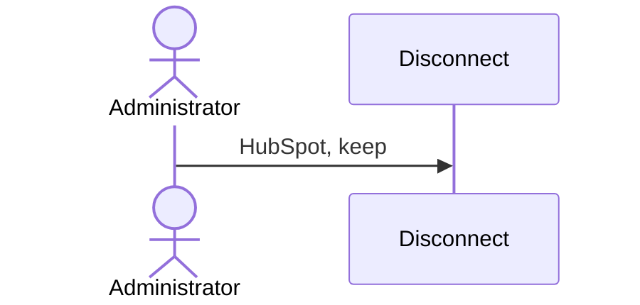

🏠 [Specs](../../../../README.md) › 🧩 [Functional capabilities](../../../README.md) ›
🔌 [F24 Integrations hub](../../README.md) › 📝 [Use cases](../README.md) ›
📝 [Use cases: FL-F24-04 Run and control](README.md) › 📝 UC-F24-17 Disconnect and keep or delete the data

# 📝 UC-F24-17 Disconnect and keep or delete the data

**Status:** ✅ specified

## Summary

The administrator disconnects a tool and keeps or deletes the data.

## Personas

- [U07 Administrator](../../../../01-users/personas/u07-administrator.md)

## Goal

Clean exit.

## Trigger

Not needed.

## Frequency

Rare.

## Preconditions

- Connection.

## Postconditions

- Success: disconnected.
- Failure: none.

## Main flow

1. Disconnect (S-F24-17).
2. Tokens revoked (BR-F24-10).
3. Keep or delete.
4. Done.

## Alternative flows

- 3a. Keep read-only.

## Error flows

- 2e. Revoke fails.
- Any step: a service does not answer; the call is retried first (BR-F3-32), then the message follows the error pattern
  (D122) and what was typed stays on the screen.

## Business rules

- [BR-F24-10 Disconnect cleanly](../../business-rules/br-f24-10-disconnect-cleanly.md)
- [BR-F24-01 Synced data follows the country pack](../../business-rules/br-f24-01-connectors-follow-the-country-pack.md)

## Entities

- [E-F24-02 Tool connection](../../data/e-f24-02-tool-connection.md)
- [E-F24-08 Sync log entry](../../data/e-f24-08-sync-log-entry.md)

## Permissions

Administrator.

## Notifications

- Users.

## Audit events

Disconnections.

## AI involvement

None.

## API, MCP and A2A exposure

Through T5 and T6 with the caller's rights (BR-F3-34).

## Screens

- [S-F24-17 Disconnect](../../screens/04-run-and-control/s-f24-17-disconnect.md)

## Flowchart

See [FL-F24-04 Run and control](../../flows/fl-f24-04-run-and-control.md#flowchart).

## Sequence diagram

## Acceptance criteria

1. **Given** disconnect **when** done **then** tokens revoked.
2. **Given** delete **when** chosen **then** deleted.
3. **Given** revoke fails **when** done **then** retried.

## Non-functional notes

D408's targets ([Performance](../../../../05-non-functional/performance.md)): 95 % of screens within 1 second; lists
paged on the server, the first page within 1 second; reports within 5 seconds or in the background.

## Regulatory references

Data rules of the France country pack that connectors follow:
[CR-FR-049 Processors and transfers outside the EU](../../../../10-country-packs/france/data-protection/cr-fr-049-processors-and-transfers.md),
[CR-FR-195 Candidates' personal data](../../../../10-country-packs/france/data-protection/cr-fr-195-candidate-data.md),
[CR-FR-063 Consent for email and SMS marketing](../../../../10-country-packs/france/consumer/cr-fr-063-electronic-marketing-consent.md),
[CR-FR-170 Switching between cloud services (Data Act)](../../../../10-country-packs/france/digital/cr-fr-170-data-act-switching.md),
[CR-FR-051 Access and erasure requests](../../../../10-country-packs/france/data-protection/cr-fr-051-access-and-erasure.md),
[CR-FR-052 Personal data kept no longer than needed](../../../../10-country-packs/france/data-protection/cr-fr-052-storage-limitation.md).

## Related use cases

- [UC-F24-15 Follow each connector's health and sync log](uc-f24-15-follow-each-connector-s-health-and-sync-log.md)

## Open questions

None.

---

⬅️ [UC-F24-16 Handle an outside API change or error](uc-f24-16-handle-an-outside-api-change-or-error.md) ·
⬆️ [Up](README.md) · ➡️ [UC-F24-18](../05-keep-the-catalogue/uc-f24-18-review-the-list-of-50-every-year.md)
