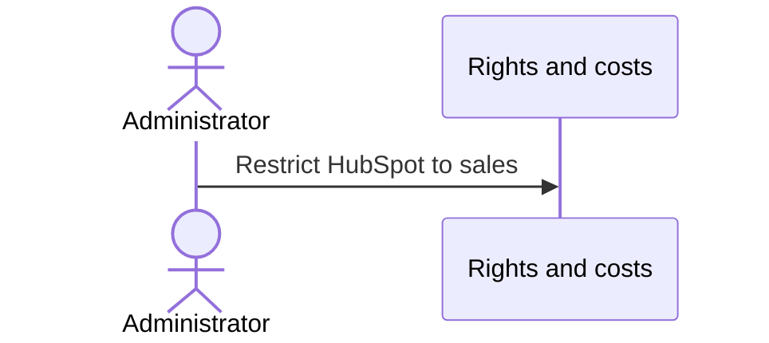

🏠 [Specs](../../../../README.md) › 🧩 [Functional capabilities](../../../README.md) ›
🔌 [F24 Integrations hub](../../README.md) › 📝 [Use cases](../README.md) ›
📝 [Use cases: FL-F24-04 Run and control](README.md) › 📝 UC-F24-20 Control the rights and costs of connectors

# 📝 UC-F24-20 Control the rights and costs of connectors

**Status:** ✅ specified

## Summary

The administrator and owner control the rights and costs of connectors.

## Personas

- [U07 Administrator](../../../../01-users/personas/u07-administrator.md)
- [U13 Owner](../../../../01-users/personas/u13-owner.md)

## Goal

Control.

## Trigger

Review.

## Frequency

Quarterly.

## Preconditions

- Connections.

## Postconditions

- Success: restricted.
- Failure: none.

## Main flow

1. Review scopes (S-F24-20).
2. Restrict roles.
3. See costs (BR-F24-11).
4. Save.

## Alternative flows

- 3a. Budget in F22.

## Error flows

- 2e. None.
- Any step: a service does not answer; the call is retried first (BR-F3-32), then the message follows the error pattern
  (D122) and what was typed stays on the screen.

## Business rules

- [BR-F24-11 Connector costs are metered](../../business-rules/br-f24-11-connector-costs-metered.md)
- [BR-F24-08 Credentials in the vault](../../business-rules/br-f24-08-credentials-in-the-vault.md)
- [BR-F24-13 Automation tools through signed webhooks and the API](../../business-rules/br-f24-13-automation-tools-through-signed-webhooks-and-the-api.md)

## Entities

- [E-F24-02 Tool connection](../../data/e-f24-02-tool-connection.md)
- [E-F24-09 Connector action](../../data/e-f24-09-connector-action.md)
- [E-F24-13 Webhook subscription](../../data/e-f24-13-webhook-subscription.md)

## Permissions

Administrator, owner.

## Notifications

- None.

## Audit events

Changes.

## AI involvement

None.

## API, MCP and A2A exposure

Through T5 and T6 with the caller's rights (BR-F3-34).

## Screens

- [S-F24-20 Rights and costs](../../screens/04-run-and-control/s-f24-20-rights-and-costs.md)

## Flowchart

See [FL-F24-04 Run and control](../../flows/fl-f24-04-run-and-control.md#flowchart).

## Sequence diagram

## Acceptance criteria

1. **Given** restricted **when** saved **then** sales only.
2. **Given** costs **when** read **then** from F22.
3. **Given** a webhook token **when** reviewed **then** its rights.

## Non-functional notes

D408's targets ([Performance](../../../../05-non-functional/performance.md)): 95 % of screens within 1 second; lists
paged on the server, the first page within 1 second; reports within 5 seconds or in the background.

## Regulatory references

Data rules of the France country pack that connectors follow:
[CR-FR-049 Processors and transfers outside the EU](../../../../10-country-packs/france/data-protection/cr-fr-049-processors-and-transfers.md),
[CR-FR-195 Candidates' personal data](../../../../10-country-packs/france/data-protection/cr-fr-195-candidate-data.md),
[CR-FR-063 Consent for email and SMS marketing](../../../../10-country-packs/france/consumer/cr-fr-063-electronic-marketing-consent.md),
[CR-FR-170 Switching between cloud services (Data Act)](../../../../10-country-packs/france/digital/cr-fr-170-data-act-switching.md),
[CR-FR-051 Access and erasure requests](../../../../10-country-packs/france/data-protection/cr-fr-051-access-and-erasure.md),
[CR-FR-052 Personal data kept no longer than needed](../../../../10-country-packs/france/data-protection/cr-fr-052-storage-limitation.md).

## Related use cases

- [UC-F24-22 Automate with n8n, Make or Zapier](../06-business-tools/uc-f24-22-automate-with-n8n-make-or-zapier.md)

## Open questions

None.

---

⬅️ [UC-F24-19 Request a missing connector](../05-keep-the-catalogue/uc-f24-19-request-a-missing-connector.md) ·
⬆️ [Up](README.md) ·
➡️ [UC-F24-21](../06-business-tools/uc-f24-21-connect-a-bank-payment-shop-accounting-or-carrier-tool.md)
