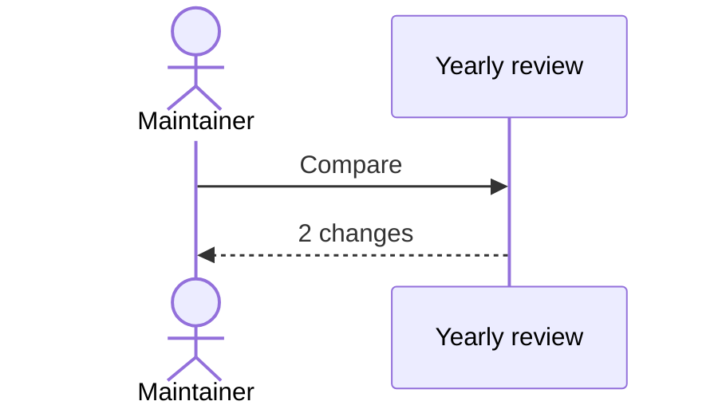

🏠 [Specs](../../../../README.md) › 🧩 [Functional capabilities](../../../README.md) ›
🔌 [F24 Integrations hub](../../README.md) › 📝 [Use cases](../README.md) ›
📝 [Use cases: FL-F24-05 Keep the catalogue](README.md) › 📝 UC-F24-18 Review the list of 50 every year

# 📝 UC-F24-18 Review the list of 50 every year

**Status:** ✅ specified

## Summary

The maintainer reviews the list of 50 every year, icons included.

## Personas

- [U47 SimpleERP maintainer](../../../../01-users/personas/u47-simpleerp-maintainer.md)

## Goal

Current list.

## Trigger

Yearly.

## Frequency

Yearly.

## Preconditions

- Market data.

## Postconditions

- Success: published.
- Failure: none.

## Main flow

1. Compare (S-F24-18).
2. Propose changes (BR-F24-06).
3. Check icons (UC-F24-27).
4. Publish.

## Alternative flows

- 2a. Keep.

## Error flows

- 4e. None.
- Any step: a service does not answer; the call is retried first (BR-F3-32), then the message follows the error pattern
  (D122) and what was typed stays on the screen.

## Business rules

- [BR-F24-06 The list reviewed every year](../../business-rules/br-f24-06-list-reviewed-yearly.md)

## Entities

- [E-F24-01 Connector](../../data/e-f24-01-connector.md)
- [E-F24-15 Connector catalogue review](../../data/e-f24-15-connector-catalogue-review.md)

## Permissions

Maintainer.

## Notifications

- Users of leaving tools.

## Audit events

Reviews.

## AI involvement

Market data.

## API, MCP and A2A exposure

Through T5 and T6 with the caller's rights (BR-F3-34).

## Screens

- [S-F24-18 Yearly review](../../screens/05-keep-the-catalogue/s-f24-18-yearly-review.md)

## Flowchart

See [FL-F24-05 Keep the catalogue](../../flows/fl-f24-05-keep-the-catalogue.md#flowchart).

## Sequence diagram

## Acceptance criteria

1. **Given** 2 changes **when** published **then** list updated.
2. **Given** a leaving tool **when** published **then** keeps working.
3. **Given** icons **when** reviewed **then** checked.

## Non-functional notes

D408's targets ([Performance](../../../../05-non-functional/performance.md)): 95 % of screens within 1 second; lists
paged on the server, the first page within 1 second; reports within 5 seconds or in the background.

## Regulatory references

Data rules of the France country pack that connectors follow:
[CR-FR-049 Processors and transfers outside the EU](../../../../10-country-packs/france/data-protection/cr-fr-049-processors-and-transfers.md),
[CR-FR-195 Candidates' personal data](../../../../10-country-packs/france/data-protection/cr-fr-195-candidate-data.md),
[CR-FR-063 Consent for email and SMS marketing](../../../../10-country-packs/france/consumer/cr-fr-063-electronic-marketing-consent.md),
[CR-FR-170 Switching between cloud services (Data Act)](../../../../10-country-packs/france/digital/cr-fr-170-data-act-switching.md),
[CR-FR-051 Access and erasure requests](../../../../10-country-packs/france/data-protection/cr-fr-051-access-and-erasure.md),
[CR-FR-052 Personal data kept no longer than needed](../../../../10-country-packs/france/data-protection/cr-fr-052-storage-limitation.md).

## Related use cases

- [UC-F24-27 Keep the integration icons](uc-f24-27-keep-the-integration-icons.md)

## Open questions

None.

---

⬅️ [UC-F24-17](../04-run-and-control/uc-f24-17-disconnect-and-keep-or-delete-the-data.md) · ⬆️ [Up](README.md) ·
➡️ [UC-F24-19 Request a missing connector](uc-f24-19-request-a-missing-connector.md)
