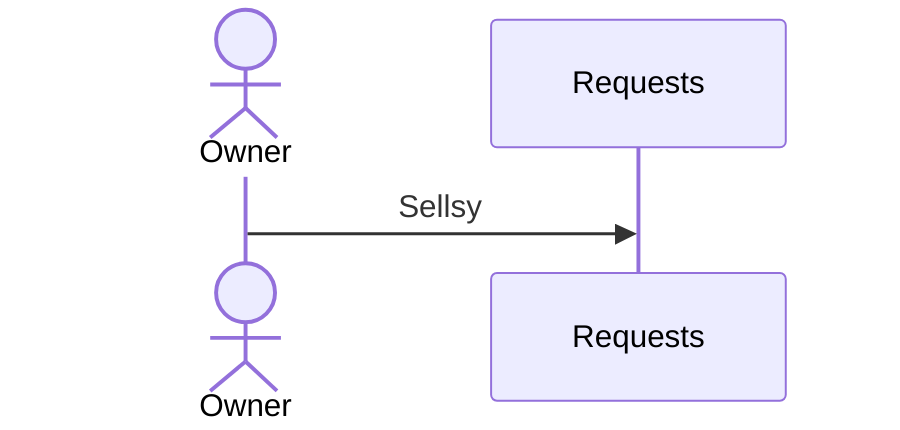

🏠 [Specs](../../../../README.md) › 🧩 [Functional capabilities](../../../README.md) ›
🔌 [F24 Integrations hub](../../README.md) › 📝 [Use cases](../README.md) ›
📝 [Use cases: FL-F24-05 Keep the catalogue](README.md) › 📝 UC-F24-19 Request a missing connector

# 📝 UC-F24-19 Request a missing connector

**Status:** ✅ specified

## Summary

The owner requests a missing connector.

## Personas

- [U13 Owner](../../../../01-users/personas/u13-owner.md)

## Goal

Get it.

## Trigger

Missing.

## Frequency

Rare.

## Preconditions

- None.

## Postconditions

- Success: ready.
- Failure: refused.

## Main flow

1. Request (S-F24-19).
2. Factory or maintainers build.
3. Told when ready.
4. Connect.

## Alternative flows

- 2a. Factory (F19).

## Error flows

- 2e. Refused.
- Any step: a service does not answer; the call is retried first (BR-F3-32), then the message follows the error pattern
  (D122) and what was typed stays on the screen.

## Business rules

- [BR-F24-02 Every connector in the fewest steps](../../business-rules/br-f24-02-fewest-steps-everywhere.md)

## Entities

- [E-F24-01 Connector](../../data/e-f24-01-connector.md)
- [E-F24-16 Connector request](../../data/e-f24-16-connector-request.md)

## Permissions

Owner.

## Notifications

- When ready.

## Audit events

Requests.

## AI involvement

None.

## API, MCP and A2A exposure

Through T5 and T6 with the caller's rights (BR-F3-34).

## Screens

- [S-F24-19 Requests](../../screens/05-keep-the-catalogue/s-f24-19-requests.md)

## Flowchart

See [FL-F24-05 Keep the catalogue](../../flows/fl-f24-05-keep-the-catalogue.md#flowchart).

## Sequence diagram

## Acceptance criteria

1. **Given** a request **when** built **then** told.
2. **Given** refused **when** refused **then** reason.
3. **Given** ready **when** connected **then** works.

## Non-functional notes

D408's targets ([Performance](../../../../05-non-functional/performance.md)): 95 % of screens within 1 second; lists
paged on the server, the first page within 1 second; reports within 5 seconds or in the background.

## Regulatory references

Data rules of the France country pack that connectors follow:
[CR-FR-049 Processors and transfers outside the EU](../../../../10-country-packs/france/data-protection/cr-fr-049-processors-and-transfers.md),
[CR-FR-195 Candidates' personal data](../../../../10-country-packs/france/data-protection/cr-fr-195-candidate-data.md),
[CR-FR-063 Consent for email and SMS marketing](../../../../10-country-packs/france/consumer/cr-fr-063-electronic-marketing-consent.md),
[CR-FR-170 Switching between cloud services (Data Act)](../../../../10-country-packs/france/digital/cr-fr-170-data-act-switching.md),
[CR-FR-051 Access and erasure requests](../../../../10-country-packs/france/data-protection/cr-fr-051-access-and-erasure.md),
[CR-FR-052 Personal data kept no longer than needed](../../../../10-country-packs/france/data-protection/cr-fr-052-storage-limitation.md).

## Related use cases

- [UC-F24-01 Browse the connector catalogue](../01-find-and-connect/uc-f24-01-browse-the-connector-catalogue.md)

## Open questions

None.

---

⬅️ [UC-F24-18 Review the list of 50 every year](uc-f24-18-review-the-list-of-50-every-year.md) · ⬆️ [Up](README.md) ·
➡️ [UC-F24-20](../04-run-and-control/uc-f24-20-control-the-rights-and-costs-of-connectors.md)
