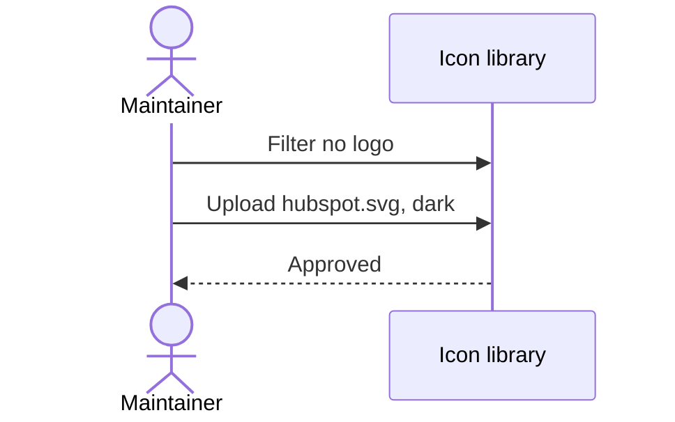

🏠 [Specs](../../../../README.md) › 🧩 [Functional capabilities](../../../README.md) ›
🔌 [F24 Integrations hub](../../README.md) › 📝 [Use cases](../README.md) ›
📝 [Use cases: FL-F24-05 Keep the catalogue](README.md) › 📝 UC-F24-27 Keep the integration icons

# 📝 UC-F24-27 Keep the integration icons

**Status:** ✅ specified

## Summary

The maintainer adds each integration's logo to the icon library after checking the vendor's brand terms, with its
dark-mode variant, or leaves the category's fallback icon.

## Personas

- [U47 simple-ERP maintainer](../../../../01-users/personas/u47-simple-erp-maintainer.md)

## Goal

Every integration recognisable at a glance.

## Trigger

A new connector; a yearly review.

## Frequency

With each catalogue change.

## Preconditions

- The connector exists.

## Postconditions

- Success: logo approved or fallback kept.
- Failure: refused file.

## Main flow

1. The maintainer opens the Icon library (S-F24-25) and filters "no logo".
2. They read the vendor's brand terms.
3. They upload the SVG and its dark variant.
4. simple-ERP checks format, size and contrast on both themes (BR-F24-16).
5. The logo shows everywhere the integration appears.

## Alternative flows

- 2a. Terms forbid it: the category icon stays.

## Error flows

- 4e. Wrong format or too large: refused.
- Any step: a service does not answer; the call is retried first (BR-F3-32), then the message follows the error pattern
  (D122) and what was typed stays on the screen.

## Business rules

- [BR-F24-16 Every integration shows its icon](../../business-rules/br-f24-16-every-integration-shows-its-icon.md)

## Entities

- [E-F24-12 Integration icon](../../data/e-f24-12-integration-icon.md)
- [E-F24-11 Connector category](../../data/e-f24-11-connector-category.md)

## Permissions

Maintainer.

## Notifications

- None.

## Audit events

Icons.

## AI involvement

None.

## API, MCP and A2A exposure

Through the API (T5) and as AI assistant tools (T6), with the caller's rights (BR-F3-34).

## Screens

- [S-F24-25 Icon library](../../screens/05-keep-the-catalogue/s-f24-25-icon-library.md)

## Flowchart

See [FL-F24-05 Keep the catalogue](../../flows/fl-f24-05-keep-the-catalogue.md#flowchart).

## Sequence diagram

## Acceptance criteria

1. **Given** hubspot.svg 12 KB **when** uploaded **then** approved.
2. **Given** a 200 KB PNG **when** uploaded **then** refused.
3. **Given** terms forbid **when** checked **then** the category icon stays.
4. **Given** no dark variant **when** shown in dark mode **then** on a light tile.

## Non-functional notes

D408's targets ([Performance](../../../../05-non-functional/performance.md)): 95 % of screens within 1 second; lists
paged on the server, the first page within 1 second; reports within 5 seconds or in the background.

## Regulatory references

None.

## Related use cases

- [UC-F24-18 Review the list of 50 every year](uc-f24-18-review-the-list-of-50-every-year.md)

## Open questions

None.

---

⬅️ [UC-F24-26](../07-employees-and-their-tools/uc-f24-26-see-which-tools-receive-my-data.md) · ⬆️ [Up](README.md) ·
➡️ [UC-F24-28](../08-ai-connectors-suites-and-warehouse/uc-f24-28-have-the-ai-build-a-connector.md)
