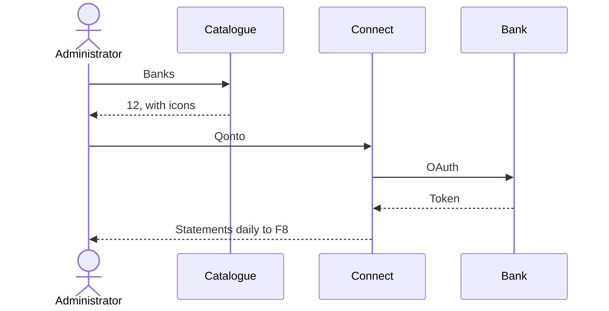

🏠 [Specs](../../../../README.md) › 🧩 [Functional capabilities](../../../README.md) ›
🔌 [F24 Integrations hub](../../README.md) › 📝 [Use cases](../README.md) ›
📝 [Use cases: FL-F24-06 Business tools](README.md) ›
📝 UC-F24-21 Connect a bank, payment, shop, accounting or carrier tool

# 📝 UC-F24-21 Connect a bank, payment, shop, accounting or carrier tool

**Status:** ✅ specified

## Summary

The administrator connects a business tool from the new categories (a bank, a payment provider, an online shop, an
accounting tool, a carrier) in the fewest steps, and its data flows to the capability that needs it.

## Personas

- [U07 Administrator](../../../../01-users/personas/u07-administrator.md)
- [U13 Owner](../../../../01-users/personas/u13-owner.md), who approves a paid connector

## Goal

Business tools connected without an integrator.

## Trigger

A tool the company uses.

## Frequency

A few at set-up.

## Preconditions

- The tool has a connector in the catalogue.

## Postconditions

- Success: connection active, data flowing.
- Failure: nothing saved.

## Main flow

1. The administrator filters the Catalogue (S-F24-01) by "banks" and sees each connector with its icon.
2. They choose one and open Connect (S-F24-02).
3. They sign in with OAuth; simple-ERP proposes the settings (BR-F24-02).
4. They confirm; data starts flowing to F8, F6, F11 or F7.
5. The connection shows in Health (UC-F24-15).

## Alternative flows

- 3a. A paid connector: the owner approves first (BR-F24-11).

## Error flows

- 3e. Sign-in refused: reason shown, nothing saved.
- Any step: a service does not answer; the call is retried first (BR-F3-32), then the message follows the error pattern
  (D122) and what was typed stays on the screen.

## Business rules

- [BR-F24-12 The catalogue covers every business category](../../business-rules/br-f24-12-the-catalogue-covers-every-business-category.md)
- [BR-F24-16 Every integration shows its icon](../../business-rules/br-f24-16-every-integration-shows-its-icon.md)
- [BR-F24-02 Every connector in the fewest steps](../../business-rules/br-f24-02-fewest-steps-everywhere.md)

## Entities

- [E-F24-11 Connector category](../../data/e-f24-11-connector-category.md)
- [E-F24-12 Integration icon](../../data/e-f24-12-integration-icon.md)
- [E-F24-02 Tool connection](../../data/e-f24-02-tool-connection.md)

## Permissions

Administrator; owner approves paid.

## Notifications

- The administrator when connected or failing.

## Audit events

Connections.

## AI involvement

The AI assistant suggests the connectors of the company's sector.

## API, MCP and A2A exposure

Through the API (T5) and as AI assistant tools (T6), with the caller's rights (BR-F3-34).

## Screens

- [S-F24-01 Catalogue](../../screens/01-find-and-connect/s-f24-01-catalogue.md)
- [S-F24-02 Connect](../../screens/01-find-and-connect/s-f24-02-connect.md)

## Flowchart

See [FL-F24-06 Business tools](../../flows/fl-f24-06-business-tools.md#flowchart).

## Sequence diagram

## Acceptance criteria

1. **Given** the filter "banks" **when** applied **then** each bank connector shows its icon or the banks icon.
2. **Given** Qonto connected by OAuth **when** confirmed **then** statements reach F8 daily.
3. **Given** a paid connector **when** chosen **then** the owner approves first.
4. **Given** a refused sign-in **when** tried **then** nothing is saved.

## Non-functional notes

D408's targets ([Performance](../../../../05-non-functional/performance.md)): 95 % of screens within 1 second; lists
paged on the server, the first page within 1 second; reports within 5 seconds or in the background.

## Regulatory references

None.

## Related use cases

- [UC-F24-01 Browse the connector catalogue](../01-find-and-connect/uc-f24-01-browse-the-connector-catalogue.md)
- [UC-F24-02 Connect a tool in the fewest steps](../01-find-and-connect/uc-f24-02-connect-a-tool-in-the-fewest-steps.md)

## Open questions

None.

---

⬅️ [UC-F24-20](../04-run-and-control/uc-f24-20-control-the-rights-and-costs-of-connectors.md) · ⬆️ [Up](README.md) ·
➡️ [UC-F24-22 Automate with n8n, Make or Zapier](uc-f24-22-automate-with-n8n-make-or-zapier.md)
