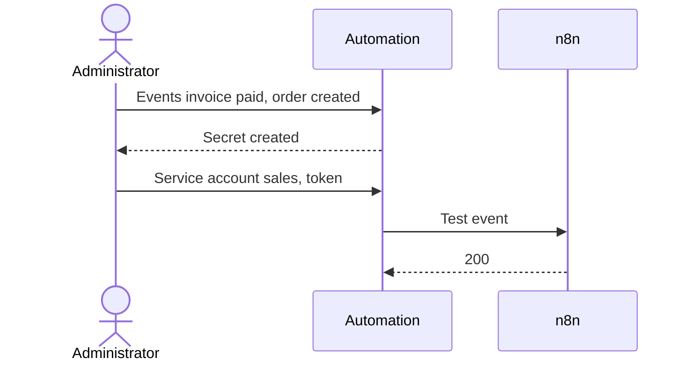

🏠 [Specs](../../../../README.md) › 🧩 [Functional capabilities](../../../README.md) ›
🔌 [F24 Integrations hub](../../README.md) › 📝 [Use cases](../README.md) ›
📝 [Use cases: FL-F24-06 Business tools](README.md) › 📝 UC-F24-22 Automate with n8n, Make or Zapier

# 📝 UC-F24-22 Automate with n8n, Make or Zapier

**Status:** ✅ specified

## Summary

The administrator connects an automation tool: chooses the events sent by signed webhooks and the rights of the service
account the tool uses on the API.

## Personas

- [U07 Administrator](../../../../01-users/personas/u07-administrator.md)

## Goal

Company automations without code in SimpleERP.

## Trigger

An automation to build.

## Frequency

A few a year.

## Preconditions

- The automation tool exists.

## Postconditions

- Success: webhooks active, token issued.
- Failure: paused endpoints.

## Main flow

1. The administrator opens Automation (S-F24-21) and chooses n8n.
2. They choose the events: invoice paid, order created.
3. They enter the endpoint; SimpleERP creates the secret (BR-F24-13).
4. They create a service account with chosen rights and its token.
5. A test event is sent and acknowledged.

## Alternative flows

- 4a. Read-only token.

## Error flows

- 5e. Endpoint fails repeatedly: paused, administrator told.
- Any step: a service does not answer; the call is retried first (BR-F3-32), then the message follows the error pattern
  (D122) and what was typed stays on the screen.

## Business rules

- [BR-F24-13 Automation tools through signed webhooks and the API](../../business-rules/br-f24-13-automation-tools-through-signed-webhooks-and-the-api.md)
- [BR-F24-08 Credentials in the vault](../../business-rules/br-f24-08-credentials-in-the-vault.md)

## Entities

- [E-F24-13 Webhook subscription](../../data/e-f24-13-webhook-subscription.md)
- [E-F24-02 Tool connection](../../data/e-f24-02-tool-connection.md)

## Permissions

Administrator.

## Notifications

- The administrator when an endpoint is paused.

## Audit events

Subscriptions, tokens, pauses.

## AI involvement

The AI assistant explains which events exist.

## API, MCP and A2A exposure

Through the API (T5) and as AI assistant tools (T6), with the caller's rights (BR-F3-34).

## Screens

- [S-F24-21 Automation](../../screens/06-business-tools/s-f24-21-automation.md)

## Flowchart

See [FL-F24-06 Business tools](../../flows/fl-f24-06-business-tools.md#flowchart).

## Sequence diagram

## Acceptance criteria

1. **Given** n8n with "invoice paid" **when** an invoice is paid **then** a signed event reaches the endpoint.
2. **Given** a token with sales rights **when** it writes a payslip **then** refused.
3. **Given** 10 failures **when** counted **then** paused and the administrator told.

## Non-functional notes

D408's targets ([Performance](../../../../05-non-functional/performance.md)): 95 % of screens within 1 second; lists
paged on the server, the first page within 1 second; reports within 5 seconds or in the background.

## Regulatory references

None.

## Related use cases

- [UC-F24-20 Control the rights and costs of connectors](../04-run-and-control/uc-f24-20-control-the-rights-and-costs-of-connectors.md)
- [UC-F24-15 Follow each connector's health and sync log](../04-run-and-control/uc-f24-15-follow-each-connector-s-health-and-sync-log.md)

## Open questions

None.

---

⬅️ [UC-F24-21](uc-f24-21-connect-a-bank-payment-shop-accounting-or-carrier-tool.md) · ⬆️ [Up](README.md) ·
➡️ [UC-F24-23](uc-f24-23-bring-hr-and-payroll-data-from-silae-payfit-or-lucca.md)
