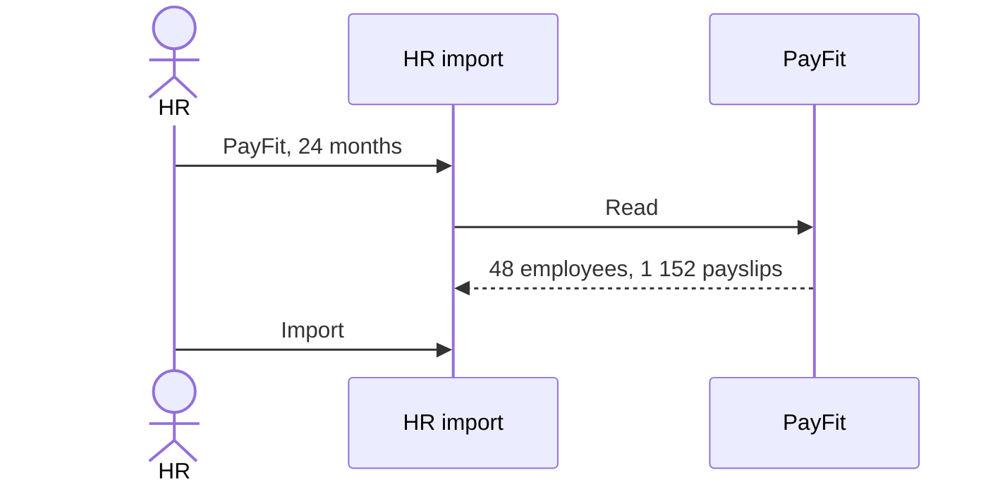

🏠 [Specs](../../../../README.md) › 🧩 [Functional capabilities](../../../README.md) ›
🔌 [F24 Integrations hub](../../README.md) › 📝 [Use cases](../README.md) ›
📝 [Use cases: FL-F24-06 Business tools](README.md) › 📝 UC-F24-23 Bring HR and payroll data from Silae, PayFit or Lucca

# 📝 UC-F24-23 Bring HR and payroll data from Silae, PayFit or Lucca

**Status:** ✅ specified

## Summary

HR connects the company's HR or payroll software and imports employees, contracts, absences and pay history into F9 and
F13, then keeps them in sync until the company switches.

## Personas

- [U06 Human resources](../../../../01-users/personas/u06-hr.md)
- [U07 Administrator](../../../../01-users/personas/u07-administrator.md)

## Goal

Start in simple-ERP with the HR history.

## Trigger

Onboarding of a company using these tools.

## Frequency

Once; daily sync until the switch.

## Preconditions

- F9 on; credentials of the tool.

## Postconditions

- Success: data imported, sync active or stopped at the switch.
- Failure: errors listed.

## Main flow

1. HR opens HR and payroll import (S-F24-23) and chooses PayFit.
2. The administrator signs in; HR chooses data kinds and history length.
3. A dry run shows counts and errors.
4. HR imports; employees, contracts, absences and payslips reach F9 and F13 with dates (BR-F24-14).
5. At the switch date the sync stops.

## Alternative flows

- 2a. Lucca: absences synced daily.

## Error flows

- 3e. Employees without social security number: listed.
- Any step: a service does not answer; the call is retried first (BR-F3-32), then the message follows the error pattern
  (D122) and what was typed stays on the screen.

## Business rules

- [BR-F24-14 HR and payroll software imports with their history](../../business-rules/br-f24-14-hr-and-payroll-software-imports-with-their-history.md)
- [BR-F24-01 Synced data follows the country pack](../../business-rules/br-f24-01-connectors-follow-the-country-pack.md)

## Entities

- [E-F24-06 Sync job](../../data/e-f24-06-sync-job.md)
- [E-F24-02 Tool connection](../../data/e-f24-02-tool-connection.md)

## Permissions

HR and administrator.

## Notifications

- HR when done.

## Audit events

Imports and sync.

## AI involvement

Maps unusual fields.

## API, MCP and A2A exposure

Through the API (T5) and as AI assistant tools (T6), with the caller's rights (BR-F3-34).

## Screens

- [S-F24-23 HR and payroll import](../../screens/06-business-tools/s-f24-23-hr-and-payroll-import.md)

## Flowchart

See [FL-F24-06 Business tools](../../flows/fl-f24-06-business-tools.md#flowchart).

## Sequence diagram

## Acceptance criteria

1. **Given** PayFit with 48 employees and 24 months **when** imported **then** 48 employees and their payslips reach F9
   and F13.
2. **Given** a switch on 2027-01-01 **when** it comes **then** the sync stops and history stays.
3. **Given** 2 employees without number **when** dry run **then** listed.

## Non-functional notes

D408's targets ([Performance](../../../../05-non-functional/performance.md)): 95 % of screens within 1 second; lists
paged on the server, the first page within 1 second; reports within 5 seconds or in the background.

## Regulatory references

None.

## Related use cases

- [UC-F24-11 Sync an ATS both ways](../03-crm-and-ats/uc-f24-11-sync-an-ats-both-ways.md)

## Open questions

None.

---

⬅️ [UC-F24-22 Automate with n8n, Make or Zapier](uc-f24-22-automate-with-n8n-make-or-zapier.md) · ⬆️ [Up](README.md) ·
➡️ [UC-F24-24 Connect the e-invoicing platform](uc-f24-24-connect-the-e-invoicing-platform.md)
