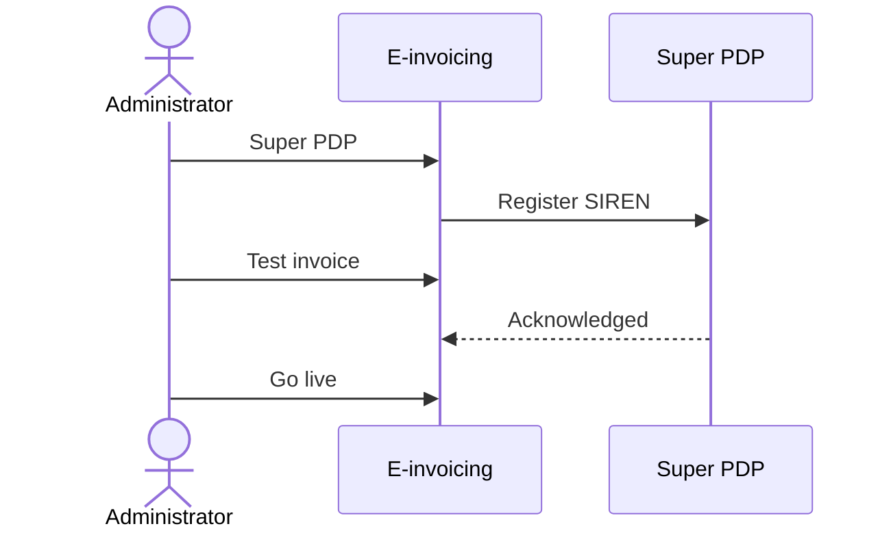

🏠 [Specs](../../../../README.md) › 🧩 [Functional capabilities](../../../README.md) ›
🔌 [F24 Integrations hub](../../README.md) › 📝 [Use cases](../README.md) ›
📝 [Use cases: FL-F24-06 Business tools](README.md) › 📝 UC-F24-24 Connect the e-invoicing platform

# 📝 UC-F24-24 Connect the e-invoicing platform

**Status:** ✅ specified

## Summary

The administrator and accounting connect the company's e-invoicing platform step by step: choose it, register the
company, send a test invoice, receive the acknowledgement, go live.

## Personas

- [U07 Administrator](../../../../01-users/personas/u07-administrator.md)
- [U05 Accounting](../../../../01-users/personas/u05-accounting.md)

## Goal

Invoices sent and received through the platform, on time for the reform.

## Trigger

The e-invoicing reform; onboarding.

## Frequency

Once.

## Preconditions

- Company identifiers set (F1).

## Postconditions

- Success: live.
- Failure: stays on the previous channel.

## Main flow

1. The administrator opens E-invoicing platform (S-F24-22) and chooses Super PDP.
2. simple-ERP registers the company with its identifiers and addresses (BR-F24-15).
3. Accounting sends a test invoice.
4. The platform's acknowledgement arrives.
5. The administrator goes live; F6 and F8 use it.

## Alternative flows

- 1a. Another platform with the AFNOR XP Z12-013 adapter.
- 5a. Public buyers through Chorus Pro.

## Error flows

- 4e. Test rejected: reason shown.
- Any step: a service does not answer; the call is retried first (BR-F3-32), then the message follows the error pattern
  (D122) and what was typed stays on the screen.

## Business rules

- [BR-F24-15 The e-invoicing platform connected step by step](../../business-rules/br-f24-15-the-e-invoicing-platform-connected-step-by-step.md)

## Entities

- [E-F24-14 E-invoicing registration](../../data/e-f24-14-e-invoicing-registration.md)

## Permissions

Administrator and accounting.

## Notifications

- Accounting when live.

## Audit events

Steps.

## AI involvement

Explains rejections.

## API, MCP and A2A exposure

Through the API (T5) and as AI assistant tools (T6), with the caller's rights (BR-F3-34).

## Screens

- [S-F24-22 E-invoicing platform](../../screens/06-business-tools/s-f24-22-e-invoicing-platform.md)

## Flowchart

See [FL-F24-06 Business tools](../../flows/fl-f24-06-business-tools.md#flowchart).

## Sequence diagram

## Acceptance criteria

1. **Given** Super PDP **when** the test invoice is acknowledged **then** live.
2. **Given** a missing SIREN **when** tested **then** rejected with the reason.
3. **Given** an AFNOR platform **when** chosen **then** the generic adapter.

## Non-functional notes

D408's targets ([Performance](../../../../05-non-functional/performance.md)): 95 % of screens within 1 second; lists
paged on the server, the first page within 1 second; reports within 5 seconds or in the background.

## Regulatory references

[CR-FR-016](../../../../10-country-packs/france/invoicing/cr-fr-016-electronic-invoicing.md),
[CR-FR-091](../../../../10-country-packs/france/invoicing/cr-fr-091-public-contracts-payment-and-chorus-pro.md).

## Related use cases

- [UC-F24-02 Connect a tool in the fewest steps](../01-find-and-connect/uc-f24-02-connect-a-tool-in-the-fewest-steps.md)

## Open questions

None.

---

⬅️ [UC-F24-23](uc-f24-23-bring-hr-and-payroll-data-from-silae-payfit-or-lucca.md) · ⬆️ [Up](README.md) ·
➡️ [UC-F24-25](../07-employees-and-their-tools/uc-f24-25-connect-my-own-calendar-and-mail-on-the-phone.md)
