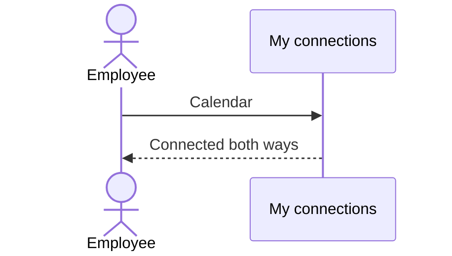

🏠 [Specs](../../../../README.md) › 🧩 [Functional capabilities](../../../README.md) ›
🔌 [F24 Integrations hub](../../README.md) › 📝 [Use cases](../README.md) ›
📝 [Use cases: FL-F24-07 Employees and their tools](README.md) ›
📝 UC-F24-25 Connect my own calendar and mail on the phone

# 📝 UC-F24-25 Connect my own calendar and mail on the phone

**Status:** ✅ specified

## Summary

An employee connects their own calendar and mail from the phone, when the company allows it, so that appointments and
messages appear in simple-ERP.

## Personas

- [U01 Employee](../../../../01-users/personas/u01-employee.md)

## Goal

One agenda.

## Trigger

The employee's choice.

## Frequency

Once.

## Preconditions

- Personal connections allowed by the administrator.

## Postconditions

- Success: connected.
- Failure: told whom to ask.

## Main flow

1. The employee opens My connections (S-F24-24) on the phone.
2. They choose their calendar.
3. They sign in.
4. They choose the direction.

## Alternative flows

- 2a. Mail too.

## Error flows

- 1e. Not allowed: told whom to ask.
- Any step: a service does not answer; the call is retried first (BR-F3-32), then the message follows the error pattern
  (D122) and what was typed stays on the screen.

## Business rules

- [BR-F24-16 Every integration shows its icon](../../business-rules/br-f24-16-every-integration-shows-its-icon.md)

## Entities

- [E-F24-05 Calendar link](../../data/e-f24-05-calendar-link.md)

## Permissions

Employee, own.

## Notifications

- None.

## Audit events

Connections.

## AI involvement

None.

## API, MCP and A2A exposure

Through the API (T5) and as AI assistant tools (T6), with the caller's rights (BR-F3-34).

## Screens

- [S-F24-24 My connections](../../screens/07-employees-and-their-tools/s-f24-24-my-connections.md)

## Flowchart

See [FL-F24-07 Employees and their tools](../../flows/fl-f24-07-employees-and-their-tools.md#flowchart).

## Sequence diagram

## Acceptance criteria

1. **Given** allowed **when** connected **then** appointments sync both ways.
2. **Given** not allowed **when** opened **then** told whom to ask.
3. **Given** the calendar **when** shown **then** with its icon.

## Non-functional notes

D408's targets ([Performance](../../../../05-non-functional/performance.md)): 95 % of screens within 1 second; lists
paged on the server, the first page within 1 second; reports within 5 seconds or in the background.

## Regulatory references

None.

## Related use cases

- [UC-F24-05 Sync mail, calendars and contacts](../02-office-suites/uc-f24-05-sync-mail-calendars-and-contacts.md)

## Open questions

None.

---

⬅️ [UC-F24-24 Connect the e-invoicing platform](../06-business-tools/uc-f24-24-connect-the-e-invoicing-platform.md) ·
⬆️ [Up](README.md) · ➡️ [UC-F24-26 See which tools receive my data](uc-f24-26-see-which-tools-receive-my-data.md)
