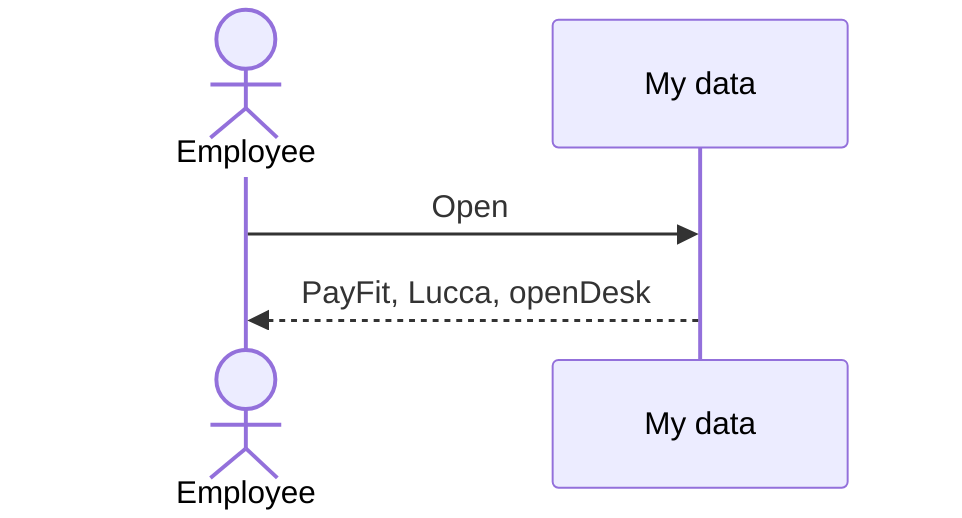

🏠 [Specs](../../../../README.md) › 🧩 [Functional capabilities](../../../README.md) ›
🔌 [F24 Integrations hub](../../README.md) › 📝 [Use cases](../README.md) ›
📝 [Use cases: FL-F24-07 Employees and their tools](README.md) › 📝 UC-F24-26 See which tools receive my data

# 📝 UC-F24-26 See which tools receive my data

**Status:** ✅ specified

## Summary

An employee sees which connected tools receive their personal data, for what purpose, and asks the administrator a
question.

## Personas

- [U01 Employee](../../../../01-users/personas/u01-employee.md)
- [U07 Administrator](../../../../01-users/personas/u07-administrator.md), who answers

## Goal

Transparency on data shared.

## Trigger

Curiosity or concern.

## Frequency

Rare.

## Preconditions

- None.

## Postconditions

- Success: list shown.
- Failure: none.

## Main flow

1. The employee opens My connections (S-F24-24), "My data".
2. SimpleERP lists the tools receiving their data with purpose (BR-F24-01).
3. They ask a question.
4. The administrator answers.

## Alternative flows

- 3a. Ask for a copy (UC-F15-10).

## Error flows

- 2e. None.
- Any step: a service does not answer; the call is retried first (BR-F3-32), then the message follows the error pattern
  (D122) and what was typed stays on the screen.

## Business rules

- [BR-F24-01 Synced data follows the country pack](../../business-rules/br-f24-01-connectors-follow-the-country-pack.md)

## Entities

- [E-F24-02 Tool connection](../../data/e-f24-02-tool-connection.md)

## Permissions

Employee, own.

## Notifications

- The administrator on questions.

## Audit events

Questions.

## AI involvement

None.

## API, MCP and A2A exposure

Through the API (T5) and as AI assistant tools (T6), with the caller's rights (BR-F3-34).

## Screens

- [S-F24-24 My connections](../../screens/07-employees-and-their-tools/s-f24-24-my-connections.md)

## Flowchart

See [FL-F24-07 Employees and their tools](../../flows/fl-f24-07-employees-and-their-tools.md#flowchart).

## Sequence diagram

## Acceptance criteria

1. **Given** 3 tools **when** opened **then** listed with purpose.
2. **Given** a question **when** sent **then** the administrator told.
3. **Given** a copy asked **when** asked **then** the data-subject request opens.

## Non-functional notes

D408's targets ([Performance](../../../../05-non-functional/performance.md)): 95 % of screens within 1 second; lists
paged on the server, the first page within 1 second; reports within 5 seconds or in the background.

## Regulatory references

None.

## Related use cases

- [UC-F24-25 Connect my own calendar and mail on the phone](uc-f24-25-connect-my-own-calendar-and-mail-on-the-phone.md)

## Open questions

None.

---

⬅️ [UC-F24-25](uc-f24-25-connect-my-own-calendar-and-mail-on-the-phone.md) · ⬆️ [Up](README.md) ·
➡️ [UC-F24-27 Keep the integration icons](../05-keep-the-catalogue/uc-f24-27-keep-the-integration-icons.md)
