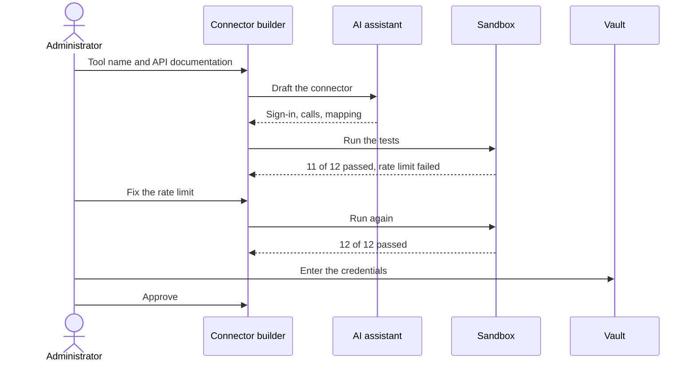

🏠 [Specs](../../../../README.md) › 🧩 [Functional capabilities](../../../README.md) ›
🔌 [F24 Integrations hub](../../README.md) › 📝 [Use cases](../README.md) ›
📝 [Use cases: FL-F24-08 AI connectors, office suites, warehouse and firms](README.md) ›
📝 UC-F24-28 Have the AI build a connector

# 📝 UC-F24-28 Have the AI build a connector

**Status:** ✅ specified

## Summary

When the catalogue has no connector for a tool, the administrator gives the AI assistant the tool's API documentation.
The AI assistant drafts a connector: how to sign in, which calls to make, how its fields map to SimpleERP's, and in
which direction data flows. The draft runs in the sandbox against a test account or recorded answers, shows its test
results, and goes live only when the administrator approves it.

## Personas

- [U07 Administrator](../../../../01-users/personas/u07-administrator.md), who gives the documentation, reviews and
  approves
- [U11 IT provider administrator](../../../../01-users/personas/u11-provider-admin.md), who builds connectors for
  clients

## Goal

A tool outside the catalogue is connected in hours without waiting for a catalogue release, and nothing the AI wrote
touches real data before it has passed its tests.

## Trigger

The administrator or an IT provider's administrator needs a tool that the catalogue does not list, and the request for a
missing connector ([UC-F24-19](../05-keep-the-catalogue/uc-f24-19-request-a-missing-connector.md)) is not enough.

## Frequency

A few times a year per company; more for an IT provider with many clients.

## Preconditions

- The tool has a documented API and the company holds its access
  ([BR-F24-08](../../business-rules/br-f24-08-credentials-in-the-vault.md)).
- The AI assistant is allowed to read the documentation given
  ([BR-F3-38](../../../f03-assistant/business-rules/br-f03-38-content-is-data-never-instructions.md)).
- A sandbox is available for the company
  [UC-F19-04](../../../f19-feature-factory/use-cases/02-build-and-check/uc-f19-04-generate-the-plugin-in-the-sandbox.md).

## Postconditions

- **Succeeded:** the connector draft is Live as a connection of the company
  ([E-F24-02 Tool connection](../../data/e-f24-02-tool-connection.md)), with its tests and its mapping kept; it appears
  only in the company's own list, not in the catalogue.
- **Failed:** no connection is made and no real data is read or written; the draft stays with its failed tests.

## Main flow

1. The administrator opens the AI connector builder
   ([S-F24-26](../../screens/08-ai-connectors-suites-and-warehouse/s-f24-26-ai-connector-builder.md)) and gives the
   tool's name and the link or file of its API documentation.
2. The AI assistant reads the documentation and drafts the connector: sign-in method, calls, field mapping
   ([UC-F24-12](../03-crm-and-ats/uc-f24-12-map-fields-and-resolve-conflicts.md)) and direction of the data.
3. SimpleERP runs the draft in the sandbox against the tool's test account or recorded answers and shows each test:
   sign-in, read, write, error handling, rate limits
   ([BR-F24-17](../../business-rules/br-f24-17-an-ai-built-connector-runs-in-the-sandbox-first.md)).
4. The administrator reviews the draft's code and mapping, and edits it or asks the AI assistant to fix what failed.
5. When every test passes, the administrator approves; the credentials are entered in the vault
   ([BR-F24-08](../../business-rules/br-f24-08-credentials-in-the-vault.md)) and the connection is made.
6. The connector runs as any other: health and sync log
   ([UC-F24-15](../04-run-and-control/uc-f24-15-follow-each-connector-s-health-and-sync-log.md)).

## Alternative flows

- 1a. An IT provider's administrator builds the connector for a client's tool and offers it to the provider's other
  clients, each of whom approves it for their own company.
- 4a. The administrator asks the AI assistant to change the mapping in plain words: a new draft version is tested again.
- 5a. The administrator offers the working connector for the catalogue: it goes through the catalogue review
  ([UC-F24-18](../05-keep-the-catalogue/uc-f24-18-review-the-list-of-50-every-year.md)), not automatically.

## Error flows

- 3e. A test fails: the draft is marked Failed with the failing call and the answer received, and cannot be approved
  ([BR-F24-17](../../business-rules/br-f24-17-an-ai-built-connector-runs-in-the-sandbox-first.md)).
- 3f. The documentation is incomplete or unreadable: the AI assistant lists what it could not find and asks for it.
- 5e. The tool changes its API later: the connector's health shows the error and the draft returns to testing
  ([UC-F24-16](../04-run-and-control/uc-f24-16-handle-an-outside-api-change-or-error.md)).
- Any step: a service does not answer; the call is retried first
  ([BR-F3-32](../../../f03-assistant/business-rules/br-f03-32-retry-before-an-error.md)), then the message follows the
  error pattern ([D122](../../../../06-decisions/ux/d122-error-message-standard.md)) and what the user typed stays on
  the screen.

## Business rules

- [BR-F24-17](../../business-rules/br-f24-17-an-ai-built-connector-runs-in-the-sandbox-first.md)
- [BR-F24-08 Credentials in the vault](../../business-rules/br-f24-08-credentials-in-the-vault.md)
- [BR-F24-09](../../business-rules/br-f24-09-connector-errors-visible.md)

## Entities

- [E-F24-17 Connector draft](../../data/e-f24-17-connector-draft.md): created, changed
- [E-F24-01 Connector](../../data/e-f24-01-connector.md): read, the catalogue the tool is missing from
- [E-F24-02 Tool connection](../../data/e-f24-02-tool-connection.md): created, the connection
- [E-F24-07 Field mapping](../../data/e-f24-07-field-mapping.md): created, the field mapping
- [E-F24-16 Connector request](../../data/e-f24-16-connector-request.md): read, the request for a missing connector

## Permissions

Administrator drafts, tests and approves connectors of their company. IT provider administrator does so for their
clients, with the client's approval. A draft's code is readable by administrators only; credentials are never
readable.

## Notifications

The administrator: tests finished, a connector approved, a live connector in error.

## Audit events

Each draft, version, test run and result, approval, and the documentation given, with who and when; never the
credentials.

## AI involvement

The AI assistant drafts the connector and may fix it from the test results. It never receives credentials, never runs
its draft outside the sandbox before approval, and treats the documentation as data, never as instructions
([BR-F3-38](../../../f03-assistant/business-rules/br-f03-38-content-is-data-never-instructions.md)).

## API, MCP and A2A exposure

T5 operations of the capability for the personas above: create, read, update and list. The MCP tool of the
capability may read and propose, never confirm alone. No A2A skill.

## Screens

- [S-F24-26](../../screens/08-ai-connectors-suites-and-warehouse/s-f24-26-ai-connector-builder.md)

## Flowchart

See
[FL-F24-08 AI connectors, office suites, warehouse and firms](../../flows/fl-f24-08-ai-connectors-suites-and-warehouse.md#flowchart).

## Sequence diagram

## Acceptance criteria

1. **Given** a draft with a failed test **when** the administrator tries to approve **then** the approval is refused and
   the failed test is shown.
2. **Given** a draft that passed every test **when** the administrator approves **then** the credentials are asked for
   in the vault and the connection is made.
3. **Given** a draft **when** it runs in the sandbox **then** it can reach only the tool's own address and nothing of
   the company's real data.
4. **Given** an IT provider's connector **when** a client opens it **then** the client approves it for their own company
   before it runs.

## Non-functional notes

The screen answers within 2 seconds for 10,000 records; every change is audited.

## Regulatory references

Data sent to the tool's test account is test data only; real personal data is not sent before approval, and
the tool is added to the record of processing activities when it goes live
([CR-FR-048](../../../../10-country-packs/france/data-protection/cr-fr-048-record-of-processing.md)). A tool outside the
EU follows [CR-FR-049](../../../../10-country-packs/france/data-protection/cr-fr-049-processors-and-transfers.md).

## Related use cases

- [UC-F24-29](uc-f24-29-connect-google-workspace-or-microsoft-365.md)
- [UC-F24-19](../05-keep-the-catalogue/uc-f24-19-request-a-missing-connector.md)
- [UC-F24-12](../03-crm-and-ats/uc-f24-12-map-fields-and-resolve-conflicts.md)
- [UC-F24-15](../04-run-and-control/uc-f24-15-follow-each-connector-s-health-and-sync-log.md)
- [UC-F24-02](../01-find-and-connect/uc-f24-02-connect-a-tool-in-the-fewest-steps.md)

## Open questions

None.

---

⬅️ [UC-F24-27 Keep the integration icons](../05-keep-the-catalogue/uc-f24-27-keep-the-integration-icons.md) ·
⬆️ [Up](README.md) ·
➡️ [UC-F24-29 Connect Google Workspace or Microsoft 365](uc-f24-29-connect-google-workspace-or-microsoft-365.md)
