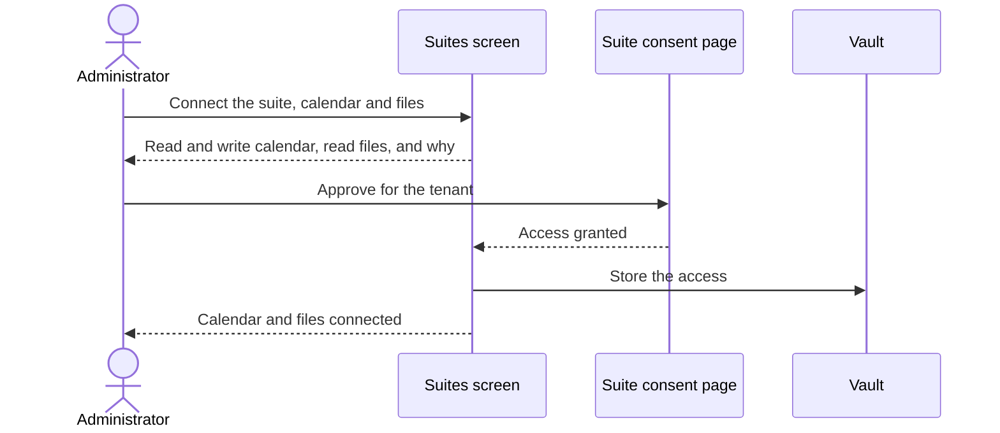

🏠 [Specs](../../../../README.md) › 🧩 [Functional capabilities](../../../README.md) ›
🔌 [F24 Integrations hub](../../README.md) › 📝 [Use cases](../README.md) ›
📝 [Use cases: FL-F24-08 AI connectors, office suites, warehouse and firms](README.md) ›
📝 UC-F24-29 Connect Google Workspace or Microsoft 365

# 📝 UC-F24-29 Connect Google Workspace or Microsoft 365

**Status:** ✅ specified

## Summary

The administrator connects the company's Google Workspace or Microsoft 365 to simple-ERP for mail, calendars, contacts,
files and chat. For each component the screen lists the permissions requested, why they are needed, and whether they are
read-only or read and write; only the permissions the enabled features need are requested, and each can be revoked.

## Personas

- [U07 Administrator](../../../../01-users/personas/u07-administrator.md), who connects the suite and chooses its
  components

## Goal

The company works with its usual suite from simple-ERP while it grants no more access than the features it switched on
require.

## Trigger

The administrator turns on a feature that needs the suite, or opens the suites screen to connect one.

## Frequency

Once per suite; again when a feature is added or removed.

## Preconditions

- The company has a Google Workspace or Microsoft 365 tenant and an administrator account on it.
- The sign-in of the company allows the administrator to consent for the tenant
  ([UC-F24-03](../02-office-suites/uc-f24-03-sign-in-once-through-the-suite-s-identity-provider.md)).

## Postconditions

- **Succeeded:** the suite is connected with the listed permissions only; each enabled component works; the connection
  shows what it may do.
- **Failed:** no permission is granted and nothing is read or written in the suite.

## Main flow

1. The administrator opens the office suites screen
   ([S-F24-27](../../screens/08-ai-connectors-suites-and-warehouse/s-f24-27-office-suites.md)) and picks the suite.
2. simple-ERP lists the components (mail, calendar, contacts, files, chat) with the features that use each, and shows
   for each the permissions it would request and why
   ([BR-F24-18](../../business-rules/br-f24-18-suite-access-uses-the-fewest-scopes-needed.md)).
3. The administrator ticks the components to connect; the permission list shrinks or grows with the choice.
4. The administrator is sent to the suite's own consent page and approves for the tenant; the credentials go to the
   vault ([BR-F24-08](../../business-rules/br-f24-08-credentials-in-the-vault.md)).
5. simple-ERP checks each component with a harmless read and shows it as connected.
6. Later, the administrator turns a component off: its permissions are revoked at the suite and removed from the
   connection.

## Alternative flows

- 2a. A feature needs write access only for one action: the screen requests write only for that component.
- 4a. The tenant's own administrator must approve: the request is sent to them and the connection waits.
- 6a. The administrator disconnects the whole suite and chooses what to do with the data copied
  ([UC-F24-17](../04-run-and-control/uc-f24-17-disconnect-and-keep-or-delete-the-data.md)).

## Error flows

- 4e. The consent is refused: nothing is connected and the screen says which permission was refused.
- 5e. A component's check fails: it is shown as not connected, with the suite's error.
- Any step: a service does not answer; the call is retried first
  ([BR-F3-32](../../../f03-assistant/business-rules/br-f03-32-retry-before-an-error.md)), then the message follows the
  error pattern ([D122](../../../../06-decisions/ux/d122-error-message-standard.md)) and what the user typed stays on
  the screen.

## Business rules

- [BR-F24-18](../../business-rules/br-f24-18-suite-access-uses-the-fewest-scopes-needed.md)
- [BR-F24-08 Credentials in the vault](../../business-rules/br-f24-08-credentials-in-the-vault.md)

## Entities

- [E-F24-02 Tool connection](../../data/e-f24-02-tool-connection.md): created, the connection
- [E-F24-03 Suite component](../../data/e-f24-03-suite-component.md): created, the suite components
- [E-F24-05 Calendar link](../../data/e-f24-05-calendar-link.md): created, the calendar links

## Permissions

Administrator connects and disconnects suites. The owner reads the list of permissions. Employees connect their own
mailbox and calendar through
[UC-F24-25](../07-employees-and-their-tools/uc-f24-25-connect-my-own-calendar-and-mail-on-the-phone.md), not here.

## Notifications

The administrator: a permission about to expire, a component in error, a permission added by a new feature that needs
approval.

## Audit events

Each connection, permission requested and granted, component enabled and disabled, check and revocation, with who and
when.

## AI involvement

No AI step of its own. The AI assistant may open the screen and prefill it from the user's words; the user checks and
confirms ([BR-F3-07](../../../f03-assistant/business-rules/br-f03-07-no-deletes-no-irreversible-acts.md)).

## API, MCP and A2A exposure

T5 operations of the capability for the personas above: create, read, update and list. The MCP tool of the
capability may read and propose, never confirm alone. No A2A skill.

## Screens

- [S-F24-27](../../screens/08-ai-connectors-suites-and-warehouse/s-f24-27-office-suites.md)

## Flowchart

See
[FL-F24-08 AI connectors, office suites, warehouse and firms](../../flows/fl-f24-08-ai-connectors-suites-and-warehouse.md#flowchart).

## Sequence diagram

## Acceptance criteria

1. **Given** only the calendar enabled **when** the permissions are requested **then** none for mail, contacts or files
   is asked.
2. **Given** a component turned off **when** the administrator saves **then** its permissions are revoked at the suite.
3. **Given** a feature that needs write access **when** it is enabled **then** write is requested for that component
   only.
4. **Given** a refused consent **when** the administrator returns **then** nothing is connected and the refused
   permission is named.

## Non-functional notes

The screen answers within 2 seconds for 10,000 records; every change is audited.

## Regulatory references

The suites are run by providers that may be outside the EU: the company records them as processors and checks
the transfer rules before connecting
([CR-FR-049](../../../../10-country-packs/france/data-protection/cr-fr-049-processors-and-transfers.md),
[CR-FR-048](../../../../10-country-packs/france/data-protection/cr-fr-048-record-of-processing.md)). The France-pack
wording on transfers is written later.

## Related use cases

- [UC-F24-28 Have the AI build a connector](uc-f24-28-have-the-ai-build-a-connector.md)
- [UC-F24-30 Export data to a warehouse](uc-f24-30-export-data-to-a-warehouse.md)
- [UC-F24-03](../02-office-suites/uc-f24-03-sign-in-once-through-the-suite-s-identity-provider.md)
- [UC-F24-09](../02-office-suites/uc-f24-09-use-the-suites-full-read-and-write-api.md)
- [UC-F24-25](../07-employees-and-their-tools/uc-f24-25-connect-my-own-calendar-and-mail-on-the-phone.md)
- [UC-F24-20](../04-run-and-control/uc-f24-20-control-the-rights-and-costs-of-connectors.md)

## Open questions

None.

---

⬅️ [UC-F24-28 Have the AI build a connector](uc-f24-28-have-the-ai-build-a-connector.md) · ⬆️ [Up](README.md) ·
➡️ [UC-F24-30 Export data to a warehouse](uc-f24-30-export-data-to-a-warehouse.md)
