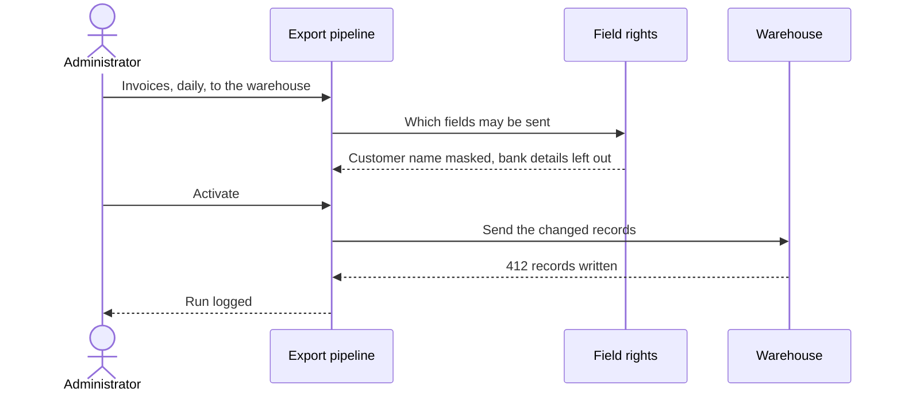

🏠 [Specs](../../../../README.md) › 🧩 [Functional capabilities](../../../README.md) ›
🔌 [F24 Integrations hub](../../README.md) › 📝 [Use cases](../README.md) ›
📝 [Use cases: FL-F24-08 AI connectors, office suites, warehouse and firms](README.md) ›
📝 UC-F24-30 Export data to a warehouse

# 📝 UC-F24-30 Export data to a warehouse

**Status:** ✅ specified

## Summary

The administrator sets up a standing export of chosen records (invoices, stock moves, time entries) to a data warehouse
or a file store the company owns, for analysis in the company's own tools. Each pipeline has its destination, schedule
and masking; it sends only the fields its owner may read, masks or drops personal data as set, and logs every run.

## Personas

- [U07 Administrator](../../../../01-users/personas/u07-administrator.md), who sets the pipelines and their masking
- [U11 IT provider administrator](../../../../01-users/personas/u11-provider-admin.md), who runs pipelines for clients

## Goal

The company analyses its data in its own warehouse without exposing fields that people there have no right to read.

## Trigger

The administrator or an IT provider's administrator creates a pipeline, or a scheduled run starts.

## Frequency

A few pipelines per company; runs hourly to weekly.

## Preconditions

- A destination the company owns exists and its access is in the vault
  ([BR-F24-08](../../business-rules/br-f24-08-credentials-in-the-vault.md)).
- The records to export are chosen, and the field rights of their roles are set
  ([BR-F2-25](../../../f02-no-code-configuration/business-rules/br-f02-25-field-rights-apply-on-every-channel.md)).

## Postconditions

- **Succeeded:** each run sends the new and changed records, with the fields allowed and masked as set, and is logged;
  the destination holds a copy that follows SimpleERP.
- **Failed:** a failed run sends nothing partial: the batch is retried or marked failed, and the destination keeps its
  last complete state.

## Main flow

1. The administrator opens the warehouse export screen
   ([S-F24-28](../../screens/08-ai-connectors-suites-and-warehouse/s-f24-28-warehouse-export.md)) and creates a
   pipeline: records, destination, schedule and format.
2. SimpleERP lists every field of the records with its right and masking: allowed, masked (hashed or shortened) or left
   out ([BR-F24-19](../../business-rules/br-f24-19-exports-follow-field-rights-and-masking.md)).
3. The administrator confirms the field choice; fields the pipeline's owner may not read cannot be added.
4. A test run sends a sample to the destination and shows its shape.
5. The administrator activates the pipeline; each run sends the records changed since the last one.
6. The administrator reads each run in the log and pauses or retires the pipeline when needed.

## Alternative flows

- 2a. The administrator masks a personal field with a stable hash so the warehouse can join records without reading the
  person.
- 5a. The administrator runs the pipeline now, outside its schedule.
- 6a. An IT provider's administrator runs pipelines for a client with the client's approval.

## Error flows

- 3e. A field the pipeline's owner may not read is chosen: it is refused and the right needed is shown.
- 5e. A run fails: nothing partial is kept at the destination, the run is retried and then marked Failed with the reason
  ([BR-F24-09](../../business-rules/br-f24-09-connector-errors-visible.md)).
- Any step: a service does not answer; the call is retried first
  ([BR-F3-32](../../../f03-assistant/business-rules/br-f03-32-retry-before-an-error.md)), then the message follows the
  error pattern ([D122](../../../../06-decisions/ux/d122-error-message-standard.md)) and what the user typed stays on
  the screen.

## Business rules

- [BR-F24-19](../../business-rules/br-f24-19-exports-follow-field-rights-and-masking.md)
- [BR-F2-25](../../../f02-no-code-configuration/business-rules/br-f02-25-field-rights-apply-on-every-channel.md)
- [BR-F24-09](../../business-rules/br-f24-09-connector-errors-visible.md)

## Entities

- [E-F24-18 Export pipeline](../../data/e-f24-18-export-pipeline.md): created, changed
- [E-F24-06 Sync job](../../data/e-f24-06-sync-job.md): created, each run is a sync job
- [E-F24-08 Sync log entry](../../data/e-f24-08-sync-log-entry.md): created, the log of each run

## Permissions

Administrator creates and runs pipelines within their own field rights. IT provider administrator does so for their
clients. The owner approves a pipeline that exports personal data.

## Notifications

The administrator: a pipeline failed twice in a row, a destination about to run out of room, a field added to the
records that the pipeline does not yet cover.

## Audit events

Each pipeline created, changed, activated, paused and retired, each run with its record counts, and each field choice
with its masking, with who and when.

## AI involvement

No AI step of its own. The AI assistant may open the screen and prefill it from the user's words; the user checks and
confirms ([BR-F3-07](../../../f03-assistant/business-rules/br-f03-07-no-deletes-no-irreversible-acts.md)).

## API, MCP and A2A exposure

T5 operations of the capability for the personas above: create, read, update and list. The MCP tool of the
capability may read and propose, never confirm alone. No A2A skill.

## Screens

- [S-F24-28](../../screens/08-ai-connectors-suites-and-warehouse/s-f24-28-warehouse-export.md)

## Flowchart

See
[FL-F24-08 AI connectors, office suites, warehouse and firms](../../flows/fl-f24-08-ai-connectors-suites-and-warehouse.md#flowchart).

## Sequence diagram

## Acceptance criteria

1. **Given** a field the administrator may not read **when** they add it to a pipeline **then** it is refused and the
   right needed is shown.
2. **Given** a personal field set to masked **when** a run sends it **then** the destination receives the masked value
   only.
3. **Given** a run that fails midway **when** the destination is read **then** it holds its last complete state, nothing
   partial.
4. **Given** a pipeline paused **when** the schedule passes **then** no run starts.

## Non-functional notes

The screen answers within 2 seconds for 10,000 records; every change is audited.

## Regulatory references

An export to a warehouse is a processing of personal data: it is added to the record of processing
activities, uses only the data needed, and any destination outside the EU follows the transfer rules
([CR-FR-048](../../../../10-country-packs/france/data-protection/cr-fr-048-record-of-processing.md),
[CR-FR-050](../../../../10-country-packs/france/data-protection/cr-fr-050-privacy-by-design.md),
[CR-FR-049](../../../../10-country-packs/france/data-protection/cr-fr-049-processors-and-transfers.md)). Data the
company must keep for its books is not deleted by an export
([CR-FR-002](../../../../10-country-packs/france/accounting/cr-fr-002-accounting-records-kept-ten-years.md)). The
France-pack wording is written later.

## Related use cases

- [UC-F24-29](uc-f24-29-connect-google-workspace-or-microsoft-365.md)
- [UC-F24-31 Sync with the accountant's software](uc-f24-31-sync-with-the-accountants-software.md)
- [UC-F24-15](../04-run-and-control/uc-f24-15-follow-each-connector-s-health-and-sync-log.md)
- [UC-F24-20](../04-run-and-control/uc-f24-20-control-the-rights-and-costs-of-connectors.md)
- [UC-F24-31 Sync with the accountant's software](uc-f24-31-sync-with-the-accountants-software.md)

## Open questions

None.

---

⬅️ [UC-F24-29 Connect Google Workspace or Microsoft 365](uc-f24-29-connect-google-workspace-or-microsoft-365.md) ·
⬆️ [Up](README.md) ·
➡️ [UC-F24-31 Sync with the accountant's software](uc-f24-31-sync-with-the-accountants-software.md)
