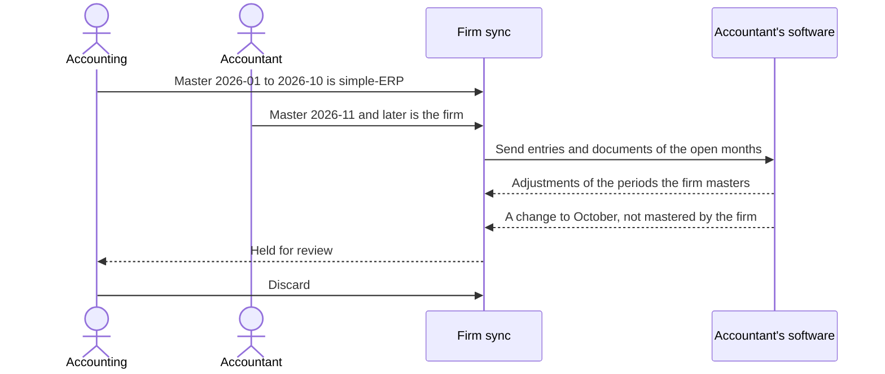

🏠 [Specs](../../../../README.md) › 🧩 [Functional capabilities](../../../README.md) ›
🔌 [F24 Integrations hub](../../README.md) › 📝 [Use cases](../README.md) ›
📝 [Use cases: FL-F24-08 AI connectors, office suites, warehouse and firms](README.md) ›
📝 UC-F24-31 Sync with the accountant's software

# 📝 UC-F24-31 Sync with the accountant's software

**Status:** ✅ specified

## Summary

A company that works with an external accountant on the accountant's own software syncs with it: the chart of accounts,
posted entries, supporting documents and bank lines go to the firm, and the firm's adjustments come back. For each
period, one side is the master: it alone changes that period's entries, and a change made on the other side is held for
review, never merged silently.

## Personas

- [U08 External accountant](../../../../01-users/personas/u08-external-accountant.md), who works in the firm's software
  and resolves held changes
- [U05 Accounting](../../../../01-users/personas/u05-accounting.md), who sets the masters and resolves held changes

## Goal

The accountant and the company work on the same books without double entry and without overwriting each other.

## Trigger

Accounting and the accountant agree to sync, or a period changes hands (handed to the firm for the year-end, for
example).

## Frequency

Set up once; runs daily; the master of a period changes a few times a year.

## Preconditions

- The accountant works with software the connector catalogue lists, or has an AI-built connector
  ([UC-F24-28](uc-f24-28-have-the-ai-build-a-connector.md)).
- The accountant has access as an external accountant
  [UC-F8-14](../../../f08-accounting/use-cases/01-set-up-and-post/uc-f08-14-work-with-the-external-accountant.md).
- The periods are defined and the lock dates set
  ([BR-F8-02](../../../f08-accounting/business-rules/br-f08-02-lock-dates.md)).

## Postconditions

- **Succeeded:** the sync runs; each period has its master; entries and documents match on both sides; held changes are
  listed for review.
- **Failed:** no sync starts; the books on both sides are unchanged.

## Main flow

1. Accounting opens the accounting firm sync screen
   ([S-F24-29](../../screens/08-ai-connectors-suites-and-warehouse/s-f24-29-accounting-firm-sync.md)) and picks the
   firm's software connection.
2. Accounting and the accountant set the master of each period: simple-ERP for the open months, the firm for the periods
   it has taken over ([BR-F24-20](../../business-rules/br-f24-20-one-side-is-the-master-per-period.md)).
3. A first sync matches accounts and posted entries on both sides and lists differences before anything is written.
4. Each run sends the entries, documents and bank lines of the periods mastered here, and brings back the adjustments of
   the periods mastered by the firm.
5. A change made on the non-master side of a period is held and shown in the Conflict list.
6. The accountant and accounting resolve each held change: accept it into the master side with a new entry, or discard
   it.

## Alternative flows

- 2a. The accountant takes over the year-end: the master of the closed months moves to the firm and the lock dates
  follow ([BR-F8-02](../../../f08-accounting/business-rules/br-f08-02-lock-dates.md)).
- 4a. The firm returns the annual closing entries: they are posted as entries of the firm's period with the firm named.
- 6a. The accountant reads the held changes within the access of an external accountant
  [UC-F8-14](../../../f08-accounting/use-cases/01-set-up-and-post/uc-f08-14-work-with-the-external-accountant.md).

## Error flows

- 3e. An account exists on one side only: it is listed and nothing is created until accounting maps it.
- 5e. The firm's software changes its format: the sync pauses with the error
  ([UC-F24-16](../04-run-and-control/uc-f24-16-handle-an-outside-api-change-or-error.md)) and the books stay as they
  were.
- Any step: a service does not answer; the call is retried first
  ([BR-F3-32](../../../f03-assistant/business-rules/br-f03-32-retry-before-an-error.md)), then the message follows the
  error pattern ([D122](../../../../06-decisions/ux/d122-error-message-standard.md)) and what the user typed stays on
  the screen.

## Business rules

- [BR-F24-20](../../business-rules/br-f24-20-one-side-is-the-master-per-period.md)
- [BR-F24-07](../../business-rules/br-f24-07-two-way-sync-with-ownership.md)
- [BR-F8-02 Lock dates](../../../f08-accounting/business-rules/br-f08-02-lock-dates.md)

## Entities

- [E-F24-19 Firm sync](../../data/e-f24-19-firm-sync.md): created, changed
- [E-F24-06 Sync job](../../data/e-f24-06-sync-job.md): created, each run is a sync job
- [E-F8-10 Fiscal period](../../../f08-accounting/data/e-f08-10-fiscal-period.md): read, the periods
- [E-F8-12 Filing partner](../../../f08-accounting/data/e-f08-12-filing-partner.md): read, the filing partner the firm
  may be

## Permissions

Accounting sets masters and resolves held changes. The external accountant resolves held changes of the periods they
master, within their access. The owner reads the masters and the held changes.

## Notifications

Accounting and the accountant: a change held for review, a sync paused, a period handed over.

## Audit events

Each sync run with counts, each master set and moved, each held change and its resolution, with who and when, on both
sides.

## AI involvement

No AI step of its own. The AI assistant may open the screen and prefill it from the user's words; the user checks and
confirms ([BR-F3-07](../../../f03-assistant/business-rules/br-f03-07-no-deletes-no-irreversible-acts.md)).

## API, MCP and A2A exposure

T5 operations of the capability for the personas above: create, read, update and list. The MCP tool of the
capability may read and propose, never confirm alone. No A2A skill.

## Screens

- [S-F24-29](../../screens/08-ai-connectors-suites-and-warehouse/s-f24-29-accounting-firm-sync.md)

## Flowchart

See
[FL-F24-08 AI connectors, office suites, warehouse and firms](../../flows/fl-f24-08-ai-connectors-suites-and-warehouse.md#flowchart).

## Sequence diagram

## Acceptance criteria

1. **Given** October mastered by simple-ERP **when** the firm changes an October entry **then** the change is held and
   not applied.
2. **Given** a period handed to the firm **when** accounting changes an entry in it **then** the change is refused or
   held, as the lock dates say.
3. **Given** an account on one side only **when** the first sync runs **then** it is listed and nothing is created.
4. **Given** a held change accepted **when** accounting resolves it **then** a new entry on the master side records it
   with the reviewer's name.

## Non-functional notes

The screen answers within 2 seconds for 10,000 records; every change is audited.

## Regulatory references

Posted entries stay inalterable
([CR-FR-003](../../../../10-country-packs/france/accounting/cr-fr-003-posted-entries-are-inalterable.md)) and the
accounting file stays whole ([CR-FR-005](../../../../10-country-packs/france/accounting/cr-fr-005-fec-export.md)): a
correction is a new entry, never an overwrite. The firm acts as a processor of the company's data and the
engagement letter says so
([CR-FR-152](../../../../10-country-packs/france/professional-firms/cr-fr-152-accountant-engagement-letter.md),
[CR-FR-049](../../../../10-country-packs/france/data-protection/cr-fr-049-processors-and-transfers.md)).

## Related use cases

- [UC-F24-30 Export data to a warehouse](uc-f24-30-export-data-to-a-warehouse.md)
- [UC-F24-28 Have the AI build a connector](uc-f24-28-have-the-ai-build-a-connector.md)
- [UC-F24-10 Sync a CRM both ways](../03-crm-and-ats/uc-f24-10-sync-a-crm-both-ways.md)
- [UC-F8-14](../../../f08-accounting/use-cases/01-set-up-and-post/uc-f08-14-work-with-the-external-accountant.md)
- [UC-F8-29](../../../f08-accounting/use-cases/10-accountant-collaboration/uc-f08-29-answer-the-accountants-questions-and-requests.md)

## Open questions

None.

---

⬅️ [UC-F24-30 Export data to a warehouse](uc-f24-30-export-data-to-a-warehouse.md) · ⬆️ [Up](README.md)
