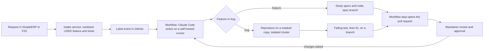

🏠 [Specs](../../README.md) › 🧩 [Functional capabilities](../README.md) ›
🤖 [F25 DevOps agents (hosted edition)](README.md) › 🛠️ How to build the DevOps agents

# 🛠️ How to build the DevOps agents

**Status:** ✅ study written for the owner on 2026-11-12, updated the same day: in the CI (D437), isolated (D442)

## Question

How could the DevOps agents of F25 be built: turning customers' requests into USER features and tickets, studying the
specs and the code, drafting spec changes as pull requests, reproducing bugs read-only on the fully managed SimpleERP,
proposing fixes as pull requests, and waiting for a maintainer's approval
([D432](../../06-decisions/f25-devops-agents/d432-devops-agents-coverage.md),
[D434](../../06-decisions/f25-devops-agents/d434-maintainer-approval-label.md),
[D435](../../06-decisions/f25-devops-agents/d435-agents-access-and-limits.md)).

## Ways to build an agent with Claude

Four ways exist, which differ in who runs the agent loop and who hosts it (from the Claude API reference, 2026-11):

| Way | The loop | Where it runs | Tools | Fits F25 |
|---|---|---|---|---|
| Messages API, own loop | Written by us | Our cluster | Only ours | The light steps (triage, duplicates) |
| Messages API, Tool Runner | The SDK's loop over our tools, with per-turn hooks for approvals and logs | Our cluster | Only ours | The light steps, with less code |
| Claude Agent SDK | The Claude Code harness as a library: read, edit, search, shell, MCP, subagents, hooks, permissions | Our cluster | Built-in file and shell tools, plus MCP | The heavy steps: studying code and specs, writing spec changes and fixes, running tests |
| Managed Agents | Anthropic runs the loop and hosts a container per session | Anthropic's platform | A hosted sandbox, MCP, skills | Not chosen: customers' production data and the hosting stay on the publisher's European infrastructure ([D375](../../06-decisions/vision/d375-managed-hosting-eu-only.md)) |

**Choice (the owner, 2026-11-12, [D437](../../06-decisions/f25-devops-agents/d437-devops-agents-in-the-ci.md)).** The
DevOps agents live in the CI: GitHub Actions workflows run the Claude Code GitHub Action, on self-hosted runners in the
European hosting cluster. The action is the Claude Code harness, so the agents use the repository's `CLAUDE.md` and
`.claude/` (rules, skills, the ticket and test-first checks), restored from the base branch on pull request events, and
follow the same rules as people. Its documentation (read on 2026-11-12) says it runs in beta, cannot approve or merge
pull requests, and by default commits to a branch rather than opening the pull request; whether it runs on self-hosted
runners is not stated there and is checked when building.

**Revised by [D442](../../06-decisions/f25-devops-agents/d442-devops-runners-isolated-cluster.md) (2026-11-12).** The
runners moved to a separate, isolated European cluster with no outbound access except GitHub and the AI gateway;
production is read only from a masked copy of the reporting customer's company; jobs from forks or outside pull requests
never run on these runners.

## Architecture

| Part | How | Decided in |
|---|---|---|
| Trigger | The intake service files the USER feature and its ticket through its own GitHub App; the `issues` labeled event (USER-FEATURE-REQUEST, USER-REPORTED-BUG) starts the workflow; maintainers' comments start revisions. Bots trigger the action only when listed in `allowed_bots`, so only the intake App is listed | [D433](../../06-decisions/f25-devops-agents/d433-user-family-and-labels.md) |
| Runners | Actions Runner Controller (a CNCF project) runs ephemeral runner pods in a separate, isolated European cluster, autoscaled, with no outbound access except GitHub and the AI gateway; never jobs from forks or outside pull requests | [D442](../../06-decisions/f25-devops-agents/d442-devops-runners-isolated-cluster.md), [D375](../../06-decisions/vision/d375-managed-hosting-eu-only.md), [D421](../../06-decisions/technical/d421-infrastructure-cncf.md) |
| Agent | The Claude Code GitHub Action, with `prompt` for each workflow (triage, feature study, bug fix), `claude_args` for the model, the allowed tools (only the test and check commands in Bash) and a maximum number of turns | [D437](../../06-decisions/f25-devops-agents/d437-devops-agents-in-the-ci.md) |
| Models | Through the AI gateway's Messages API with workload identity or a key from the vault, so that calls are metered, masked and traced | [D417](../../06-decisions/technical/d417-ai-operations-design.md) |
| Repository access | A GitHub App token minted per job with Contents, Issues and Pull requests only; branch protection requires a maintainer's review; the action itself cannot approve or merge; a workflow step opens the pull request from the agent's branch | [D434](../../06-decisions/f25-devops-agents/d434-maintainer-approval-label.md) |
| Production access | A masked copy of the reporting customer's company, refreshed for the run, given to the job as an MCP server; never the live namespace; health data excluded unless HDS-certified (BR-F25-13) | [D442](../../06-decisions/f25-devops-agents/d442-devops-runners-isolated-cluster.md), [D393](../../06-decisions/f20-hosted-support-assistant/d393-hosted-support-assistant-coverage.md) |
| Approval | The `needs-maintainer-approval` label, reported and reverted by a workflow if anyone but a maintainer removes it or moves the status (harness ticket GH-23, pull request #24, pending until merged), branch protection, and the pull request review; a GitHub environment with required reviewers guards any job that needs more | [D441](../../06-decisions/f25-devops-agents/d441-approval-label-reported-and-reverted.md), [D434](../../06-decisions/f25-devops-agents/d434-maintainer-approval-label.md) |
| Budgets | `--max-turns` per job, task budgets on the model calls, and the metering gateway's money budget per request (F22) | [D398](../../06-decisions/f22-unified-cost-management/d398-budgets-warn-then-stop.md) |

## Tools the agents need

- **GitHub:** the action's built-in GitHub tools (issues, comments, branches), with the per-job App token.
- **The repository and the specs:** the job's checkout; Bash allowed only for the test, lint and specs-check commands.
- **The harness checks:** the ticket rules (GIT-10), the specs checks and the tests, run before anything is filed.
- **Production, read-only:** a custom MCP server (`--mcp-config`) exposing status, logs, events and metrics of a masked
  copy of the reporting customer's company, and a browser on that copy (D442).
- **Metering:** every model call through the gateway (F22).

## Models and costs

Dated estimates, to re-read before building: models and prices as the Claude API reference stated them when cached on
2026-11-03, per million tokens; vendors change both without notice:

| Step | Model | Effort | Input | Output |
|---|---|---|---|---|
| Studying specs and code, writing fixes | Claude Opus 5.5 (`claude-opus-5-5`) | high, or xhigh for hard fixes | 4.00 USD (cache reads 0.20) | 20.00 USD |
| Triage, duplicates, summaries | Claude Haiku 5.5 (`claude-haiku-5-5`) or Claude Sonnet 5.5 (`claude-sonnet-5-5`) | low | 0.10 or 2.00 USD | 0.50 or 10.00 USD |

- **Prompt caching:** the stable part (tools, rules, `AGENT.md`, the specs pages a run reads) first, the request last,
  so that repeated runs read most input from the cache.
- **Task budgets** (a beta feature) let a run pace itself within a token ceiling; the metering gateway enforces the
  money budget.
- **Refusal fallbacks (as documented on 2026-11-03):** a declined request is retried on a fallback model by the API
  (`fallbacks`, beta).
- **Order of cost, an estimate to measure:** a bug study and fix reading about 300 000 tokens, mostly from the cache,
  and writing about 30 000 costs in the order of 1 USD on Claude Opus 5.5; triage costs a fraction of a cent on Claude
  Haiku 5.5. The evaluation set measures the real figures before launch.
- **Sovereignty:** customers' data sent to a model leaves the publisher's infrastructure; masking at the gateway, only
  providers of the hosted edition's list (D440), health data never (BR-F25-13), and a European processing region where
  the provider offers
  one, checked when building.
- **Customers' details stay out of GitHub:** the USER ticket holds a sanitised summary (no names, amounts or company
  data); the details stay in SimpleERP and reach the job only through the read-only MCP server; the action's full
  output stays off, since workflow logs could be read by anyone who can read the repository if it becomes public.

## The agent team

(Proposed) An approved ticket is built by a team of agent roles ([FL-F25-08](flows/fl-f25-08-team-builds-a-ticket.md),
[D567](../../06-decisions/f25-devops-agents/d567-the-agent-team-roles-contract-worktrees-one-commit-verification.md)):
each role is an agent definition of the repository with its own instructions and tools, and the architect runs the
workflow and delegates to the others.

| Role | Does | Tools | Isolation |
|---|---|---|---|
| Architect | Writes the work contract from the study note, assigns the work, settles contract questions | read, write, run | the integration checkout |
| Backend engineer | Builds the back-end part of the contract | read, write, run | its own worktree from the starting commit |
| Frontend engineer | Builds the screens of the contract, against the specification screenshots | read, write, run | its own worktree from the starting commit |
| Test engineer | Writes the acceptance tests first, then verifies the candidate commit | read, write, run; never edits source while verifying | its own worktree |
| Code reviewer | Reads the candidate commit and the evidence, answers PASS or CHANGES_REQUESTED for that commit | read only | none |
| Release engineer | Integrates the workers' commits in dependency order, opens or updates the draft pull request | read, write, run | the integration checkout |

(Proposed) Run controls: one active run per repository (a workflow concurrency group, queued, never cancelled in
progress); a 30-minute timeout, a turn limit and the request's money budget per run; at most two repair cycles;
checkpoints (starting commit, worker branches, integration, verified commit, verdict, draft pull request) kept on GitHub
apart from the code, so a rerun resumes without a second pull request. Per ticket the dashboards keep the elapsed time,
the AI cost, the repair cycles and the maintainer's interventions.

## Safeguards

- **Customer text is untrusted:** a request, a log line or a page may try to instruct the agent; it is fenced as data,
  and rights, budgets and approvals are enforced outside the prompt
  ([D417](../../06-decisions/technical/d417-ai-operations-design.md)).
- **No merge, no deploy, no Ready:** enforced by GitHub (branch protection, App permissions), by the workflow that
  reports and reverts label removals and status moves by non-maintainers (D441) and by the harness check, not by the
  agent's instructions.
- **Security reports private:** a report that may be a vulnerability never becomes a public USER issue; it goes to a
  private security advisory (BR-F25-12).
- **Tests first:** a fix starts with a failing test, recorded as for any ticket (TEST-7).
- **Everything audited and metered:** each run keeps what it read, wrote and cost (BR-F25-11).
- **Approval belongs to a commit:** (Proposed) the test role's results and the reviewer's verdict name the candidate
  commit; any change after them needs a new verification, and the draft pull request's head must be that commit
  ([FL-F25-08](flows/fl-f25-08-team-builds-a-ticket.md)).

## Build order

1. **Intake and triage:** reports and requests from the app and the support assistant become sanitised USER features
   with one ticket; duplicates linked. Needs harness ticket GH-23's labels and revert workflow (pull request #24) and
   the isolated runners' cluster (D442).
2. **Feature study:** spec pull requests and SPECS features, approved by maintainers.
3. **Bug reproduction and fixes:** read-only reproduction, failing test, fix pull request, PRODUCT ticket.
4. **Quality:** the evaluation set from past requests, approval rate, rework and cost per request on the dashboards.
5. **Agent team:** (Proposed) the roles, the work contract, worktrees, integration, verification on one commit and the
   draft pull request ([FL-F25-08](flows/fl-f25-08-team-builds-a-ticket.md)), once steps 1 to 3 run.

## Questions for the technical interviews

- **T7:** the gateway's Messages API for the action (REQ-T07-02), with workload identity from the runner.
- **T6:** which GitHub App permissions exactly, and which GitHub MCP server.
- **T9:** the isolated runners' cluster and its limits (D442), and whether the action runs as is on Actions Runner
  Controller.
- **T7:** which models are allowed to read customers' production data, and in which region.

---

⬆️ [Up](README.md)
