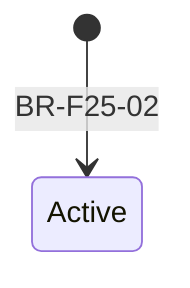

🏠 [Specs](../../../README.md) › 🧩 [Functional capabilities](../../README.md) ›
🤖 [F25 DevOps agents (hosted edition)](../README.md) › 🗃️ [Data](README.md) › 🗃️ E-F25-01 Bug or feature request

# 🗃️ E-F25-01 Bug or feature request

**Status:** ✅ specified

## Purpose

A bug report or feature request.

## Fields

| Name | Type | Required | Validation | Default | Example | Personal data | Custom fields |
|---|---|---|---|---|---|---|---|
| company, reporter, kind, text | records | yes | BR-F25-02 | - | Acme, owner, bug, invoices fail | yes | no |

## Relations

As its use cases.

## Lifecycle

## Indexes and search

By number, date, partner.

## Retention

Kept for the period of its kind of record in the country pack (D293), or else its kind's default in the
[retention schedule](../../../05-non-functional/data-retention.md).

## Audit

Every change.

## Import and export

CSV, FEC where relevant.

## Used by

- [UC-F25-01](../use-cases/01-intake/uc-f25-01-report-a-bug-from-simple-erp.md)
- [UC-F25-02](../use-cases/01-intake/uc-f25-02-request-a-feature-from-simple-erp.md)
- [UC-F25-14](../use-cases/05-tell-the-customer/uc-f25-14-follow-my-request-s-status.md)
- [UC-F25-16](../use-cases/05-tell-the-customer/uc-f25-16-offer-the-feature-factory-for-a-custom-need.md)
- [UC-F25-20](../use-cases/05-tell-the-customer/uc-f25-20-ask-the-assistant-about-my-requests.md)

## Open questions

None.

---

⬆️ [Up](README.md) · ➡️ [E-F25-02 USER feature](e-f25-02-user-feature.md)
