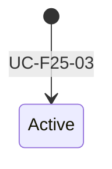

🏠 [Specs](../../../README.md) › 🧩 [Functional capabilities](../../README.md) ›
🤖 [F25 DevOps agents (hosted edition)](../README.md) › 🗃️ [Data](README.md) › 🗃️ E-F25-02 USER feature

# 🗃️ E-F25-02 USER feature

**Status:** ✅ specified

## Purpose

The GitHub feature of a request.

## Fields

| Name | Type | Required | Validation | Default | Example | Personal data | Custom fields |
|---|---|---|---|---|---|---|---|
| issue, label, ticket | records | yes | BR-F25-02 | - | #312, USER, #313 | no | no |

## Relations

As its use cases.

## Lifecycle

## Indexes and search

By number, date, partner.

## Retention

Kept for the period of its kind of record in the country pack (D293), or else its kind's default in the
[retention schedule](../../../05-non-functional/data-retention.md).

## Audit

Every change.

## Import and export

CSV, FEC where relevant.

## Used by

- [UC-F25-03](../use-cases/01-intake/uc-f25-03-open-the-user-feature-with-its-ticket.md)
- [UC-F25-04](../use-cases/01-intake/uc-f25-04-deduplicate-against-open-issues.md)

## Open questions

None.

---

⬅️ [E-F25-01 Bug or feature request](e-f25-01-bug-or-feature-request.md) · ⬆️ [Up](README.md) ·
➡️ [E-F25-03 USER ticket](e-f25-03-user-ticket.md)
