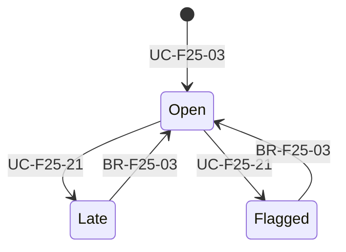

🏠 [Specs](../../../README.md) › 🧩 [Functional capabilities](../../README.md) ›
🤖 [F25 DevOps agents (hosted edition)](../README.md) › 🗃️ [Data](README.md) › 🗃️ E-F25-03 USER ticket

# 🗃️ E-F25-03 USER ticket

**Status:** ✅ specified

## Purpose

Its single ticket.

## Fields

| Name | Type | Required | Validation | Default | Example | Personal data | Custom fields |
|---|---|---|---|---|---|---|---|
| issue, component label, reporters | records | yes | BR-F25-02, BR-F25-03 | - | #313, USER-REPORTED-BUG, 3 | no | no |

## Relations

As its use cases.

## Lifecycle

## Indexes and search

By number, date, partner.

## Retention

Kept for the period of its kind of record in the country pack (D293), or else its kind's default in the
[retention schedule](../../../05-non-functional/data-retention.md).

## Audit

Every change.

## Import and export

CSV, FEC where relevant.

## Used by

- [UC-F25-03](../use-cases/01-intake/uc-f25-03-open-the-user-feature-with-its-ticket.md)
- [UC-F25-07](../use-cases/02-feature-requests/uc-f25-07-create-the-specs-feature-and-its-tickets.md)
- [UC-F25-21 Triage requests by severity and priority](../use-cases/01-intake/uc-f25-21-triage-requests-by-severity-and-priority.md)
- [UC-F25-24 Vote on declined requests](../use-cases/05-tell-the-customer/uc-f25-24-vote-on-declined-requests.md)

## Open questions

None.

---

⬅️ [E-F25-02 USER feature](e-f25-02-user-feature.md) · ⬆️ [Up](README.md) ·
➡️ [E-F25-04 Study note](e-f25-04-study-note.md)
