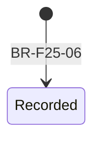

🏠 [Specs](../../../README.md) › 🧩 [Functional capabilities](../../README.md) ›
🤖 [F25 DevOps agents (hosted edition)](../README.md) › 🗃️ [Data](README.md) › 🗃️ E-F25-04 Study note

# 🗃️ E-F25-04 Study note

**Status:** ✅ specified

## Purpose

What the agents read and found.

## Fields

| Name | Type | Required | Validation | Default | Example | Personal data | Custom fields |
|---|---|---|---|---|---|---|---|
| request, specs read, code read, summary | records | yes | BR-F25-06 | - | #313, UC-F06-04, sales service, ... | no | no |

## Relations

As its use cases.

## Lifecycle

## Indexes and search

By number, date, partner.

## Retention

Kept for the period of its kind of record in the country pack (D293), or else its kind's default in the
[retention schedule](../../../05-non-functional/data-retention.md).

## Audit

Every change.

## Import and export

CSV, FEC where relevant.

## Used by

- [UC-F25-05](../use-cases/02-feature-requests/uc-f25-05-study-the-code-and-the-specs-for-a-feature.md)

## Open questions

None.

---

⬅️ [E-F25-03 USER ticket](e-f25-03-user-ticket.md) · ⬆️ [Up](README.md) ·
➡️ [E-F25-05 Agent pull request](e-f25-05-agent-pull-request.md)
