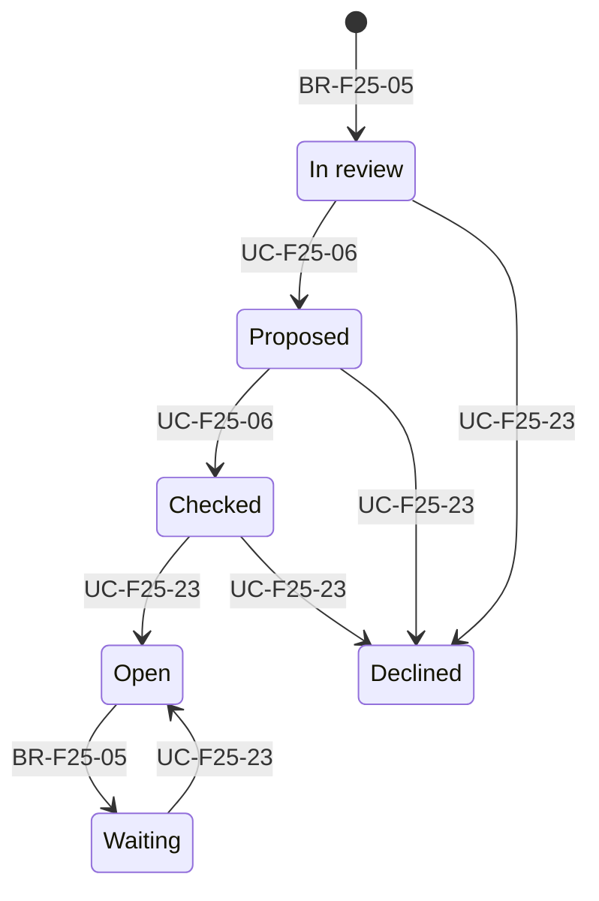

🏠 [Specs](../../../README.md) › 🧩 [Functional capabilities](../../README.md) ›
🤖 [F25 DevOps agents (hosted edition)](../README.md) › 🗃️ [Data](README.md) › 🗃️ E-F25-05 Agent pull request

# 🗃️ E-F25-05 Agent pull request

**Status:** ✅ specified

## Purpose

A pull request opened by an agent.

## Fields

| Name | Type | Required | Validation | Default | Example | Personal data | Custom fields |
|---|---|---|---|---|---|---|---|
| repository, branch, kind, state | records | yes | BR-F25-05, BR-F25-08 | - | simple-erp, bugfix/GH-314-..., fix, in review | no | no |

## Relations

As its use cases.

## Lifecycle

## Indexes and search

By number, date, partner.

## Retention

Kept for the period of its kind of record in the country pack (D293), or else its kind's default in the
[retention schedule](../../../05-non-functional/data-retention.md).

## Audit

Every change.

## Import and export

CSV, FEC where relevant.

## Used by

- [UC-F25-06](../use-cases/02-feature-requests/uc-f25-06-draft-the-spec-changes-as-a-pull-request.md)
- [UC-F25-10](../use-cases/03-bugs/uc-f25-10-propose-the-fix-as-a-pull-request-tests-first.md)
- [UC-F25-13](../use-cases/04-approve-and-govern/uc-f25-13-ask-the-agents-for-changes.md)
- [UC-F25-23 Check an agent's spec pull request](../use-cases/02-feature-requests/uc-f25-23-check-an-agents-spec-pull-request.md)

## Open questions

None.

---

⬅️ [E-F25-04 Study note](e-f25-04-study-note.md) · ⬆️ [Up](README.md) ·
➡️ [E-F25-06 Agent ticket](e-f25-06-agent-ticket.md)
