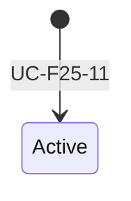

🏠 [Specs](../../../README.md) › 🧩 [Functional capabilities](../../README.md) ›
🤖 [F25 DevOps agents (hosted edition)](../README.md) › 🗃️ [Data](README.md) › 🗃️ E-F25-06 Agent ticket

# 🗃️ E-F25-06 Agent ticket

**Status:** ✅ specified

## Purpose

A SPECS or PRODUCT ticket created by an agent.

## Fields

| Name | Type | Required | Validation | Default | Example | Personal data | Custom fields |
|---|---|---|---|---|---|---|---|
| issue, family, approval label | records | yes | BR-F25-07 | needs-maintainer-approval | #314, PRODUCT, on | no | no |

## Relations

As its use cases.

## Lifecycle

## Indexes and search

By number, date, partner.

## Retention

Kept for the period of its kind of record in the country pack (D293), or else its kind's default in the
[retention schedule](../../../05-non-functional/data-retention.md).

## Audit

Every change.

## Import and export

CSV, FEC where relevant.

## Used by

- [UC-F25-07](../use-cases/02-feature-requests/uc-f25-07-create-the-specs-feature-and-its-tickets.md)
- [UC-F25-11](../use-cases/03-bugs/uc-f25-11-create-the-product-ticket.md)
- [UC-F25-12](../use-cases/04-approve-and-govern/uc-f25-12-approve-or-refuse-agents-tickets.md)

## Open questions

None.

---

⬅️ [E-F25-05 Agent pull request](e-f25-05-agent-pull-request.md) · ⬆️ [Up](README.md) ·
➡️ [E-F25-07 Reproduction](e-f25-07-reproduction.md)
