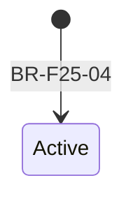

🏠 [Specs](../../../README.md) › 🧩 [Functional capabilities](../../README.md) ›
🤖 [F25 DevOps agents (hosted edition)](../README.md) › 🗃️ [Data](README.md) › 🗃️ E-F25-07 Reproduction

# 🗃️ E-F25-07 Reproduction

**Status:** ✅ specified

## Purpose

A bug reproduced read-only.

## Fields

| Name | Type | Required | Validation | Default | Example | Personal data | Custom fields |
|---|---|---|---|---|---|---|---|
| request, steps, evidence | records | yes | BR-F25-04 | - | #313, 3 steps, masked screenshot | no | no |

## Relations

As its use cases.

## Lifecycle

## Indexes and search

By number, date, partner.

## Retention

Kept for the period of its kind of record in the country pack (D293), or else its kind's default in the
[retention schedule](../../../05-non-functional/data-retention.md).

## Audit

Every change.

## Import and export

CSV, FEC where relevant.

## Used by

- [UC-F25-08](../use-cases/03-bugs/uc-f25-08-reproduce-a-bug-on-the-managed-simple-erp.md)
- [UC-F25-09](../use-cases/03-bugs/uc-f25-09-find-the-cause-in-the-code.md)

## Open questions

None.

---

⬅️ [E-F25-06 Agent ticket](e-f25-06-agent-ticket.md) · ⬆️ [Up](README.md) ·
➡️ [E-F25-08 Approval](e-f25-08-approval.md)
