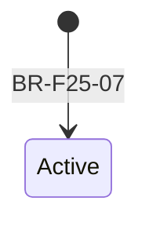

🏠 [Specs](../../../README.md) › 🧩 [Functional capabilities](../../README.md) ›
🤖 [F25 DevOps agents (hosted edition)](../README.md) › 🗃️ [Data](README.md) › 🗃️ E-F25-08 Approval

# 🗃️ E-F25-08 Approval

**Status:** ✅ specified

## Purpose

A maintainer's decision.

## Fields

| Name | Type | Required | Validation | Default | Example | Personal data | Custom fields |
|---|---|---|---|---|---|---|---|
| ticket, maintainer, decision, reason | records | yes | BR-F25-07 | - | #314, M, approved, - | no | no |

## Relations

As its use cases.

## Lifecycle

## Indexes and search

By number, date, partner.

## Retention

Kept for the period of its kind of record in the country pack (D293), or else its kind's default in the
[retention schedule](../../../05-non-functional/data-retention.md).

## Audit

Every change.

## Import and export

CSV, FEC where relevant.

## Used by

- [UC-F25-12](../use-cases/04-approve-and-govern/uc-f25-12-approve-or-refuse-agents-tickets.md)
- [UC-F25-13](../use-cases/04-approve-and-govern/uc-f25-13-ask-the-agents-for-changes.md)
- [UC-F25-19](../use-cases/04-approve-and-govern/uc-f25-19-measure-the-quality-of-the-agents-work.md)

## Open questions

None.

---

⬅️ [E-F25-07 Reproduction](e-f25-07-reproduction.md) · ⬆️ [Up](README.md) ·
➡️ [E-F25-09 Request status](e-f25-09-request-status.md)
