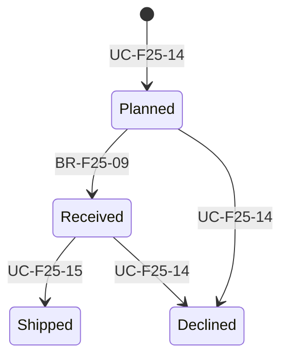

🏠 [Specs](../../../README.md) › 🧩 [Functional capabilities](../../README.md) ›
🤖 [F25 DevOps agents (hosted edition)](../README.md) › 🗃️ [Data](README.md) › 🗃️ E-F25-09 Request status

# 🗃️ E-F25-09 Request status

**Status:** ✅ specified

## Purpose

What the customer sees.

## Fields

| Name | Type | Required | Validation | Default | Example | Personal data | Custom fields |
|---|---|---|---|---|---|---|---|
| request, status, release | records | yes | BR-F25-09 | - | #313, shipped, 3.4.0 | no | no |

## Relations

As its use cases.

## Lifecycle

## Indexes and search

By number, date, partner.

## Retention

Kept for the period of its kind of record in the country pack (D293), or else its kind's default in the
[retention schedule](../../../05-non-functional/data-retention.md).

## Audit

Every change.

## Import and export

CSV, FEC where relevant.

## Used by

- [UC-F25-14](../use-cases/05-tell-the-customer/uc-f25-14-follow-my-request-s-status.md)
- [UC-F25-15](../use-cases/05-tell-the-customer/uc-f25-15-be-told-when-it-ships.md)
- [UC-F25-20](../use-cases/05-tell-the-customer/uc-f25-20-ask-the-assistant-about-my-requests.md)

## Open questions

None.

---

⬅️ [E-F25-08 Approval](e-f25-08-approval.md) · ⬆️ [Up](README.md) · ➡️ [E-F25-10 Agent run](e-f25-10-agent-run.md)
