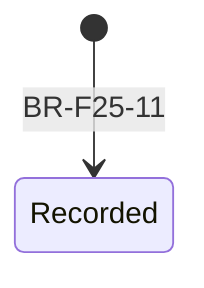

🏠 [Specs](../../../README.md) › 🧩 [Functional capabilities](../../README.md) ›
🤖 [F25 DevOps agents (hosted edition)](../README.md) › 🗃️ [Data](README.md) › 🗃️ E-F25-10 Agent run

# 🗃️ E-F25-10 Agent run

**Status:** ✅ specified

## Purpose

One agent run, metered and audited.

## Fields

| Name | Type | Required | Validation | Default | Example | Personal data | Custom fields |
|---|---|---|---|---|---|---|---|
| request, reads, writes, cost | records | yes | BR-F25-11 | - | #313, 14 files, 1 PR, 0.42 | no | no |

## Relations

As its use cases.

## Lifecycle

## Indexes and search

By number, date, partner.

## Retention

Kept for the period of its kind of record in the country pack (D293), or else its kind's default in the
[retention schedule](../../../05-non-functional/data-retention.md).

## Audit

Every change.

## Import and export

CSV, FEC where relevant.

## Used by

- [UC-F25-17](../use-cases/04-approve-and-govern/uc-f25-17-control-the-agents-rights-and-audit.md)
- [UC-F25-18](../use-cases/04-approve-and-govern/uc-f25-18-follow-the-agents-costs-and-budgets.md)
- [UC-F25-19](../use-cases/04-approve-and-govern/uc-f25-19-measure-the-quality-of-the-agents-work.md)

## Open questions

None.

---

⬅️ [E-F25-09 Request status](e-f25-09-request-status.md) · ⬆️ [Up](README.md) ·
➡️ [E-F25-11 Triage](e-f25-11-triage.md)
