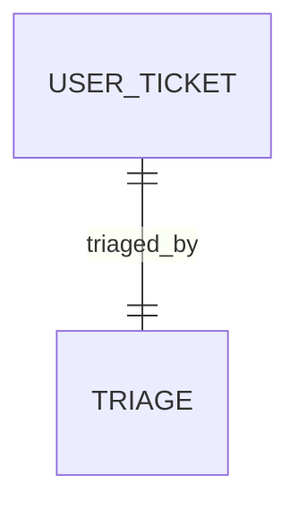
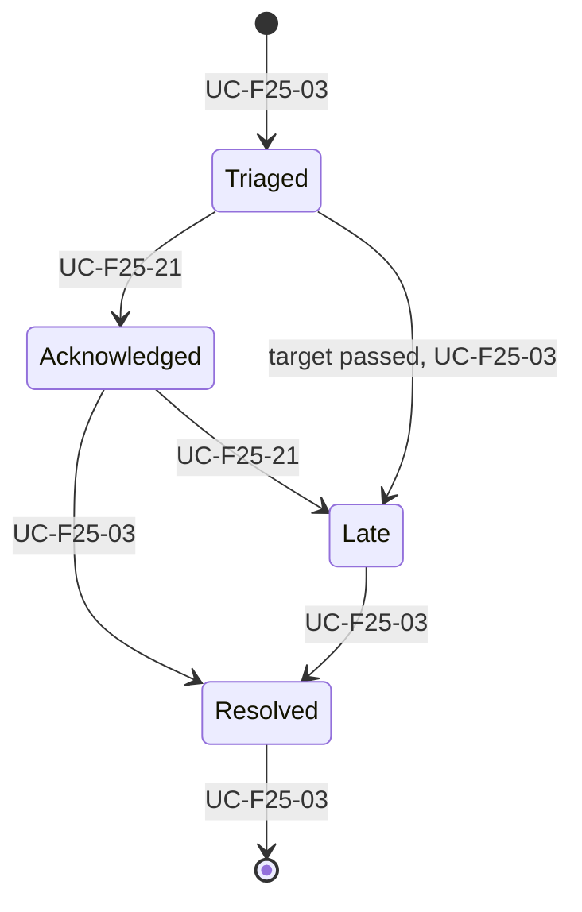

🏠 [Specs](../../../README.md) › 🧩 [Functional capabilities](../../README.md) ›
🤖 [F25 DevOps agents (hosted edition)](../README.md) › 🗃️ [Data](README.md) › 🗃️ E-F25-11 Triage

# 🗃️ E-F25-11 Triage

**Status:** ✅ specified

## Purpose

The severity, priority and target times of a USER ticket.

## Fields

| Name | Type | Required | Validation | Default | Example | Personal data | Custom fields |
|---|---|---|---|---|---|---|---|
| ticket | link | yes | a USER ticket | - | #313 | no | no |
| severity | choice | yes | critical, high, normal, low | normal | critical | no | no |
| priority | number | yes | from reach and votes | computed | 1 | no | no |
| acknowledge by, resolve by | date and time | yes | from the severity | computed | 2026-11-12 13:00, 2026-11-14 09:00 | no | no |
| state | choice | yes | on time, late | on time | on time | no | no |

## Relations

## Lifecycle

## Indexes and search

By severity, priority and state.

## Retention

As the ticket.

## Audit

Every creation and change, with who, when, the old and the new value.

## Import and export

CSV and JSON export through the API (T5); no bulk import.

## Used by

- [UC-F25-21 Triage requests by severity and priority](../use-cases/01-intake/uc-f25-21-triage-requests-by-severity-and-priority.md)
- [UC-F25-03 Open the USER feature with its ticket](../use-cases/01-intake/uc-f25-03-open-the-user-feature-with-its-ticket.md)
- [UC-F25-14 Follow my request's status](../use-cases/05-tell-the-customer/uc-f25-14-follow-my-request-s-status.md)

## Open questions

None.

---

⬅️ [E-F25-10 Agent run](e-f25-10-agent-run.md) · ⬆️ [Up](README.md) ·
➡️ [E-F25-12 Vulnerability case](e-f25-12-vulnerability-case.md)
