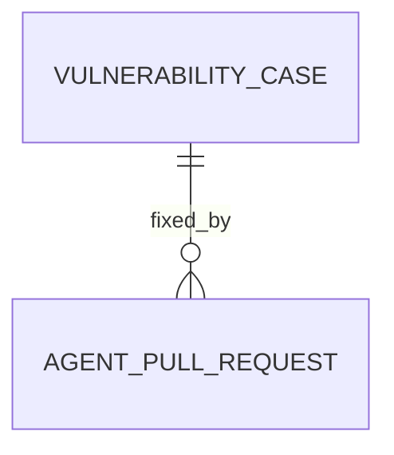
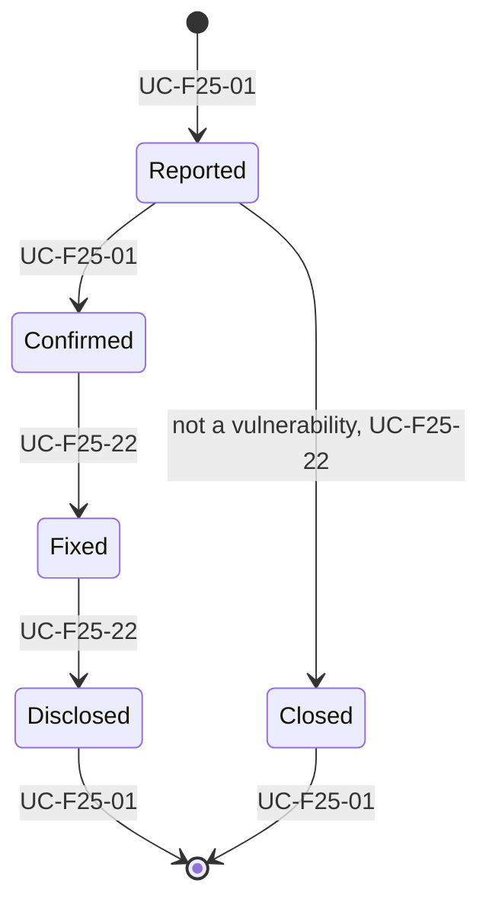

🏠 [Specs](../../../README.md) › 🧩 [Functional capabilities](../../README.md) ›
🤖 [F25 DevOps agents (hosted edition)](../README.md) › 🗃️ [Data](README.md) › 🗃️ E-F25-12 Vulnerability case

# 🗃️ E-F25-12 Vulnerability case

**Status:** 🔄 waiting for the owner

## Purpose

A reported vulnerability handled in a private advisory, with its reporting deadlines.

## Fields

| Name | Type | Required | Validation | Default | Example | Personal data | Custom fields |
|---|---|---|---|---|---|---|---|
| advisory | link | yes | a private advisory | - | GHSA private | no | no |
| severity | choice | yes | critical, high, medium, low | - | high | no | no |
| exploited | yes or no | yes | - | no | yes | no | no |
| early warning, notification, final report | dates | if exploited | 24 h, 72 h, 14 days after the fix | computed | 2026-11-13, 2026-11-15, 2026-11-28 | no | no |
| fix | link | when fixed | a release | - | 3.4.1 | no | no |
| disclosed | date | when public | after the fix | - | 2026-11-20 | no | no |

## Relations

## Lifecycle

## Indexes and search

Maintainers and hosting engineers only.

## Retention

(Proposed) 10 years, the product's support period (CR-FR-168).

## Audit

Every creation and change, with who, when, the old and the new value.

## Import and export

CSV and JSON export through the API (T5); no bulk import.

## Used by

- [UC-F25-22 Handle a reported vulnerability under the CRA](../use-cases/06-vulnerability-handling/uc-f25-22-handle-a-reported-vulnerability-under-the-cra.md)
- [UC-F25-01 Report a bug from simple-ERP](../use-cases/01-intake/uc-f25-01-report-a-bug-from-simple-erp.md)

## Open questions

None.

---

⬅️ [E-F25-11 Triage](e-f25-11-triage.md) · ⬆️ [Up](README.md) ·
➡️ [E-F25-13 Spec check report](e-f25-13-spec-check-report.md)
