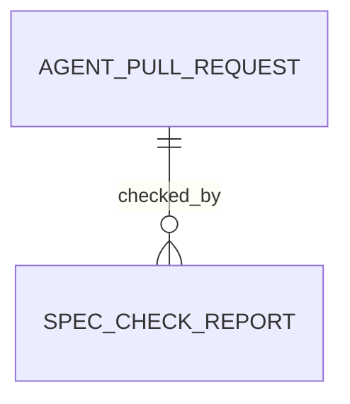
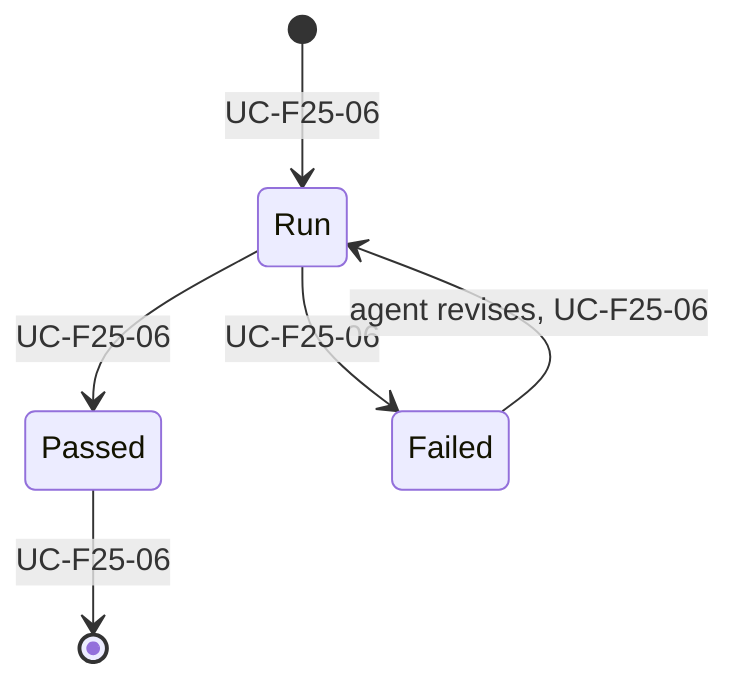

🏠 [Specs](../../../README.md) › 🧩 [Functional capabilities](../../README.md) ›
🤖 [F25 DevOps agents (hosted edition)](../README.md) › 🗃️ [Data](README.md) › 🗃️ E-F25-13 Spec check report

# 🗃️ E-F25-13 Spec check report

**Status:** ✅ specified

## Purpose

The result of the checks on an agent's spec pull request.

## Fields

| Name | Type | Required | Validation | Default | Example | Personal data | Custom fields |
|---|---|---|---|---|---|---|---|
| pull request | link | yes | an agent pull request | - | specs PR 418 | no | no |
| unsourced | list | no | statements | - | 2 thresholds | no | no |
| contradictions | list | no | decisions | - | D443 | no | no |
| tool checks | list | yes | links, templates, prose, coverage | - | all passed | no | no |
| result | choice | yes | passed, back to the agent | - | passed | no | no |

## Relations

## Lifecycle

## Indexes and search

By pull request.

## Retention

As the pull request.

## Audit

Every creation and change, with who, when, the old and the new value.

## Import and export

CSV and JSON export through the API (T5); no bulk import.

## Used by

- [UC-F25-23 Check an agent's spec pull request](../use-cases/02-feature-requests/uc-f25-23-check-an-agents-spec-pull-request.md)
- [UC-F25-06 Draft the spec changes as a pull request](../use-cases/02-feature-requests/uc-f25-06-draft-the-spec-changes-as-a-pull-request.md)
- [UC-F25-19 Measure the quality of the agents' work](../use-cases/04-approve-and-govern/uc-f25-19-measure-the-quality-of-the-agents-work.md)

## Open questions

None.

---

⬅️ [E-F25-12 Vulnerability case](e-f25-12-vulnerability-case.md) · ⬆️ [Up](README.md) ·
➡️ [E-F25-14 Vote](e-f25-14-vote.md)
