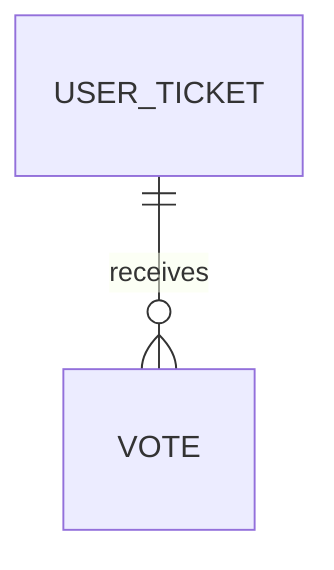
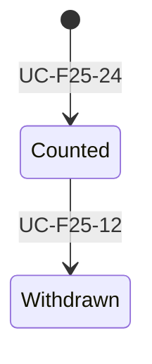

🏠 [Specs](../../../README.md) › 🧩 [Functional capabilities](../../README.md) ›
🤖 [F25 DevOps agents (hosted edition)](../README.md) › 🗃️ [Data](README.md) › 🗃️ E-F25-14 Vote

# 🗃️ E-F25-14 Vote

**Status:** ✅ specified

## Purpose

A hosted customer's vote on a public request.

## Fields

| Name | Type | Required | Validation | Default | Example | Personal data | Custom fields |
|---|---|---|---|---|---|---|---|
| request | link | yes | a public request | - | Export payslips to Silae | no | no |
| company | link | yes | a hosted company, never shown publicly | - | hidden | no | no |
| date | date | yes | one vote per company | now | 2026-11-12 | no | no |

## Relations

## Lifecycle

## Indexes and search

Counts per request.

## Retention

As the request.

## Audit

Every creation and change, with who, when, the old and the new value.

## Import and export

CSV and JSON export through the API (T5); no bulk import.

## Used by

- [UC-F25-24 Vote on declined requests](../use-cases/05-tell-the-customer/uc-f25-24-vote-on-declined-requests.md)
- [UC-F25-12 Approve or refuse agents' tickets](../use-cases/04-approve-and-govern/uc-f25-12-approve-or-refuse-agents-tickets.md)
- [UC-F25-20 Ask the AI assistant about my requests](../use-cases/05-tell-the-customer/uc-f25-20-ask-the-assistant-about-my-requests.md)

## Open questions

None.

---

⬅️ [E-F25-13 Spec check report](e-f25-13-spec-check-report.md) · ⬆️ [Up](README.md) ·
➡️ [E-F25-15 SPECS feature](e-f25-15-specs-feature.md)
