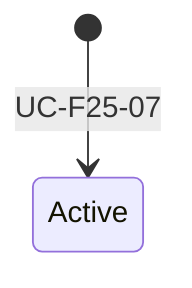

🏠 [Specs](../../../README.md) › 🧩 [Functional capabilities](../../README.md) ›
🤖 [F25 DevOps agents (hosted edition)](../README.md) › 🗃️ [Data](README.md) › 🗃️ E-F25-15 SPECS feature

# 🗃️ E-F25-15 SPECS feature

**Status:** 🔄 waiting for the owner

## Purpose

(Proposed) The SPECS feature the flow charts name with the words "SPECS feature"
([FL-F25-02](../flows/fl-f25-02-feature-requests.md)). The owner decided to create it
([D516](../../../06-decisions/foundations/d516-naming-rules-and-the-seven-classes-of-names.md)); what it holds waits for
the owner's confirmation.

## Fields

(Proposed) To define with the owner: the flow charts name the record, not its fields.

## Relations

(Proposed) To define with the owner, from the use cases below.

## Lifecycle

## Indexes and search

(Proposed) To define with the owner.

## Retention

(Proposed) As the other records of its capability, to confirm with the owner.

## Audit

(Proposed) Every change, as the other records of its capability.

## Import and export

(Proposed) To define with the owner.

## Used by

- [UC-F25-07 Create the SPECS feature and its tickets](../use-cases/02-feature-requests/uc-f25-07-create-the-specs-feature-and-its-tickets.md)

## Open questions

(Proposed) Its fields, relations and states wait for the owner (waiting list, step 36e).

---

⬅️ [E-F25-14 Vote](e-f25-14-vote.md) · ⬆️ [Up](README.md) · ➡️ [E-F25-16 Roadmap item](e-f25-16-roadmap-item.md)
