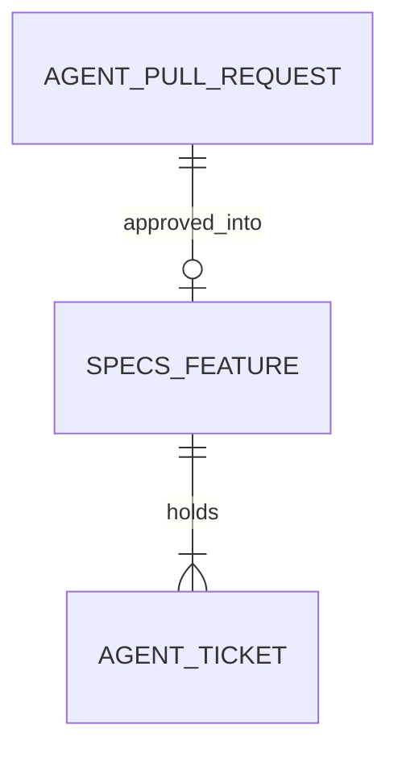
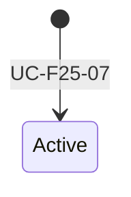

🏠 [Specs](../../../README.md) › 🧩 [Functional capabilities](../../README.md) ›
🤖 [F25 DevOps agents (hosted edition)](../README.md) › 🗃️ [Data](README.md) › 🗃️ E-F25-15 SPECS feature

# 🗃️ E-F25-15 SPECS feature

**Status:** ✅ specified

## Purpose

The SPECS feature the flow charts name with the words "SPECS feature"
([FL-F25-02](../flows/fl-f25-02-feature-requests.md)). It is the GitHub feature the agents create, with its tickets,
once their spec pull request is approved; feature and tickets carry the approval label and stay in Backlog until a
maintainer removes it (BR-F25-07). The owner decided to create it
([D516](../../../06-decisions/foundations/d516-naming-rules-and-the-seven-classes-of-names.md)); its fields are derived
from the specifications and confirmed by the owner (D572).

## Fields

| Name | Type | Required | Validation | Default | Example | Personal data | Custom fields |
|---|---|---|---|---|---|---|---|
| title | text | yes | not empty | - | Quote to invoice | no | no |
| issue | number | yes | a GitHub issue of the repository | - | #317 | no | no |
| family | choice | yes | SPECS | SPECS | SPECS | no | no |
| spec pull request | link | yes | an approved agent pull request (E-F25-05) | - | #316 | no | no |
| tickets | list | yes | agent tickets (E-F25-06), at least one | - | #319, #320 | no | no |
| approval label | yes or no | yes | on until a maintainer removes it (BR-F25-07) | on (needs-maintainer-approval) | on | no | no |
| board status | choice | yes | Backlog while the label is on, then Ready (BR-F25-07) | Backlog | Backlog | no | no |
| state | choice | yes | Active | Active | Active | no | no |

Derived from [UC-F25-07](../use-cases/02-feature-requests/uc-f25-07-create-the-specs-feature-and-its-tickets.md) (the
feature and its tickets created after the pull request is approved, the approval label, Backlog, Ready once a
maintainer removes the label), [BR-F25-07](../business-rules/br-f25-07-approval-before-ready.md), the list view
[S-F25-L15](../screens/00-lists/s-f25-l15-specs-features.md) (title and state) and the screen
[S-F25-07 SPECS feature](../screens/02-feature-requests/s-f25-07-specs-feature.md) (the GitHub issue, its tickets and
their label).

## Relations

- [E-F25-05 Agent pull request](e-f25-05-agent-pull-request.md): the spec pull request whose approval creates the
  feature.
- [E-F25-06 Agent ticket](e-f25-06-agent-ticket.md): the SPECS tickets of the feature, each with the approval label.

## Lifecycle

The board status moves from Backlog to Ready only when a maintainer removes the approval label; anyone else's change is
reported and reverted (BR-F25-07).

## Indexes and search

By issue, board status and approval label; searched on the title. The list view sorts on the title and the state and
filters on the state ([S-F25-L15](../screens/00-lists/s-f25-l15-specs-features.md)).

## Retention

As the other records of its capability.

## Audit

Every change, as the other records of its capability.

## Import and export

CSV and JSON export through the API (T5) of the fields the user may see; no bulk import.

## Used by

- [UC-F25-07 Create the SPECS feature and its tickets](../use-cases/02-feature-requests/uc-f25-07-create-the-specs-feature-and-its-tickets.md)

## Open questions

None.

---

⬅️ [E-F25-14 Vote](e-f25-14-vote.md) · ⬆️ [Up](README.md) · ➡️ [E-F25-16 Roadmap item](e-f25-16-roadmap-item.md)
