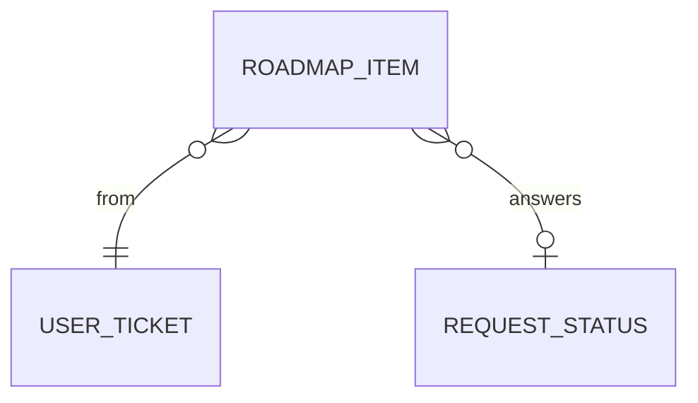
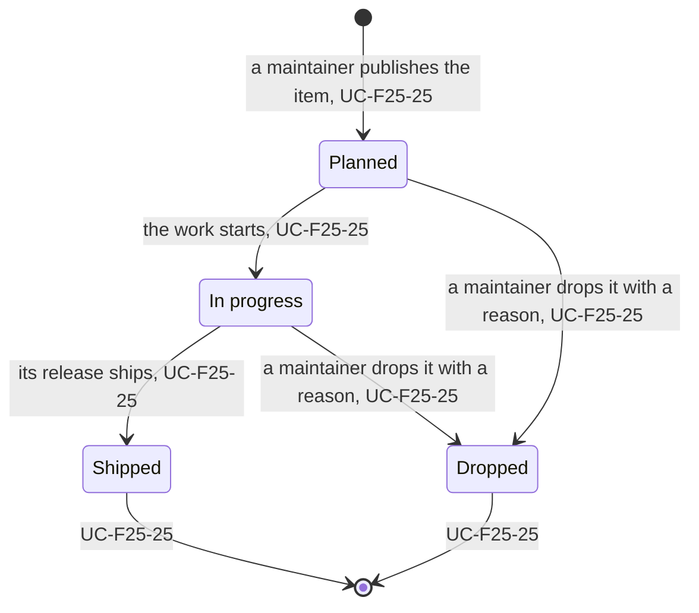

🏠 [Specs](../../../README.md) › 🧩 [Functional capabilities](../../README.md) ›
🤖 [F25 DevOps agents (hosted edition)](../README.md) › 🗃️ [Data](README.md) › 🗃️ E-F25-16 Roadmap item

# 🗃️ E-F25-16 Roadmap item

**Status:** ✅ specified

## Purpose

A public item of the roadmap, written in plain words from an accepted ticket, with its horizon and status
([D544](../../../06-decisions/f25-devops-agents/d544-benchmark-gaps-f25-devops-agents.md)). It differs from the request
status ([E-F25-09 Request status](e-f25-09-request-status.md)): the status is what one requester sees of their own
request, the roadmap item is what everyone sees of an accepted ticket.

## Fields

| Name | Type | Required | Validation | Default | Example | Personal data | Custom fields |
|---|---|---|---|---|---|---|---|
| ticket | user ticket (E-F25-03) | yes | a ticket with the approval label | - | #313 | no | no |
| title | text | yes | 1 to 100 characters, plain words | the ticket's title | Export payslips as a file | no | no |
| module | module | yes | a module of the product | - | Payroll | no | no |
| horizon | Now, Next, Later | yes | a value of the list | Later | Next | no | no |
| reason | text | no | required when moved or dropped | none | waiting for the payroll partner | no | no |
| state | Planned, In progress, Shipped, Dropped | yes | the lifecycle below | Planned | In progress | no | no |
| owner | user | yes | a user of the company | the creator | Claire P. | yes | no |

## Relations

- [E-F25-03 USER ticket](e-f25-03-user-ticket.md)
- [E-F25-09 Request status](e-f25-09-request-status.md)

## Lifecycle

## Indexes and search

By module, horizon, state and ticket.

## Retention

Shipped items stay readable as history; dropped items are removed 90 days after the drop.

## Audit

Every publication, rewording, move, drop and change of status, with the maintainer and when.

## Import and export

No import. The published items are read through a public feed.

## Used by

- [UC-F25-25](../use-cases/07-roadmap-beta-and-credits/uc-f25-25-read-the-public-roadmap.md)

## Open questions

None.

---

⬅️ [E-F25-15 SPECS feature](e-f25-15-specs-feature.md) · ⬆️ [Up](README.md) ·
➡️ [E-F25-17 Beta enrolment](e-f25-17-beta-enrolment.md)
