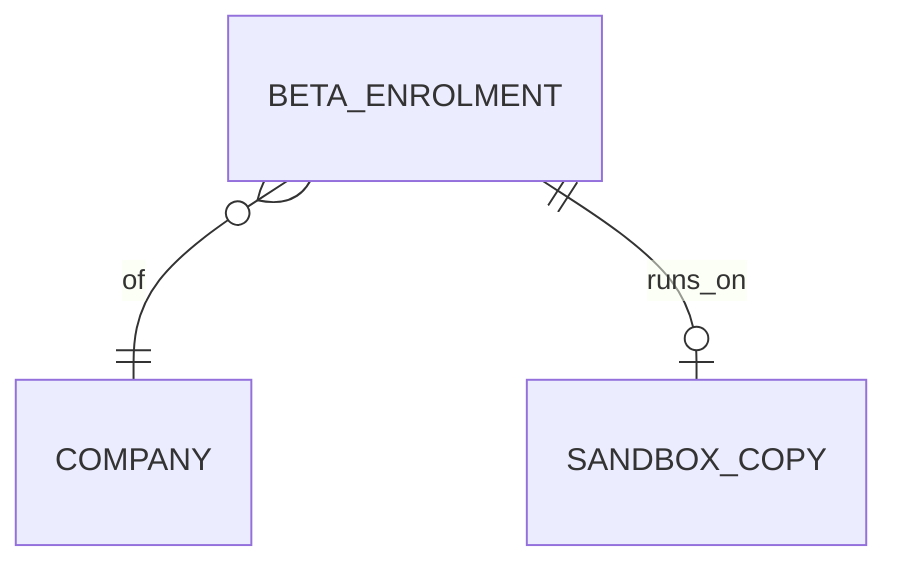
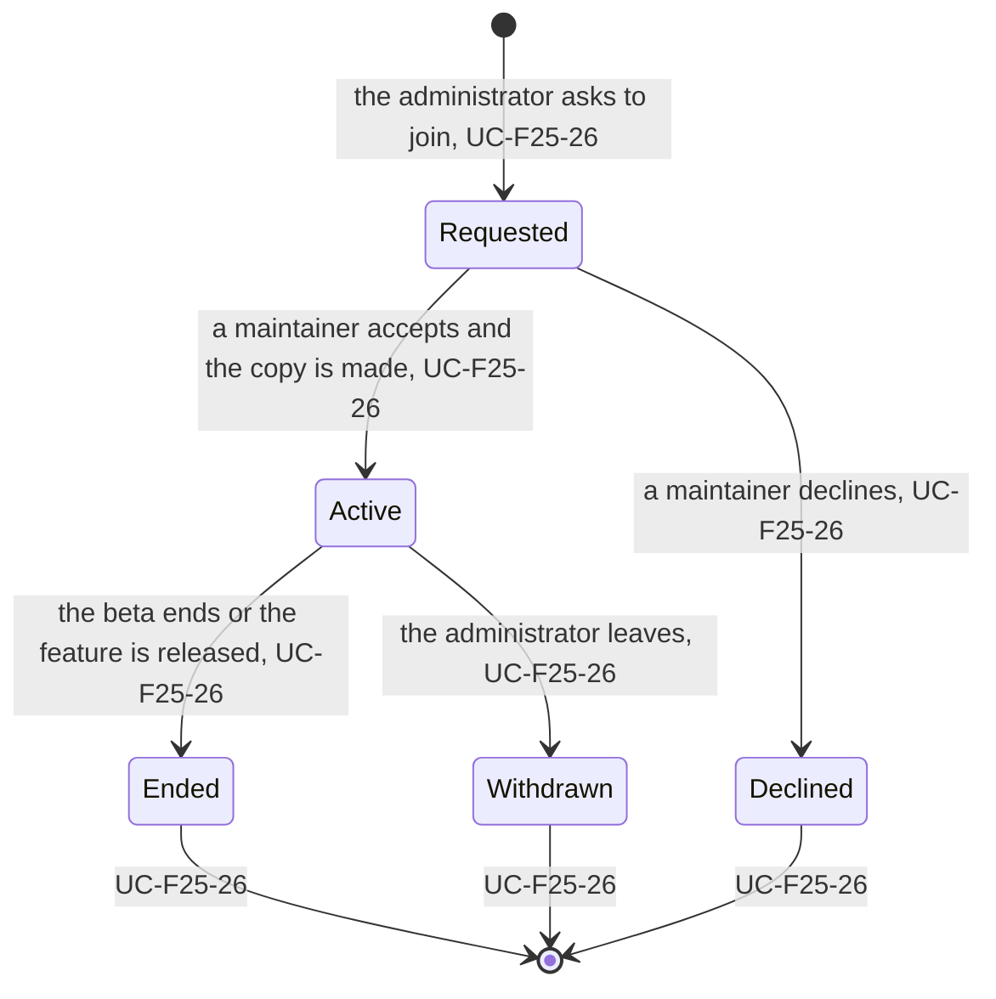

🏠 [Specs](../../../README.md) › 🧩 [Functional capabilities](../../README.md) ›
🤖 [F25 DevOps agents (hosted edition)](../README.md) › 🗃️ [Data](README.md) › 🗃️ E-F25-17 Beta enrolment

# 🗃️ E-F25-17 Beta enrolment

**Status:** ✅ specified

## Purpose

A company's enrolment in the beta of one feature: its sandbox copy, its colleagues and its end
([D544](../../../06-decisions/f25-devops-agents/d544-benchmark-gaps-f25-devops-agents.md)). It resembles the try-out
copy of the feature factory ([E-F19-06 Try-out copy](../../f19-feature-factory/data/e-f19-06-try-out-copy.md)) and the
publisher's test instance ([E-F14-22 Test instance](../../f14-plugin-store/data/e-f14-22-test-instance.md)), but those
serve a feature being sold or an extension being tested; an enrolment serves a product feature before release.

## Fields

| Name | Type | Required | Validation | Default | Example | Personal data | Custom fields |
|---|---|---|---|---|---|---|---|
| feature | beta feature | yes | a feature open to enrolments | - | New stock counts | no | no |
| company | hosted company | yes | a hosted customer | the user's company | Acme | no | no |
| colleagues | list of users | no | users of the company | the administrator | 3 colleagues | yes | no |
| masking | list of fields | yes | personal data masked by default | all personal data | names and emails | no | no |
| copy ends on | date | no | after the start | end of the beta | 2026-11-30 | no | no |
| feedback | list of notes | no | text with an optional screenshot | none | 2 notes | no | no |
| state | Requested, Active, Declined, Ended, Withdrawn | yes | the lifecycle below | Requested | Active | no | no |
| owner | user | yes | a user of the company | the creator | Claire P. | yes | no |

## Relations

- [E-F19-06 Try-out copy](../../f19-feature-factory/data/e-f19-06-try-out-copy.md)
- [E-F14-22 Test instance](../../f14-plugin-store/data/e-f14-22-test-instance.md)

## Lifecycle

## Indexes and search

By feature, company, state and end date.

## Retention

The copy is deleted at the end; the enrolment's record is kept 3 years without personal data.

## Audit

Every request, acceptance, copy made and deleted, colleague added, feedback and ending, with who and when.

## Import and export

No import. Export of the feedback with the feature's report.

## Used by

- [UC-F25-26](../use-cases/07-roadmap-beta-and-credits/uc-f25-26-join-the-beta-programme.md)

## Open questions

None.

---

⬅️ [E-F25-16 Roadmap item](e-f25-16-roadmap-item.md) · ⬆️ [Up](README.md) ·
➡️ [E-F25-18 Report credit](e-f25-18-report-credit.md)
