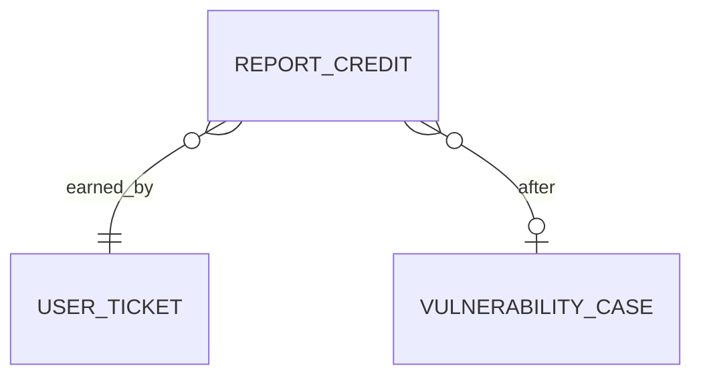
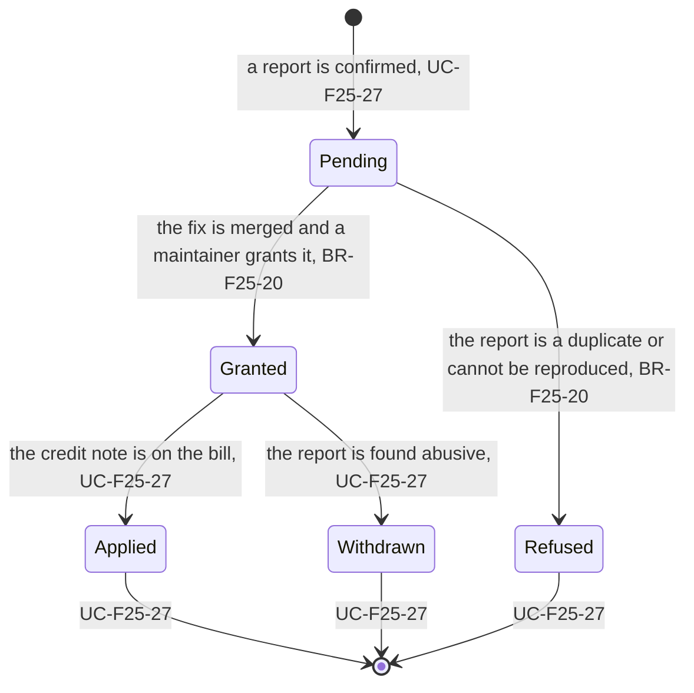

🏠 [Specs](../../../README.md) › 🧩 [Functional capabilities](../../README.md) ›
🤖 [F25 DevOps agents (hosted edition)](../README.md) › 🗃️ [Data](README.md) › 🗃️ E-F25-18 Report credit

# 🗃️ E-F25-18 Report credit

**Status:** ✅ specified

## Purpose

A credit earned by a confirmed report: the report, its severity, the amount and the bill that carries it
([D544](../../../06-decisions/f25-devops-agents/d544-benchmark-gaps-f25-devops-agents.md)). It resembles the promotion
credit of the feature factory
([E-F19-08 Promotion credit](../../f19-feature-factory/data/e-f19-08-promotion-credit.md)), but that one pays for a
feature promoted to others, while this one rewards a confirmed report.

## Fields

| Name | Type | Required | Validation | Default | Example | Personal data | Custom fields |
|---|---|---|---|---|---|---|---|
| report | user ticket (E-F25-03) | yes | a confirmed ticket | - | #313 | no | no |
| company | hosted company | yes | the reporter's company | - | Acme | no | no |
| severity | low, medium, high, critical | yes | from the triage | - | medium | no | no |
| amount | amount with currency | yes | from the published schedule | - | 25 EUR | no | no |
| reason | text | yes | stated for a grant and for a refusal | - | first confirmed report | no | no |
| bill | month | no | the next bill after the grant | none | 2026-12 | no | no |
| state | Pending, Granted, Refused, Applied, Withdrawn | yes | the lifecycle below | Pending | Granted | no | no |
| owner | user | yes | a user of the company | the creator | Claire P. | yes | no |

## Relations

- [E-F25-03 USER ticket](e-f25-03-user-ticket.md)
- [E-F25-11 Triage](e-f25-11-triage.md)
- [E-F25-12 Vulnerability case](e-f25-12-vulnerability-case.md)
- [E-F19-08 Promotion credit](../../f19-feature-factory/data/e-f19-08-promotion-credit.md)

## Lifecycle

## Indexes and search

By company, severity, state and bill.

## Retention

Kept 10 years with the invoices it reduces
([CR-FR-002](../../../10-country-packs/france/accounting/cr-fr-002-accounting-records-kept-ten-years.md)).

## Audit

Every credit created, granted, refused, applied and withdrawn, with the maintainer and the amounts.

## Import and export

No import. Export with the hosted usage statements
[UC-F22-15](../../f22-unified-cost-management/use-cases/05-billing/uc-f22-15-see-the-hosted-quota-and-units-billed.md).

## Used by

- [UC-F25-27](../use-cases/07-roadmap-beta-and-credits/uc-f25-27-receive-credits-for-confirmed-reports.md)

## Open questions

None.

---

⬅️ [E-F25-17 Beta enrolment](e-f25-17-beta-enrolment.md) · ⬆️ [Up](README.md) ·
➡️ [E-F25-19 Work contract](e-f25-19-work-contract.md)
