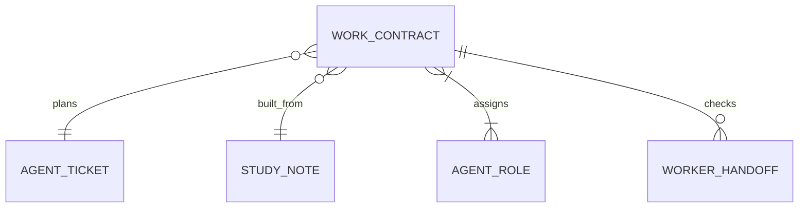
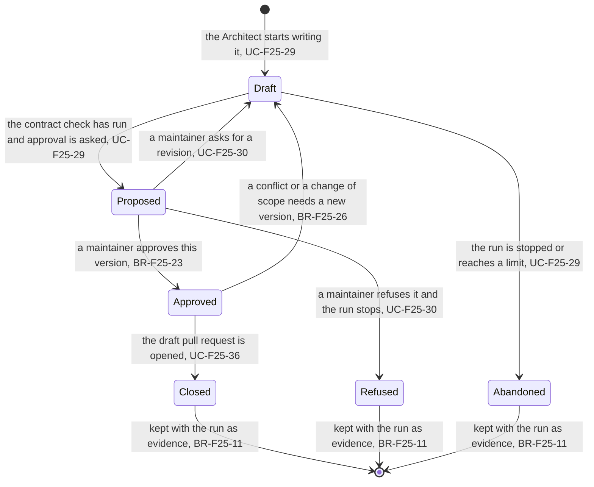

🏠 [Specs](../../../README.md) › 🧩 [Functional capabilities](../../README.md) ›
🤖 [F25 DevOps agents (hosted edition)](../README.md) › 🗃️ [Data](README.md) › 🗃️ E-F25-19 Work contract

# 🗃️ E-F25-19 Work contract

**Status:** ✅ specified

## Purpose

The plan of one ticket's work by the agent team
[D567](../../../06-decisions/f25-devops-agents/d567-the-agent-team-roles-contract-worktrees-one-commit-verification.md):
what done means, the shared terms, who owns which files, in which order the tasks run, which checks must pass and what
each handoff proves. It is written from the study note ([E-F25-04 Study note](e-f25-04-study-note.md)) and approved by a
maintainer before any worker starts
([BR-F25-23](../business-rules/br-f25-23-no-worker-starts-before-the-contract-is-approved.md)). It differs from the
approval of a ticket ([E-F25-08 Approval](e-f25-08-approval.md)): that one lets the work start at all, the contract says
how the work is shared.

## Fields

| Name | Type | Required | Validation | Default | Example | Personal data | Custom fields |
|---|---|---|---|---|---|---|---|
| ticket | agent ticket (E-F25-06) | yes | a ticket without the approval label, in Ready | - | 314 | no | no |
| study note | study note (E-F25-04) | yes | cites the pages and the files | - | the note of 314 | no | no |
| starting commit | commit identifier | yes | a commit of the base branch | the head of the base branch | a3f9c21 | no | no |
| acceptance criteria | list of text | yes | 1 to 20, each with its check | - | 3 criteria | no | no |
| shared contracts | list of API operations and data shapes | no | each used by two roles or more | none | GET /payroll/exports/{period} | no | no |
| file ownership | list of paths per role | yes | each path owned by one role only | - | Backend Engineer: services/payroll/export/ | no | no |
| tasks | list of tasks with dependencies | yes | no cycle, each task to one role | - | T0 to T3 | no | no |
| required checks | list of commands | yes | the project's checks, the failing test first for a fix | the project's checks | unit, lint, specs, end-to-end | no | no |
| handoff evidence | list of items | yes | at least the commits, the changed files, the checks with exit codes and the blockers | those four | the four, and screenshots | no | no |
| gaps and overlaps | list of flags | no | set by the contract check | none | 1 gap | no | no |
| version | number | yes | rises at each revision | 1 | 2 | no | no |
| proposed on | date and time | no | set when approval is asked | none | 2026-11-16 10:40 | no | no |
| approved by | user | no | a maintainer, set at approval | none | a maintainer | yes | no |
| state | Draft, Proposed, Approved, Refused, Closed, Abandoned | yes | the lifecycle below | Draft | Proposed | no | no |
| owner | user | yes | a user of the company | the creator | Claire P. | yes | no |

A contract holds no customer data: the study note's sanitised summary is enough, and the details stay in
SimpleERP ([BR-F25-04](../business-rules/br-f25-04-read-only-on-production.md)).

## Relations

- [E-F25-06 Agent ticket](e-f25-06-agent-ticket.md)
- [E-F25-04 Study note](e-f25-04-study-note.md)
- [E-F25-08 Approval](e-f25-08-approval.md)
- [E-F25-20 Agent role](e-f25-20-agent-role.md)
- [E-F25-21 Worker handoff](e-f25-21-worker-handoff.md)

## Lifecycle

A revision after approval raises the version and puts the contract back to Draft. Workers already running
finish their current task and wait for the new approval.

## Indexes and search

By ticket, state, starting commit and role. Full-text search on the criteria.

## Retention

Kept as long as the agent run it belongs to ([E-F25-10 Agent run](e-f25-10-agent-run.md)), with the pull
request's history.

## Audit

Every version, the contract check's findings, the approval or refusal with the maintainer, and the starting commit.

## Import and export

No import. Exported as a file with the run's evidence, and summarised in the draft pull request's body
([UC-F25-36](../use-cases/08-team-builds-a-ticket/uc-f25-36-open-the-draft-pull-request-with-its-evidence.md)).

## Used by

- [UC-F25-29](../use-cases/08-team-builds-a-ticket/uc-f25-29-write-the-work-contract-of-a-ticket.md)
- [UC-F25-30](../use-cases/08-team-builds-a-ticket/uc-f25-30-approve-the-work-contract.md)
- [UC-F25-31](../use-cases/08-team-builds-a-ticket/uc-f25-31-build-in-isolated-worktrees.md)
- [UC-F25-32](../use-cases/08-team-builds-a-ticket/uc-f25-32-hand-over-a-workers-result.md)
- [UC-F25-33](../use-cases/08-team-builds-a-ticket/uc-f25-33-integrate-the-workers-commits.md)

## Open questions

None.

---

⬅️ [E-F25-18 Report credit](e-f25-18-report-credit.md) · ⬆️ [Up](README.md) ·
➡️ [E-F25-20 Agent role](e-f25-20-agent-role.md)
