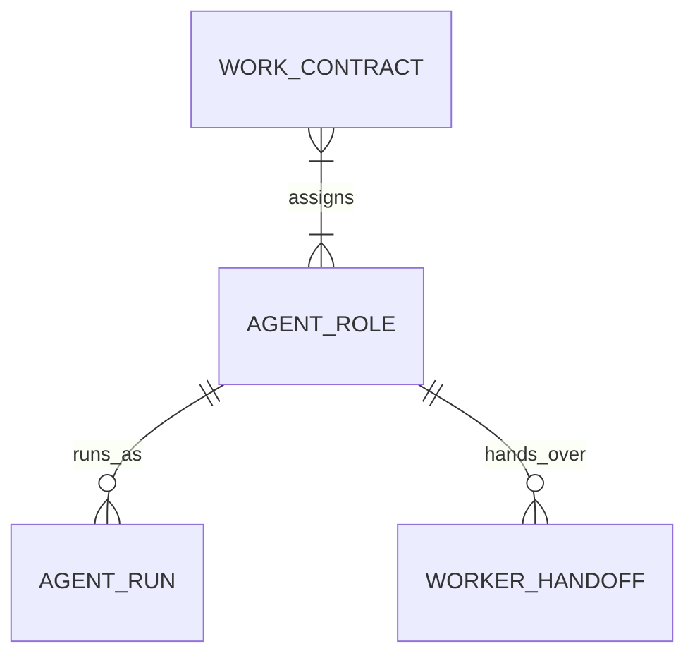
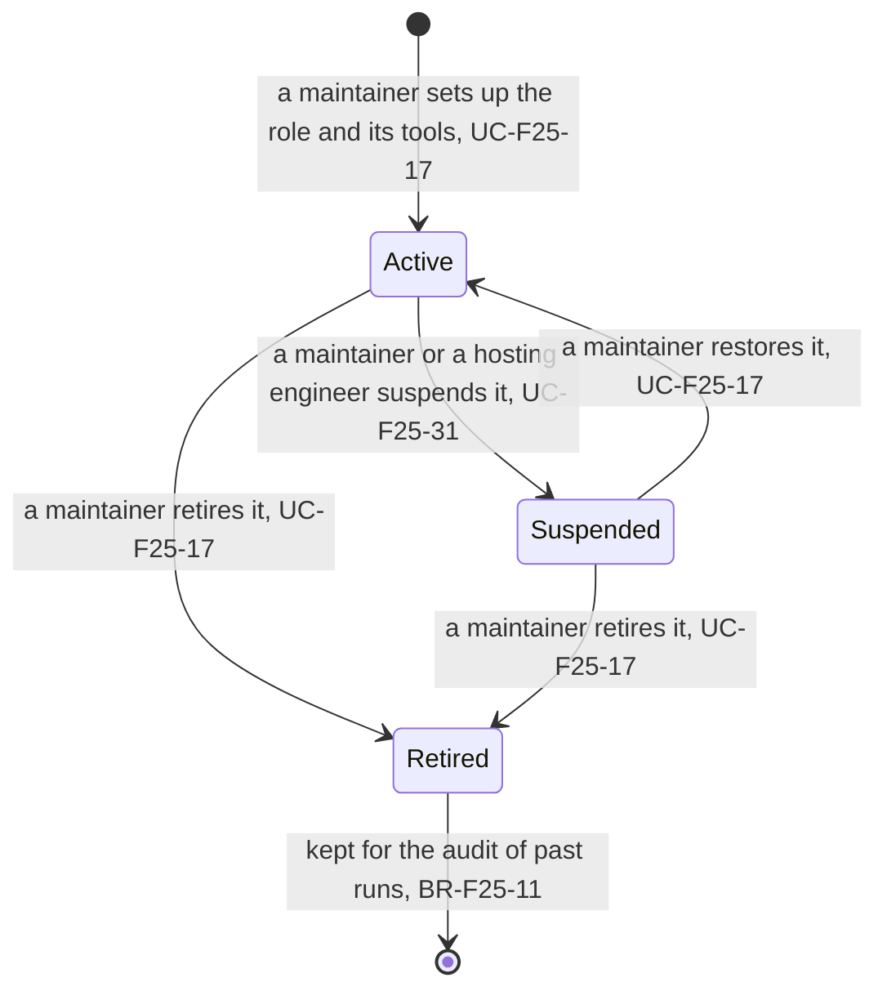

🏠 [Specs](../../../README.md) › 🧩 [Functional capabilities](../../README.md) ›
🤖 [F25 DevOps agents (hosted edition)](../README.md) › 🗃️ [Data](README.md) › 🗃️ E-F25-20 Agent role

# 🗃️ E-F25-20 Agent role

**Status:** 🔄 waiting for the owner

## Purpose

One role of the agent team, with the tools it may use and its limits
[D567](../../../06-decisions/f25-devops-agents/d567-the-agent-team-roles-contract-worktrees-one-commit-verification.md):
Architect, Backend Engineer, Frontend Engineer, Test Engineer, Code Reviewer and Release Engineer. The Code Reviewer's
tools are read-only. A role's record narrows the rights of the agents' GitHub App for its workers and never widens them
([D435](../../../06-decisions/f25-devops-agents/d435-agents-access-and-limits.md),
[UC-F25-17](../use-cases/04-approve-and-govern/uc-f25-17-control-the-agents-rights-and-audit.md)).

## Fields

| Name | Type | Required | Validation | Default | Example | Personal data | Custom fields |
|---|---|---|---|---|---|---|---|
| name | Architect, Backend Engineer, Frontend Engineer, Test Engineer, Code Reviewer, Release Engineer | yes | one of the six | - | Backend Engineer | no | no |
| purpose | text | yes | 1 to 300 characters | - | builds the server side of the contract | no | no |
| tools | list of tools | yes | within the agents' rights (BR-F25-05) | read and search | read, search, edit own files, test commands | no | no |
| writes | yes or no | yes | writes to the repository, always no for the Code Reviewer | no | yes | no | no |
| max turns | number | yes | 1 to 200 | 60 | 60 | no | no |
| time limit | number of minutes | yes | 1 to 240 | 90 | 90 | no | no |
| budget | amount with currency | yes | within the run's budget (D398) | 2 EUR | 2 EUR | no | no |
| changed on | date and time | yes | set at each change | now | 2026-11-16 09:12 | no | no |
| state | Active, Suspended, Retired | yes | the lifecycle below | Active | Suspended | no | no |
| owner | user | yes | a user of the company | the creator | Claire P. | yes | no |

(Proposed) The tools of each role:

| Role | Tools | Writes |
|---|---|---|
| Architect | read and search the repository and the specs, the masked copy read-only, write the work contract | no, the contract only |
| Backend Engineer | read, search, edit its own files, test and check commands, commit on its branch | yes |
| Frontend Engineer | read, search, edit its own files, test and check commands, commit on its branch | yes |
| Test Engineer | read, search, edit its own test files, run the tests, the masked copy read-only for a bug | yes |
| Code Reviewer | read and search the candidate commit and the check results, write its verdict | no, read-only |
| Release Engineer | apply accepted commits on the integration branch, run the required checks, push that branch, open the draft pull request | the integration branch only |

## Relations

- [E-F25-10 Agent run](e-f25-10-agent-run.md)
- [E-F25-19 Work contract](e-f25-19-work-contract.md)
- [E-F25-21 Worker handoff](e-f25-21-worker-handoff.md)

## Lifecycle

(Proposed) A suspended role starts no new worker. Workers already running finish their turn and hand over, and a run
whose contract needs the role waits.

## Indexes and search

By name, state and tool.

## Retention

(Proposed) Kept while any run that used it is kept, so that each run shows the tools its workers had.

## Audit

Every change of tools, limits and state, with the maintainer or the hosting engineer and when
([BR-F25-11](../business-rules/br-f25-11-agents-metered-and-audited.md)).

## Import and export

No import. (Proposed) The roles and their tools are kept as a file in the repository's agent settings, reviewed like any
other change.

## Used by

- [UC-F25-31](../use-cases/08-team-builds-a-ticket/uc-f25-31-build-in-isolated-worktrees.md)
- [UC-F25-29](../use-cases/08-team-builds-a-ticket/uc-f25-29-write-the-work-contract-of-a-ticket.md)
- [UC-F25-32](../use-cases/08-team-builds-a-ticket/uc-f25-32-hand-over-a-workers-result.md)
- [UC-F25-33](../use-cases/08-team-builds-a-ticket/uc-f25-33-integrate-the-workers-commits.md)
- [UC-F25-34](../use-cases/08-team-builds-a-ticket/uc-f25-34-verify-the-candidate-commit.md)

## Open questions

None.

---

⬅️ [E-F25-19 Work contract](e-f25-19-work-contract.md) · ⬆️ [Up](README.md) ·
➡️ [E-F25-21 Worker handoff](e-f25-21-worker-handoff.md)
