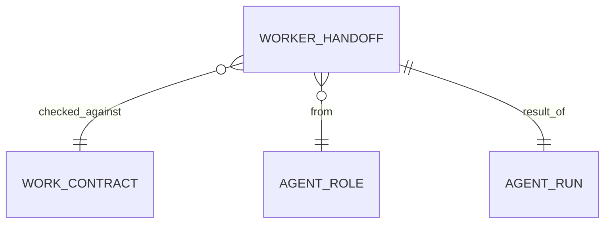
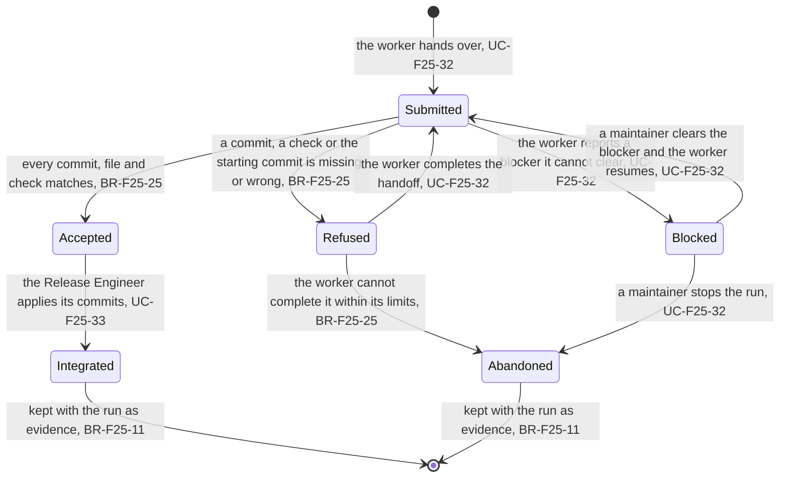

🏠 [Specs](../../../README.md) › 🧩 [Functional capabilities](../../README.md) ›
🤖 [F25 DevOps agents (hosted edition)](../README.md) › 🗃️ [Data](README.md) › 🗃️ E-F25-21 Worker handoff

# 🗃️ E-F25-21 Worker handoff

**Status:** ✅ specified

## Purpose

What one worker hands over at the end of its work
[D567](../../../06-decisions/f25-devops-agents/d567-the-agent-team-roles-contract-worktrees-one-commit-verification.md):
the facts the Release Engineer integrates and the maintainer reads. It is checked against the branch, the check runs and
the contract ([E-F25-19 Work contract](e-f25-19-work-contract.md)) before anything is integrated. It differs from the
agent run ([E-F25-10 Agent run](e-f25-10-agent-run.md)): the run records what was read, written and spent, the handoff
states the result.

## Fields

| Name | Type | Required | Validation | Default | Example | Personal data | Custom fields |
|---|---|---|---|---|---|---|---|
| contract | work contract (E-F25-19) | yes | an approved contract | - | the contract of 314, version 2 | no | no |
| role | agent role (E-F25-20) | yes | a role with tasks in the contract | - | Backend Engineer | no | no |
| worktree | text | yes | the worker's own worktree | - | team-314-backend | no | no |
| branch | text | yes | the worker's own branch | - | team/314/backend | no | no |
| starting commit | commit identifier | yes | equal to the contract's | the contract's | a3f9c21 | no | no |
| commits | list of commit identifiers in order | yes | every commit of the branch after the starting commit | - | c41e0b2, 9d07a1e | no | no |
| changed files | list of paths | yes | owned by the role (BR-F25-22) | - | 6 files | no | no |
| checks | list of commands with exit codes | yes | every required check of the role | - | unit 0, lint 0 | no | no |
| blockers | list of text | no | required when a check fails or a limit is reached | none | budget reached at task T2 | no | no |
| reason | text | no | set when Refused | none | commit 77ab3e0 not listed | no | no |
| handed over at | date and time | yes | set at submission | now | 2026-11-16 14:05 | no | no |
| state | Submitted, Accepted, Refused, Blocked, Integrated, Abandoned | yes | the lifecycle below | Submitted | Accepted | no | no |
| owner | user | yes | a user of the company | the creator | Claire P. | yes | no |

## Relations

- [E-F25-19 Work contract](e-f25-19-work-contract.md)
- [E-F25-20 Agent role](e-f25-20-agent-role.md)
- [E-F25-10 Agent run](e-f25-10-agent-run.md)

## Lifecycle

## Indexes and search

By run, contract, role, state and commit hash.

## Retention

Kept as long as the agent run it belongs to, as evidence of the pull request. It holds no personal data.

## Audit

Every submission, check result, refusal with its reason, blocker decision and integration.

## Import and export

No import. Exported as a file with the run's evidence, and summarised in the draft pull request's body
([UC-F25-36](../use-cases/08-team-builds-a-ticket/uc-f25-36-open-the-draft-pull-request-with-its-evidence.md)).

## Used by

- [UC-F25-32](../use-cases/08-team-builds-a-ticket/uc-f25-32-hand-over-a-workers-result.md)
- [UC-F25-33](../use-cases/08-team-builds-a-ticket/uc-f25-33-integrate-the-workers-commits.md)
- [UC-F25-35](../use-cases/08-team-builds-a-ticket/uc-f25-35-repair-a-rejected-candidate.md)
- [UC-F25-36](../use-cases/08-team-builds-a-ticket/uc-f25-36-open-the-draft-pull-request-with-its-evidence.md)

## Open questions

None.

---

⬅️ [E-F25-20 Agent role](e-f25-20-agent-role.md) · ⬆️ [Up](README.md) ·
➡️ [E-F25-22 Verification](e-f25-22-verification.md)
