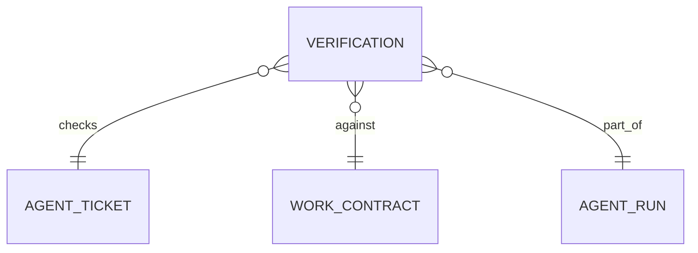
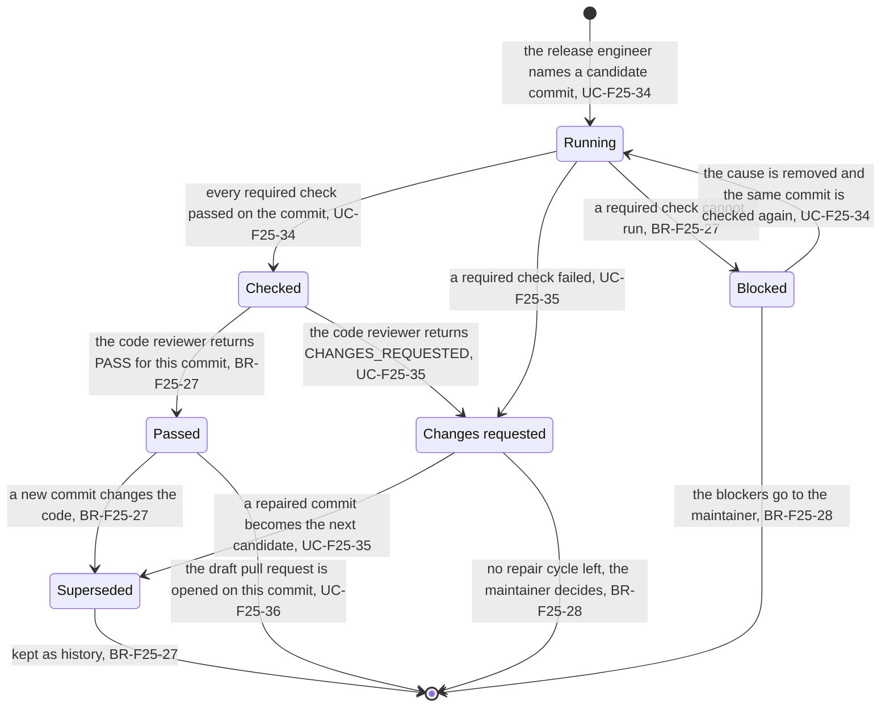

🏠 [Specs](../../../README.md) › 🧩 [Functional capabilities](../../README.md) ›
🤖 [F25 DevOps agents (hosted edition)](../README.md) › 🗃️ [Data](README.md) › 🗃️ E-F25-22 Verification

# 🗃️ E-F25-22 Verification

**Status:** 🔄 waiting for the owner

## Purpose

The checks and the verdict of one candidate commit of an agent team's run
[D567](../../../06-decisions/f25-devops-agents/d567-the-agent-team-roles-contract-worktrees-one-commit-verification.md).
It differs from the spec check report ([E-F25-13 Spec check report](e-f25-13-spec-check-report.md)): that one checks a
spec pull request's statements, a verification checks a whole candidate commit against its work contract.

## Fields

| Name | Type | Required | Validation | Default | Example | Personal data | Custom fields |
|---|---|---|---|---|---|---|---|
| ticket | agent ticket (E-F25-06) | yes | an approved ticket with an approved contract | - | #314 | no | no |
| candidate commit | commit identifier | yes | 40 hexadecimal characters, named by the release engineer | - | 9f2c4e1 (shortened) | no | no |
| cycle | number | yes | 0 for the first candidate, then 1 or 2 (BR-F25-28) | 0 | 1 | no | no |
| checks | list of check results | yes | every required check of the contract: command, exit code, evidence | - | build 0, tests 0, acceptance 1 | no | no |
| signals | list of false-confidence signals | no | mocks only, no full flow, suite not covering the new criteria | none | mocks only on the payslip screen | no | no |
| verdict | PASS, CHANGES_REQUESTED | no | given by the code reviewer for this commit only | none | CHANGES_REQUESTED | no | no |
| findings | list of findings | no | file and line, consequence, required correction | none | export line 42, net pay rounded down | no | no |
| started at | date and time | yes | set when the commit is named | now | 2026-11-16 10:42 | no | no |
| state | Running, Checked, Changes requested, Blocked, Passed, Superseded | yes | the lifecycle below | Running | Checked | no | no |
| owner | user | yes | a user of the company | the creator | Claire P. | yes | no |

## Relations

- [E-F25-06 Agent ticket](e-f25-06-agent-ticket.md)
- [E-F25-19 Work contract](e-f25-19-work-contract.md)
- [E-F25-10 Agent run](e-f25-10-agent-run.md)
- [E-F25-20 Agent role](e-f25-20-agent-role.md)

## Lifecycle

(Proposed) A Blocked verification does not use a repair cycle: repairing the code does not repair a test stack.

## Indexes and search

By ticket, candidate commit, cycle, verdict and state.

## Retention

(Proposed) Kept as long as the ticket's agent runs ([E-F25-10 Agent run](e-f25-10-agent-run.md)), with the evidence
files.

## Audit

Every verification opened, check run, verdict given, edit refused and verification superseded, with the agent role, the
commit and when.

## Import and export

No import. Export of the checks and evidence with the draft pull request's body.

## Used by

- [UC-F25-34](../use-cases/08-team-builds-a-ticket/uc-f25-34-verify-the-candidate-commit.md)
- [UC-F25-35](../use-cases/08-team-builds-a-ticket/uc-f25-35-repair-a-rejected-candidate.md)
- [UC-F25-36](../use-cases/08-team-builds-a-ticket/uc-f25-36-open-the-draft-pull-request-with-its-evidence.md)
- [UC-F25-37](../use-cases/08-team-builds-a-ticket/uc-f25-37-resume-an-interrupted-run.md)

## Open questions

None.

---

⬅️ [E-F25-21 Worker handoff](e-f25-21-worker-handoff.md) · ⬆️ [Up](README.md) ·
➡️ [E-F25-23 Run checkpoint](e-f25-23-run-checkpoint.md)
