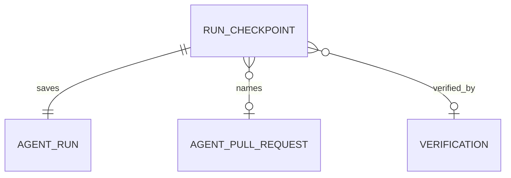
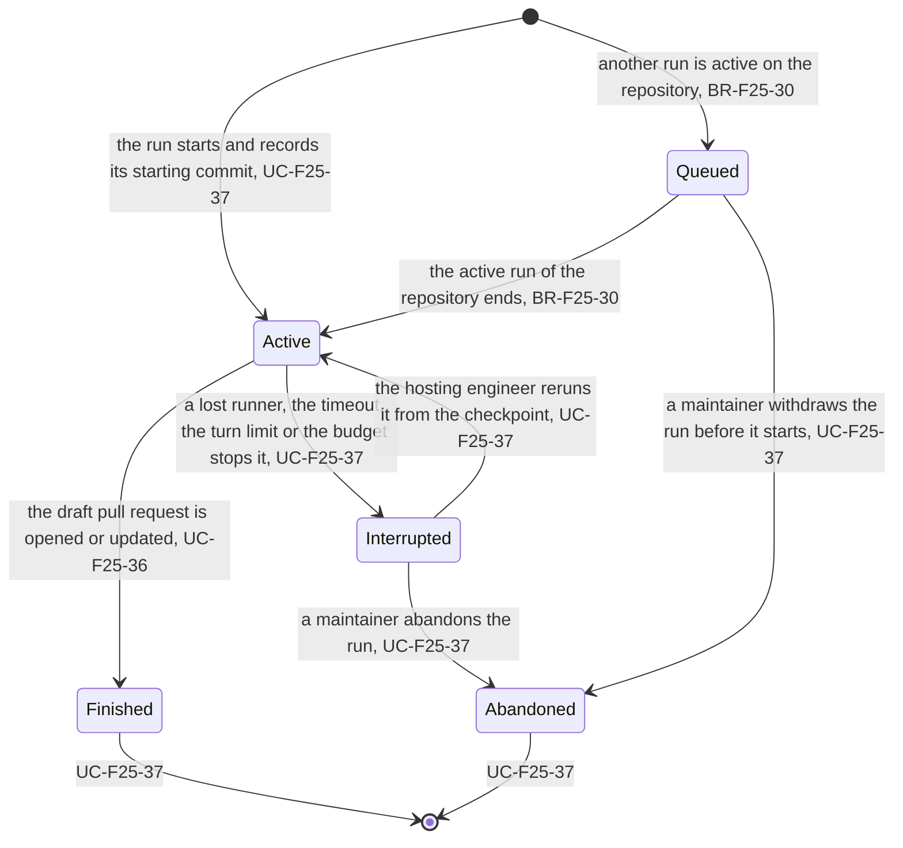

🏠 [Specs](../../../README.md) › 🧩 [Functional capabilities](../../README.md) ›
🤖 [F25 DevOps agents (hosted edition)](../README.md) › 🗃️ [Data](README.md) › 🗃️ E-F25-23 Run checkpoint

# 🗃️ E-F25-23 Run checkpoint

**Status:** ✅ specified

## Purpose

The saved progress of one run of the agent team, stored apart from the verified code, from which an interrupted run
resumes
[D567](../../../06-decisions/f25-devops-agents/d567-the-agent-team-roles-contract-worktrees-one-commit-verification.md).
It differs from the agent run ([E-F25-10 Agent run](e-f25-10-agent-run.md)): the run records what was read, written and
paid; the checkpoint records where the work stands.

## Fields

| Name | Type | Required | Validation | Default | Example | Personal data | Custom fields |
|---|---|---|---|---|---|---|---|
| run | agent run (E-F25-10) | yes | one checkpoint per run | - | 81 | no | no |
| repository | repository | yes | one active run per repository (BR-F25-30) | - | SimpleERP | no | no |
| starting commit | commit identifier | yes | 40 hexadecimal characters, recorded at the start | the base branch's head | 1a2b3c4 (shortened) | no | no |
| worker branches | list of branches and their commits | yes | one per implementation role | - | 3 branches, 5 commits | no | no |
| stage | text | yes | the last stage finished: started, workers done, integrated, verified or pull request open | started | integrated | no | no |
| verified commit | commit identifier | no | the commit of a Passed verification | none | 9f2c4e1 (shortened) | no | no |
| draft pull request | agent pull request (E-F25-05) | no | at most one per branch | none | 57 | no | no |
| stop cause | lost runner, 30-minute limit, turn limit, budget, none | no | set when the run stops | none | timeout | no | no |
| metrics | elapsed time, AI cost, repair cycles, maintainer interventions | yes | added up across resumes | 0 | 30 min, 4.10 USD, 0, 0 | no | no |
| saved at | date and time | yes | set at each save | now | 2026-11-16 11:12 | no | no |
| state | Queued, Active, Interrupted, Finished, Abandoned | yes | the lifecycle below | Queued | Active | no | no |
| owner | user | yes | a user of the company | the creator | Claire P. | yes | no |

The checkpoint is stored by the DevOps agents' service outside the repository's tracked files, never in a
commit of the branch it describes.

## Relations

- [E-F25-10 Agent run](e-f25-10-agent-run.md)
- [E-F25-05 Agent pull request](e-f25-05-agent-pull-request.md)
- [E-F25-22 Verification](e-f25-22-verification.md)

## Lifecycle

GitHub Actions keeps at most one waiting run per concurrency group and replaces it with a newer one; the
queue is therefore kept by the DevOps agents' service, which starts the next run when the repository is free. To check
when building.

## Indexes and search

By repository, state, ticket and saved date.

## Retention

Kept as long as the agent run it saves ([E-F25-10 Agent run](e-f25-10-agent-run.md)).

## Audit

Every save, stop with its cause, rerun, resume stage, queue change and abandonment, with who and when.

## Import and export

No import. The metrics are exported with the agents' costs and quality reports
([UC-F25-18](../use-cases/04-approve-and-govern/uc-f25-18-follow-the-agents-costs-and-budgets.md),
[UC-F25-19](../use-cases/04-approve-and-govern/uc-f25-19-measure-the-quality-of-the-agents-work.md)).

## Used by

- [UC-F25-37](../use-cases/08-team-builds-a-ticket/uc-f25-37-resume-an-interrupted-run.md)
- [UC-F25-36](../use-cases/08-team-builds-a-ticket/uc-f25-36-open-the-draft-pull-request-with-its-evidence.md)

## Open questions

None.

---

⬅️ [E-F25-22 Verification](e-f25-22-verification.md) · ⬆️ [Up](README.md)
