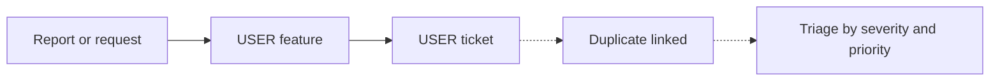

🏠 [Specs](../../../README.md) › 🧩 [Functional capabilities](../../README.md) ›
🤖 [F25 DevOps agents (hosted edition)](../README.md) › 🔀 [Flows](README.md) › 🔀 FL-F25-01 Intake

# 🔀 FL-F25-01 Intake

**Status:** ✅ specified

## Summary

Covers UC-F25-01, UC-F25-02, UC-F25-03, UC-F25-04.

## Personas

- [U07 Administrator](../../../01-users/personas/u07-administrator.md)
- [U13 Owner](../../../01-users/personas/u13-owner.md)
- [U47 simple-ERP maintainer](../../../01-users/personas/u47-simple-erp-maintainer.md)

## Flowchart

## Sequence diagram

See each use case.

## Steps

| Step | Persona | Screen | Use case | What happens |
|---|---|---|---|---|
| 1 | U07, U13 | [S-F25-01](../screens/01-intake/s-f25-01-report-a-bug.md) | [UC-F25-01](../use-cases/01-intake/uc-f25-01-report-a-bug-from-simple-erp.md) | Report a bug from simple-ERP |
| 2 | U13, U07 | [S-F25-02](../screens/01-intake/s-f25-02-request-a-feature.md) | [UC-F25-02](../use-cases/01-intake/uc-f25-02-request-a-feature-from-simple-erp.md) | Request a feature from simple-ERP |
| 3 | U47 | [S-F25-03](../screens/01-intake/s-f25-03-user-ticket.md) | [UC-F25-03](../use-cases/01-intake/uc-f25-03-open-the-user-feature-with-its-ticket.md) | Open the USER feature with its ticket |
| 4 | U47 | [S-F25-04](../screens/01-intake/s-f25-04-duplicates.md) | [UC-F25-04](../use-cases/01-intake/uc-f25-04-deduplicate-against-open-issues.md) | Deduplicate against open issues |
| 5 | U47 | [S-F25-21](../screens/01-intake/s-f25-21-triage-board.md) | [UC-F25-21](../use-cases/01-intake/uc-f25-21-triage-requests-by-severity-and-priority.md) | Triage by severity and priority |

### Entities and screens

| Entity | States in this flow | Shown at step and screen | Aggregated view |
|---|---|---|---|
| [E-F25-01 Bug or feature request](../data/e-f25-01-bug-or-feature-request.md) | Active | 1 [S-F25-01](../screens/01-intake/s-f25-01-report-a-bug.md); 2 [S-F25-02](../screens/01-intake/s-f25-02-request-a-feature.md) | Bug or feature requests |
| [E-F25-02 USER feature](../data/e-f25-02-user-feature.md) | Active | 3 [S-F25-03](../screens/01-intake/s-f25-03-user-ticket.md); 4 [S-F25-04](../screens/01-intake/s-f25-04-duplicates.md) | USER features |
| [E-F25-03 USER ticket](../data/e-f25-03-user-ticket.md) | Open, Late, Flagged | 3 [S-F25-03](../screens/01-intake/s-f25-03-user-ticket.md); 5 [S-F25-21](../screens/01-intake/s-f25-21-triage-board.md) | USER tickets |
| [E-F25-11 Triage](../data/e-f25-11-triage.md) | Triaged, Acknowledged, Late, Resolved | 3 [S-F25-03](../screens/01-intake/s-f25-03-user-ticket.md); 5 [S-F25-21](../screens/01-intake/s-f25-21-triage-board.md) | Triages |

## Errors

As each use case.

## Images

Every step and error, for each persona taking part, in light and dark mode (D120). Steps are numbered as in the Steps
table; E rows are the error cases.

| Step | Persona | Device | Light | Dark |
|---|---|---|---|---|
| 1 | U07 | desktop | [light](../images/01-intake/u07-administrator/1-bug-desktop-light.png) | [dark](../images/01-intake/u07-administrator/1-bug-desktop-dark.png) |
| 1 | U13 | desktop | [light](../images/01-intake/u13-owner/1-bug-desktop-light.png) | [dark](../images/01-intake/u13-owner/1-bug-desktop-dark.png) |
| 1 | U13 | phone | [light](../images/01-intake/u13-owner/1-bug-phone-light.png) | [dark](../images/01-intake/u13-owner/1-bug-phone-dark.png) |
| 2 | U13 | desktop | [light](../images/01-intake/u13-owner/2-feature-desktop-light.png) | [dark](../images/01-intake/u13-owner/2-feature-desktop-dark.png) |
| 2 | U13 | phone | [light](../images/01-intake/u13-owner/2-feature-phone-light.png) | [dark](../images/01-intake/u13-owner/2-feature-phone-dark.png) |
| 2 | U07 | desktop | [light](../images/01-intake/u07-administrator/2-feature-desktop-light.png) | [dark](../images/01-intake/u07-administrator/2-feature-desktop-dark.png) |
| 3 | U47 | desktop | [light](../images/01-intake/u47-simple-erp-maintainer/3-user-ticket-desktop-light.png) | [dark](../images/01-intake/u47-simple-erp-maintainer/3-user-ticket-desktop-dark.png) |
| 3 | U47 | phone | [light](../images/01-intake/u47-simple-erp-maintainer/3-user-ticket-phone-light.png) | [dark](../images/01-intake/u47-simple-erp-maintainer/3-user-ticket-phone-dark.png) |
| 4 | U47 | desktop | [light](../images/01-intake/u47-simple-erp-maintainer/4-duplicates-desktop-light.png) | [dark](../images/01-intake/u47-simple-erp-maintainer/4-duplicates-desktop-dark.png) |
| 4 | U47 | phone | [light](../images/01-intake/u47-simple-erp-maintainer/4-duplicates-phone-light.png) | [dark](../images/01-intake/u47-simple-erp-maintainer/4-duplicates-phone-dark.png) |
| E1 | U47 | desktop | [light](../images/01-intake/u47-simple-erp-maintainer/e1-rules-desktop-light.png) | [dark](../images/01-intake/u47-simple-erp-maintainer/e1-rules-desktop-dark.png) |
| E1 | U47 | phone | [light](../images/01-intake/u47-simple-erp-maintainer/e1-rules-phone-light.png) | [dark](../images/01-intake/u47-simple-erp-maintainer/e1-rules-phone-dark.png) |
| 5 | U47 | desktop | [light](../images/01-intake/u47-simple-erp-maintainer/5-triage-board-desktop-light.png) | [dark](../images/01-intake/u47-simple-erp-maintainer/5-triage-board-desktop-dark.png) |
| 5 | U47 | phone | [light](../images/01-intake/u47-simple-erp-maintainer/5-triage-board-phone-light.png) | [dark](../images/01-intake/u47-simple-erp-maintainer/5-triage-board-phone-dark.png) |

## Open questions

None.

---

⬆️ [Up](README.md) · ➡️ [FL-F25-02 Feature requests](fl-f25-02-feature-requests.md)
