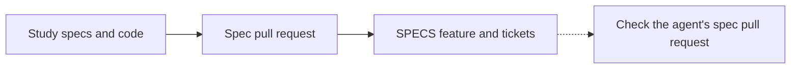
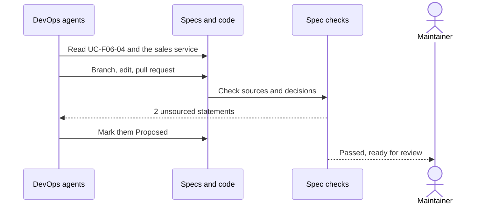

🏠 [Specs](../../../README.md) › 🧩 [Functional capabilities](../../README.md) ›
🤖 [F25 DevOps agents (hosted edition)](../README.md) › 🔀 [Flows](README.md) › 🔀 FL-F25-02 Feature requests

# 🔀 FL-F25-02 Feature requests

**Status:** ✅ specified

## Summary

A customer's feature request becomes a USER feature (FL-F25-01); the agents study the specs and the code it touches
(UC-F25-05), draft the spec changes as a pull request (UC-F25-06), which passes the spec checks for invented facts and
contradictions with the decisions before any maintainer reads it (UC-F25-23), then create the SPECS feature and its
tickets with the approval label (UC-F25-07); a request useful to one customer only is offered as a feature-factory
feature instead (UC-F25-16), and a declined one stays public as a vote (UC-F25-24).

## Personas

- [U47 simple-ERP maintainer](../../../01-users/personas/u47-simple-erp-maintainer.md)
- [U13 Owner](../../../01-users/personas/u13-owner.md)

## Flowchart

## Sequence diagram

## Steps

| Step | Persona | Screen | Use case | What happens |
|---|---|---|---|---|
| 1 | U47 | [S-F25-05](../screens/02-feature-requests/s-f25-05-study.md) | [UC-F25-05](../use-cases/02-feature-requests/uc-f25-05-study-the-code-and-the-specs-for-a-feature.md) | Study the code and the specs for a feature |
| 2 | U47 | [S-F25-06](../screens/02-feature-requests/s-f25-06-spec-pull-request.md) | [UC-F25-06](../use-cases/02-feature-requests/uc-f25-06-draft-the-spec-changes-as-a-pull-request.md) | Draft the spec changes as a pull request |
| 3 | U47 | [S-F25-07](../screens/02-feature-requests/s-f25-07-specs-feature.md) | [UC-F25-07](../use-cases/02-feature-requests/uc-f25-07-create-the-specs-feature-and-its-tickets.md) | Create the SPECS feature and its tickets |
| 4 | U47 | [S-F25-23](../screens/02-feature-requests/s-f25-23-spec-checks.md) | [UC-F25-23](../use-cases/02-feature-requests/uc-f25-23-check-an-agents-spec-pull-request.md) | Check the agent's spec pull request |

### Entities and screens

| Entity | States in this flow | Shown at step and screen | Aggregated view |
|---|---|---|---|
| [E-F25-05 Agent pull request](../data/e-f25-05-agent-pull-request.md) | In review, Proposed, Declined, Checked | 2 [S-F25-06](../screens/02-feature-requests/s-f25-06-spec-pull-request.md); 4 [S-F25-23](../screens/02-feature-requests/s-f25-23-spec-checks.md) | Agent pull requests |
| [E-F25-15 SPECS feature](../data/e-f25-15-specs-feature.md) | Active | 3 [S-F25-07](../screens/02-feature-requests/s-f25-07-specs-feature.md) | SPECS features |
| [E-F25-06 Agent ticket](../data/e-f25-06-agent-ticket.md) | Active | 3 [S-F25-07](../screens/02-feature-requests/s-f25-07-specs-feature.md) | Agent tickets |
| [E-F3-15 Agent](../../f03-assistant/data/e-f03-15-agent.md) | Paid, Paused | Shown elsewhere: [S-F3-14 Agents](../../f03-assistant/screens/10-benchmark-additions/s-f03-14-agents.md) | Agents |

## Errors

E1: the study finds the need already met by a setting or a plugin: the customer is told and the request closes (step 1).
E2: the spec checks find an unsourced statement or a contradiction: the pull request goes back to the agent with the
list and the maintainers are not asked yet (step 3). E3: the maintainer refuses the SPECS feature: the request is
declined with the reason and becomes a public vote (step 4).

## Images

Every step and error, for each persona taking part, in light and dark mode (D120). Steps are numbered as in the Steps
table; E rows are the error cases.

| Step | Persona | Device | Light | Dark |
|---|---|---|---|---|
| 1 | U47 | desktop | [light](../images/02-feature-requests/u47-simple-erp-maintainer/1-study-desktop-light.png) | [dark](../images/02-feature-requests/u47-simple-erp-maintainer/1-study-desktop-dark.png) |
| 1 | U47 | phone | [light](../images/02-feature-requests/u47-simple-erp-maintainer/1-study-phone-light.png) | [dark](../images/02-feature-requests/u47-simple-erp-maintainer/1-study-phone-dark.png) |
| 2 | U47 | desktop | [light](../images/02-feature-requests/u47-simple-erp-maintainer/2-spec-pr-desktop-light.png) | [dark](../images/02-feature-requests/u47-simple-erp-maintainer/2-spec-pr-desktop-dark.png) |
| 2 | U47 | phone | [light](../images/02-feature-requests/u47-simple-erp-maintainer/2-spec-pr-phone-light.png) | [dark](../images/02-feature-requests/u47-simple-erp-maintainer/2-spec-pr-phone-dark.png) |
| 3 | U47 | desktop | [light](../images/02-feature-requests/u47-simple-erp-maintainer/3-specs-feature-desktop-light.png) | [dark](../images/02-feature-requests/u47-simple-erp-maintainer/3-specs-feature-desktop-dark.png) |
| 3 | U47 | phone | [light](../images/02-feature-requests/u47-simple-erp-maintainer/3-specs-feature-phone-light.png) | [dark](../images/02-feature-requests/u47-simple-erp-maintainer/3-specs-feature-phone-dark.png) |
| E1 | U47 | desktop | [light](../images/02-feature-requests/u47-simple-erp-maintainer/e1-silent-desktop-light.png) | [dark](../images/02-feature-requests/u47-simple-erp-maintainer/e1-silent-desktop-dark.png) |
| E1 | U47 | phone | [light](../images/02-feature-requests/u47-simple-erp-maintainer/e1-silent-phone-light.png) | [dark](../images/02-feature-requests/u47-simple-erp-maintainer/e1-silent-phone-dark.png) |
| 4 | U47 | desktop | [light](../images/02-feature-requests/u47-simple-erp-maintainer/4-spec-checks-desktop-light.png) | [dark](../images/02-feature-requests/u47-simple-erp-maintainer/4-spec-checks-desktop-dark.png) |
| 4 | U47 | phone | [light](../images/02-feature-requests/u47-simple-erp-maintainer/4-spec-checks-phone-light.png) | [dark](../images/02-feature-requests/u47-simple-erp-maintainer/4-spec-checks-phone-dark.png) |

## Open questions

None.

---

⬅️ [FL-F25-01 Intake](fl-f25-01-intake.md) · ⬆️ [Up](README.md) · ➡️ [FL-F25-03 Bugs](fl-f25-03-bugs.md)
