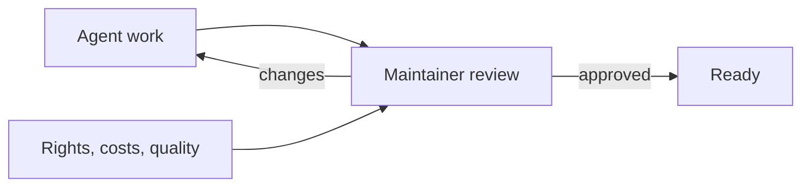

🏠 [Specs](../../../README.md) › 🧩 [Functional capabilities](../../README.md) ›
🤖 [F25 DevOps agents (hosted edition)](../README.md) › 🔀 [Flows](README.md) › 🔀 FL-F25-04 Approve and govern

# 🔀 FL-F25-04 Approve and govern

**Status:** ✅ specified

## Summary

Covers UC-F25-12, UC-F25-13, UC-F25-17, UC-F25-18, UC-F25-19.

## Personas

- [U47 SimpleERP maintainer](../../../01-users/personas/u47-simpleerp-maintainer.md)
- [U48 Hosting engineer](../../../01-users/personas/u48-hosting-engineer.md)

## Flowchart

## Sequence diagram

See each use case.

## Steps

| Step | Persona | Screen | Use case | What happens |
|---|---|---|---|---|
| 1 | U47 | [S-F25-12](../screens/04-approve-and-govern/s-f25-12-approvals.md) | [UC-F25-12](../use-cases/04-approve-and-govern/uc-f25-12-approve-or-refuse-agents-tickets.md) | Approve or refuse agents' tickets |
| 2 | U47 | [S-F25-13](../screens/04-approve-and-govern/s-f25-13-revisions.md) | [UC-F25-13](../use-cases/04-approve-and-govern/uc-f25-13-ask-the-agents-for-changes.md) | Ask the agents for changes |
| 3 | U47, U48 | [S-F25-17](../screens/04-approve-and-govern/s-f25-17-agent-rights.md) | [UC-F25-17](../use-cases/04-approve-and-govern/uc-f25-17-control-the-agents-rights-and-audit.md) | Control the agents' rights and audit |
| 4 | U47, U48 | [S-F25-18](../screens/04-approve-and-govern/s-f25-18-agent-costs.md) | [UC-F25-18](../use-cases/04-approve-and-govern/uc-f25-18-follow-the-agents-costs-and-budgets.md) | Follow the agents' costs and budgets |
| 5 | U47 | [S-F25-19](../screens/04-approve-and-govern/s-f25-19-agent-quality.md) | [UC-F25-19](../use-cases/04-approve-and-govern/uc-f25-19-measure-the-quality-of-the-agents-work.md) | Measure the quality of the agents' work |

### Entities and screens

| Entity | States in this flow | Shown at step and screen | Aggregated view |
|---|---|---|---|
| [E-F3-15 Agent](../../f03-assistant/data/e-f03-15-agent.md) | Paid, Paused | Shown elsewhere: [S-F3-14 Agents](../../f03-assistant/screens/10-benchmark-additions/s-f03-14-agents.md) | Agents |
| [E-F25-05 Agent pull request](../data/e-f25-05-agent-pull-request.md) | In review, Proposed, Declined, Checked, Open, Waiting | 2 [S-F25-13](../screens/04-approve-and-govern/s-f25-13-revisions.md) | Agent pull requests |
| [E-F25-08 Approval](../data/e-f25-08-approval.md) | Active | 1 [S-F25-12](../screens/04-approve-and-govern/s-f25-12-approvals.md); 2 [S-F25-13](../screens/04-approve-and-govern/s-f25-13-revisions.md); 5 [S-F25-19](../screens/04-approve-and-govern/s-f25-19-agent-quality.md) | Approvals |
| [E-F25-10 Agent run](../data/e-f25-10-agent-run.md) | Recorded | 3 [S-F25-17](../screens/04-approve-and-govern/s-f25-17-agent-rights.md); 4 [S-F25-18](../screens/04-approve-and-govern/s-f25-18-agent-costs.md); 5 [S-F25-19](../screens/04-approve-and-govern/s-f25-19-agent-quality.md) | Agent runs |

## Errors

As each use case.

## Images

Every step and error, for each persona taking part, in light and dark mode (D120). Steps are numbered as in the Steps
table; E rows are the error cases.

| Step | Persona | Device | Light | Dark |
|---|---|---|---|---|
| 1 | U47 | desktop | [light](../images/04-approve-and-govern/u47-simpleerp-maintainer/1-approve-desktop-light.png) | [dark](../images/04-approve-and-govern/u47-simpleerp-maintainer/1-approve-desktop-dark.png) |
| 1 | U47 | phone | [light](../images/04-approve-and-govern/u47-simpleerp-maintainer/1-approve-phone-light.png) | [dark](../images/04-approve-and-govern/u47-simpleerp-maintainer/1-approve-phone-dark.png) |
| 2 | U47 | desktop | [light](../images/04-approve-and-govern/u47-simpleerp-maintainer/2-changes-desktop-light.png) | [dark](../images/04-approve-and-govern/u47-simpleerp-maintainer/2-changes-desktop-dark.png) |
| 2 | U47 | phone | [light](../images/04-approve-and-govern/u47-simpleerp-maintainer/2-changes-phone-light.png) | [dark](../images/04-approve-and-govern/u47-simpleerp-maintainer/2-changes-phone-dark.png) |
| 3 | U47 | desktop | [light](../images/04-approve-and-govern/u47-simpleerp-maintainer/3-rights-desktop-light.png) | [dark](../images/04-approve-and-govern/u47-simpleerp-maintainer/3-rights-desktop-dark.png) |
| 3 | U47 | phone | [light](../images/04-approve-and-govern/u47-simpleerp-maintainer/3-rights-phone-light.png) | [dark](../images/04-approve-and-govern/u47-simpleerp-maintainer/3-rights-phone-dark.png) |
| 3 | U48 | desktop | [light](../images/04-approve-and-govern/u48-hosting-engineer/3-rights-desktop-light.png) | [dark](../images/04-approve-and-govern/u48-hosting-engineer/3-rights-desktop-dark.png) |
| 3 | U48 | phone | [light](../images/04-approve-and-govern/u48-hosting-engineer/3-rights-phone-light.png) | [dark](../images/04-approve-and-govern/u48-hosting-engineer/3-rights-phone-dark.png) |
| 4 | U47 | desktop | [light](../images/04-approve-and-govern/u47-simpleerp-maintainer/4-costs-desktop-light.png) | [dark](../images/04-approve-and-govern/u47-simpleerp-maintainer/4-costs-desktop-dark.png) |
| 4 | U47 | phone | [light](../images/04-approve-and-govern/u47-simpleerp-maintainer/4-costs-phone-light.png) | [dark](../images/04-approve-and-govern/u47-simpleerp-maintainer/4-costs-phone-dark.png) |
| 4 | U48 | desktop | [light](../images/04-approve-and-govern/u48-hosting-engineer/4-costs-desktop-light.png) | [dark](../images/04-approve-and-govern/u48-hosting-engineer/4-costs-desktop-dark.png) |
| 4 | U48 | phone | [light](../images/04-approve-and-govern/u48-hosting-engineer/4-costs-phone-light.png) | [dark](../images/04-approve-and-govern/u48-hosting-engineer/4-costs-phone-dark.png) |
| 5 | U47 | desktop | [light](../images/04-approve-and-govern/u47-simpleerp-maintainer/5-quality-desktop-light.png) | [dark](../images/04-approve-and-govern/u47-simpleerp-maintainer/5-quality-desktop-dark.png) |
| 5 | U47 | phone | [light](../images/04-approve-and-govern/u47-simpleerp-maintainer/5-quality-phone-light.png) | [dark](../images/04-approve-and-govern/u47-simpleerp-maintainer/5-quality-phone-dark.png) |
| E1 | U47 | desktop | [light](../images/04-approve-and-govern/u47-simpleerp-maintainer/e1-ready-refused-desktop-light.png) | [dark](../images/04-approve-and-govern/u47-simpleerp-maintainer/e1-ready-refused-desktop-dark.png) |
| E1 | U47 | phone | [light](../images/04-approve-and-govern/u47-simpleerp-maintainer/e1-ready-refused-phone-light.png) | [dark](../images/04-approve-and-govern/u47-simpleerp-maintainer/e1-ready-refused-phone-dark.png) |

## Open questions

None.

---

⬅️ [FL-F25-03 Bugs](fl-f25-03-bugs.md) · ⬆️ [Up](README.md) ·
➡️ [FL-F25-05 Tell the customer](fl-f25-05-tell-the-customer.md)
