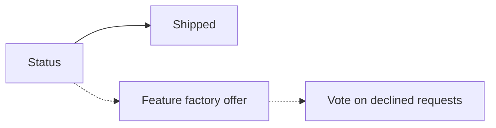

🏠 [Specs](../../../README.md) › 🧩 [Functional capabilities](../../README.md) ›
🤖 [F25 DevOps agents (hosted edition)](../README.md) › 🔀 [Flows](README.md) › 🔀 FL-F25-05 Tell the customer

# 🔀 FL-F25-05 Tell the customer

**Status:** ✅ specified

## Summary

Covers UC-F25-14, UC-F25-15, UC-F25-16, UC-F25-20.

## Personas

- [U07 Administrator](../../../01-users/personas/u07-administrator.md)
- [U13 Owner](../../../01-users/personas/u13-owner.md)
- [U47 simple-ERP maintainer](../../../01-users/personas/u47-simple-erp-maintainer.md)

## Flowchart

## Sequence diagram

See each use case.

## Steps

| Step | Persona | Screen | Use case | What happens |
|---|---|---|---|---|
| 1 | U13, U07 | [S-F25-14](../screens/05-tell-the-customer/s-f25-14-my-requests.md) | [UC-F25-14](../use-cases/05-tell-the-customer/uc-f25-14-follow-my-request-s-status.md) | Follow my request's status |
| 2 | U13 | [S-F25-15](../screens/05-tell-the-customer/s-f25-15-shipped.md) | [UC-F25-15](../use-cases/05-tell-the-customer/uc-f25-15-be-told-when-it-ships.md) | Be told when it ships |
| 3 | U47, U13 | [S-F25-16](../screens/05-tell-the-customer/s-f25-16-custom-offer.md) | [UC-F25-16](../use-cases/05-tell-the-customer/uc-f25-16-offer-the-feature-factory-for-a-custom-need.md) | Offer the feature factory for a custom need |
| 4 | U13, U07 | [S-F25-20](../screens/05-tell-the-customer/s-f25-20-requests-assistant.md) | [UC-F25-20](../use-cases/05-tell-the-customer/uc-f25-20-ask-the-assistant-about-my-requests.md) | Ask the AI assistant about my requests |
| 5 | U13, U07 | [S-F25-24](../screens/05-tell-the-customer/s-f25-24-public-requests.md) | [UC-F25-24](../use-cases/05-tell-the-customer/uc-f25-24-vote-on-declined-requests.md) | Vote on declined requests |

### Entities and screens

| Entity | States in this flow | Shown at step and screen | Aggregated view |
|---|---|---|---|
| [E-F25-09 Request status](../data/e-f25-09-request-status.md) | Planned, Received, Declined, Shipped | 1 [S-F25-14](../screens/05-tell-the-customer/s-f25-14-my-requests.md); 2 [S-F25-15](../screens/05-tell-the-customer/s-f25-15-shipped.md); 4 [S-F25-20](../screens/05-tell-the-customer/s-f25-20-requests-assistant.md); 5 [S-F25-24](../screens/05-tell-the-customer/s-f25-24-public-requests.md) | Request status |
| [E-F19-01 Feature request](../../f19-feature-factory/data/e-f19-01-feature-request.md) | Active | Shown elsewhere: [S-F19-01 Feature chat](../../f19-feature-factory/screens/01-describe-and-order/s-f19-01-feature-chat.md) | Feature requests |
| [E-F25-14 Vote](../data/e-f25-14-vote.md) | Counted, Withdrawn | 4 [S-F25-20](../screens/05-tell-the-customer/s-f25-20-requests-assistant.md); 5 [S-F25-24](../screens/05-tell-the-customer/s-f25-24-public-requests.md) | Votes |
| [E-F25-01 Bug or feature request](../data/e-f25-01-bug-or-feature-request.md) | Active | 1 [S-F25-14](../screens/05-tell-the-customer/s-f25-14-my-requests.md); 3 [S-F25-16](../screens/05-tell-the-customer/s-f25-16-custom-offer.md); 4 [S-F25-20](../screens/05-tell-the-customer/s-f25-20-requests-assistant.md) | Bug or feature requests |

## Errors

As each use case.

## Images

Every step and error, for each persona taking part, in light and dark mode (D120). Steps are numbered as in the Steps
table; E rows are the error cases.

| Step | Persona | Device | Light | Dark |
|---|---|---|---|---|
| 1 | U13 | desktop | [light](../images/05-tell-the-customer/u13-owner/1-status-desktop-light.png) | [dark](../images/05-tell-the-customer/u13-owner/1-status-desktop-dark.png) |
| 1 | U13 | phone | [light](../images/05-tell-the-customer/u13-owner/1-status-phone-light.png) | [dark](../images/05-tell-the-customer/u13-owner/1-status-phone-dark.png) |
| 1 | U07 | desktop | [light](../images/05-tell-the-customer/u07-administrator/1-status-desktop-light.png) | [dark](../images/05-tell-the-customer/u07-administrator/1-status-desktop-dark.png) |
| 2 | U13 | desktop | [light](../images/05-tell-the-customer/u13-owner/2-shipped-desktop-light.png) | [dark](../images/05-tell-the-customer/u13-owner/2-shipped-desktop-dark.png) |
| 2 | U13 | phone | [light](../images/05-tell-the-customer/u13-owner/2-shipped-phone-light.png) | [dark](../images/05-tell-the-customer/u13-owner/2-shipped-phone-dark.png) |
| 3 | U13 | desktop | [light](../images/05-tell-the-customer/u13-owner/3-factory-desktop-light.png) | [dark](../images/05-tell-the-customer/u13-owner/3-factory-desktop-dark.png) |
| 3 | U13 | phone | [light](../images/05-tell-the-customer/u13-owner/3-factory-phone-light.png) | [dark](../images/05-tell-the-customer/u13-owner/3-factory-phone-dark.png) |
| 3 | U47 | desktop | [light](../images/05-tell-the-customer/u47-simple-erp-maintainer/3-factory-desktop-light.png) | [dark](../images/05-tell-the-customer/u47-simple-erp-maintainer/3-factory-desktop-dark.png) |
| 3 | U47 | phone | [light](../images/05-tell-the-customer/u47-simple-erp-maintainer/3-factory-phone-light.png) | [dark](../images/05-tell-the-customer/u47-simple-erp-maintainer/3-factory-phone-dark.png) |
| 4 | U07 | desktop | [light](../images/05-tell-the-customer/u07-administrator/4-assistant-desktop-light.png) | [dark](../images/05-tell-the-customer/u07-administrator/4-assistant-desktop-dark.png) |
| 4 | U13 | desktop | [light](../images/05-tell-the-customer/u13-owner/4-assistant-desktop-light.png) | [dark](../images/05-tell-the-customer/u13-owner/4-assistant-desktop-dark.png) |
| 4 | U13 | phone | [light](../images/05-tell-the-customer/u13-owner/4-assistant-phone-light.png) | [dark](../images/05-tell-the-customer/u13-owner/4-assistant-phone-dark.png) |
| E1 | U13 | desktop | [light](../images/05-tell-the-customer/u13-owner/e1-declined-desktop-light.png) | [dark](../images/05-tell-the-customer/u13-owner/e1-declined-desktop-dark.png) |
| E1 | U13 | phone | [light](../images/05-tell-the-customer/u13-owner/e1-declined-phone-light.png) | [dark](../images/05-tell-the-customer/u13-owner/e1-declined-phone-dark.png) |
| 5 | U13 | desktop | [light](../images/05-tell-the-customer/u13-owner/5-public-requests-desktop-light.png) | [dark](../images/05-tell-the-customer/u13-owner/5-public-requests-desktop-dark.png) |
| 5 | U13 | phone | [light](../images/05-tell-the-customer/u13-owner/5-public-requests-phone-light.png) | [dark](../images/05-tell-the-customer/u13-owner/5-public-requests-phone-dark.png) |
| 5 | U07 | desktop | [light](../images/05-tell-the-customer/u07-administrator/5-public-requests-desktop-light.png) | [dark](../images/05-tell-the-customer/u07-administrator/5-public-requests-desktop-dark.png) |

## Open questions

None.

---

⬅️ [FL-F25-04 Approve and govern](fl-f25-04-approve-and-govern.md) · ⬆️ [Up](README.md) ·
➡️ [FL-F25-06 Vulnerability handling](fl-f25-06-vulnerability-handling.md)
