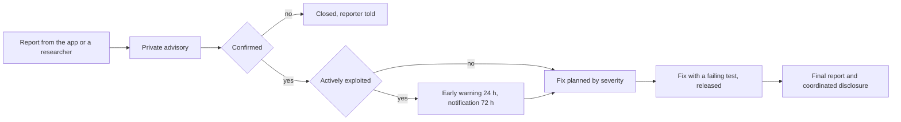
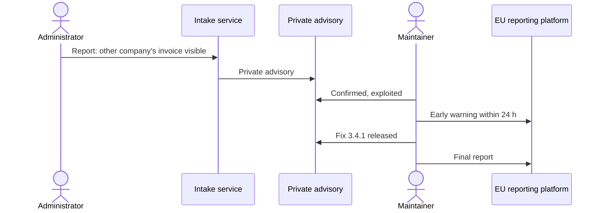

🏠 [Specs](../../../README.md) › 🧩 [Functional capabilities](../../README.md) ›
🤖 [F25 DevOps agents (hosted edition)](../README.md) › 🔀 [Flows](README.md) › 🔀 FL-F25-06 Vulnerability handling

# 🔀 FL-F25-06 Vulnerability handling

**Status:** ✅ specified

## Summary

A report that may be a vulnerability goes to a private advisory (BR-F25-12); the maintainers assess it, fix it with a
failing test first, report it under the Cyber Resilience Act when it is actively exploited, and disclose it in a
coordinated way once fixed (D482).

## Personas

- [U07 Administrator](../../../01-users/personas/u07-administrator.md)
- [U47 SimpleERP maintainer](../../../01-users/personas/u47-simpleerp-maintainer.md)
- [U48 Hosting engineer](../../../01-users/personas/u48-hosting-engineer.md)

## Flowchart

## Sequence diagram

## Steps

| Step | Persona | Screen | Use case | What happens |
|---|---|---|---|---|
| 1 | U07 | [S-F25-01](../screens/01-intake/s-f25-01-report-a-bug.md) | [UC-F25-01](../use-cases/01-intake/uc-f25-01-report-a-bug-from-simpleerp.md) | Report a problem from SimpleERP |
| 2 | U47, U48 | [S-F25-22](../screens/06-vulnerability-handling/s-f25-22-vulnerability-case.md) | [UC-F25-22](../use-cases/06-vulnerability-handling/uc-f25-22-handle-a-reported-vulnerability-under-the-cra.md) | Handle a reported vulnerability under the CRA |

### Entities and screens

| Entity | States in this flow | Shown at step and screen | Aggregated view |
|---|---|---|---|
| [E-F25-12 Vulnerability case](../data/e-f25-12-vulnerability-case.md) | Reported, Confirmed, Closed, Fixed | 1 [S-F25-01](../screens/01-intake/s-f25-01-report-a-bug.md); 2 [S-F25-22](../screens/06-vulnerability-handling/s-f25-22-vulnerability-case.md) | Vulnerability cases |
| [E-F25-05 Agent pull request](../data/e-f25-05-agent-pull-request.md) | In review, Proposed, Declined, Checked, Open, Waiting | Shown elsewhere: [S-F25-06 Spec pull request](../screens/02-feature-requests/s-f25-06-spec-pull-request.md) | Agent pull requests |

## Errors

E1: the report is not a vulnerability: the advisory is closed and a normal USER ticket opened if needed (step 2). E2: a
reporting deadline is near: the maintainers are alerted (step 2).

## Images

Every step and error, for each persona taking part, in light and dark mode (D120). Steps are numbered as in the Steps
table; E rows are the error cases.

| Step | Persona | Device | Light | Dark |
|---|---|---|---|---|
| 1 | U07 | desktop | [light](../images/06-vulnerability-handling/u07-administrator/1-report-a-bug-desktop-light.png) | [dark](../images/06-vulnerability-handling/u07-administrator/1-report-a-bug-desktop-dark.png) |
| 2 | U47 | desktop | [light](../images/06-vulnerability-handling/u47-simpleerp-maintainer/2-vulnerability-case-desktop-light.png) | [dark](../images/06-vulnerability-handling/u47-simpleerp-maintainer/2-vulnerability-case-desktop-dark.png) |
| 2 | U47 | phone | [light](../images/06-vulnerability-handling/u47-simpleerp-maintainer/2-vulnerability-case-phone-light.png) | [dark](../images/06-vulnerability-handling/u47-simpleerp-maintainer/2-vulnerability-case-phone-dark.png) |
| 2 | U48 | desktop | [light](../images/06-vulnerability-handling/u48-hosting-engineer/2-vulnerability-case-desktop-light.png) | [dark](../images/06-vulnerability-handling/u48-hosting-engineer/2-vulnerability-case-desktop-dark.png) |
| 2 | U48 | phone | [light](../images/06-vulnerability-handling/u48-hosting-engineer/2-vulnerability-case-phone-light.png) | [dark](../images/06-vulnerability-handling/u48-hosting-engineer/2-vulnerability-case-phone-dark.png) |
| E1 | U07 | desktop | [light](../images/06-vulnerability-handling/u07-administrator/e1-report-a-bug-refused-desktop-light.png) | [dark](../images/06-vulnerability-handling/u07-administrator/e1-report-a-bug-refused-desktop-dark.png) |

## Open questions

None.

---

⬅️ [FL-F25-05 Tell the customer](fl-f25-05-tell-the-customer.md) · ⬆️ [Up](README.md) ·
➡️ [FL-F25-07 Roadmap, beta, credits and changelog](fl-f25-07-roadmap-beta-and-credits.md)
