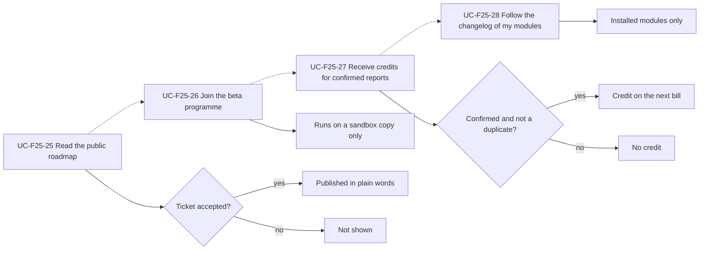
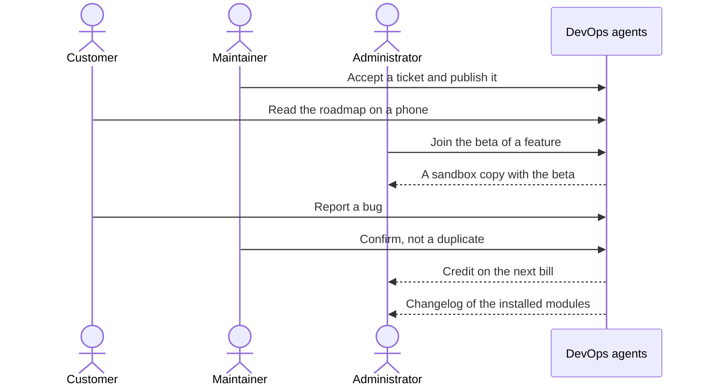

🏠 [Specs](../../../README.md) › 🧩 [Functional capabilities](../../README.md) ›
🤖 [F25 DevOps agents (hosted edition)](../README.md) › 🔀 [Flows](README.md) ›
🔀 FL-F25-07 Roadmap, beta, credits and changelog

# 🔀 FL-F25-07 Roadmap, beta, credits and changelog

**Status:** ✅ specified

## Summary

A customer reads the public roadmap of accepted tickets on a phone, the administrator joins the beta programme on a
sandbox copy, a customer's confirmed and non-duplicate report earns a credit on the hosted bill, and the administrator
and employees follow the changelog of the modules they have installed
([D544](../../../06-decisions/f25-devops-agents/d544-benchmark-gaps-f25-devops-agents.md)).

## Personas

- [U09 Customer](../../../01-users/personas/u09-customer.md), who reads the roadmap and reports a bug
- [U47 SimpleERP maintainer](../../../01-users/personas/u47-simpleerp-maintainer.md), who publishes the roadmap and
  grants credits
- [U07 Administrator](../../../01-users/personas/u07-administrator.md), who joins the beta and reads the credits and the
  changelog
- [U01 Employee](../../../01-users/personas/u01-employee.md), who reads the changelog on a phone

## Flowchart

## Sequence diagram

## Steps

| Step | Persona | Screen | Use case | What happens |
|---|---|---|---|---|
| 1 | [U09](../../../01-users/personas/u09-customer.md) | [S-F25-25](../screens/07-roadmap-beta-and-credits/s-f25-25-public-roadmap.md) | [UC-F25-25](../use-cases/07-roadmap-beta-and-credits/uc-f25-25-read-the-public-roadmap.md) | A customer reads the roadmap on a phone and sees only the tickets the maintainers accepted |
| 2 | [U07](../../../01-users/personas/u07-administrator.md) | [S-F25-26](../screens/07-roadmap-beta-and-credits/s-f25-26-beta-programme.md) | [UC-F25-26](../use-cases/07-roadmap-beta-and-credits/uc-f25-26-join-the-beta-programme.md) | The administrator joins the beta of a feature, which runs on a sandbox copy |
| 3 | [U07](../../../01-users/personas/u07-administrator.md) | [S-F25-27](../screens/07-roadmap-beta-and-credits/s-f25-27-report-credits.md) | [UC-F25-27](../use-cases/07-roadmap-beta-and-credits/uc-f25-27-receive-credits-for-confirmed-reports.md) | A maintainer confirms a report and the credit is granted to its first reporter |
| 4 | [U07](../../../01-users/personas/u07-administrator.md) | [S-F25-28](../screens/07-roadmap-beta-and-credits/s-f25-28-module-changelog.md) | [UC-F25-28](../use-cases/07-roadmap-beta-and-credits/uc-f25-28-follow-the-changelog-of-my-modules.md) | The administrator and an employee read what changed in the modules they have installed |

### Entities and screens

| Entity | States in this flow | Shown at step and screen | Aggregated view |
|---|---|---|---|
| [E-F25-16 Roadmap item](../data/e-f25-16-roadmap-item.md) | Planned, In progress, Shipped, Dropped | 1 [S-F25-25](../screens/07-roadmap-beta-and-credits/s-f25-25-public-roadmap.md) | Roadmap items |
| [E-F25-17 Beta enrolment](../data/e-f25-17-beta-enrolment.md) | Requested, Active, Declined, Ended, Withdrawn | 2 [S-F25-26](../screens/07-roadmap-beta-and-credits/s-f25-26-beta-programme.md) | Beta enrolments |
| [E-F25-18 Report credit](../data/e-f25-18-report-credit.md) | Pending, Granted, Refused, Applied, Withdrawn | 3 [S-F25-27](../screens/07-roadmap-beta-and-credits/s-f25-27-report-credits.md) | Report credits |

## Errors

- **E1 The report is a duplicate.** The customer is shown the earlier issue and no credit is promised
  ([BR-F25-20](../business-rules/br-f25-20-credits-go-to-confirmed-non-duplicate-reports-only.md), step 3).

## Images

Every step and error, for each persona taking part, in light and dark mode (D120). Steps are numbered as in the Steps
table; E rows are the error cases.

| Step | Persona | Device | Light | Dark |
|---|---|---|---|---|
| 1 | U09 | phone | [light](../images/07-roadmap-beta-and-credits/u09-customer/1-public-roadmap-phone-light.png) | [dark](../images/07-roadmap-beta-and-credits/u09-customer/1-public-roadmap-phone-dark.png) |
| 1 | U47 | desktop | [light](../images/07-roadmap-beta-and-credits/u47-simpleerp-maintainer/1-public-roadmap-desktop-light.png) | [dark](../images/07-roadmap-beta-and-credits/u47-simpleerp-maintainer/1-public-roadmap-desktop-dark.png) |
| 2 | U07 | desktop | [light](../images/07-roadmap-beta-and-credits/u07-administrator/2-beta-programme-desktop-light.png) | [dark](../images/07-roadmap-beta-and-credits/u07-administrator/2-beta-programme-desktop-dark.png) |
| 3 | U07 | desktop | [light](../images/07-roadmap-beta-and-credits/u07-administrator/3-report-credits-desktop-light.png) | [dark](../images/07-roadmap-beta-and-credits/u07-administrator/3-report-credits-desktop-dark.png) |
| 3 | U47 | desktop | [light](../images/07-roadmap-beta-and-credits/u47-simpleerp-maintainer/3-report-credits-desktop-light.png) | [dark](../images/07-roadmap-beta-and-credits/u47-simpleerp-maintainer/3-report-credits-desktop-dark.png) |
| 4 | U07 | desktop | [light](../images/07-roadmap-beta-and-credits/u07-administrator/4-module-changelog-desktop-light.png) | [dark](../images/07-roadmap-beta-and-credits/u07-administrator/4-module-changelog-desktop-dark.png) |
| 4 | U01 | phone | [light](../images/07-roadmap-beta-and-credits/u01-employee/4-module-changelog-phone-light.png) | [dark](../images/07-roadmap-beta-and-credits/u01-employee/4-module-changelog-phone-dark.png) |
| E1 | U09 | phone | [light](../images/07-roadmap-beta-and-credits/u09-customer/e1-the-report-is-a-duplicate-phone-light.png) | [dark](../images/07-roadmap-beta-and-credits/u09-customer/e1-the-report-is-a-duplicate-phone-dark.png) |

## Open questions

None.

---

⬅️ [FL-F25-06 Vulnerability handling](fl-f25-06-vulnerability-handling.md) · ⬆️ [Up](README.md) ·
➡️ [FL-F25-08 The agent team builds an approved ticket](fl-f25-08-team-builds-a-ticket.md)
