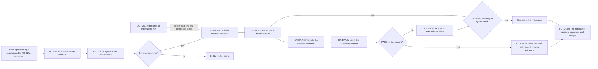
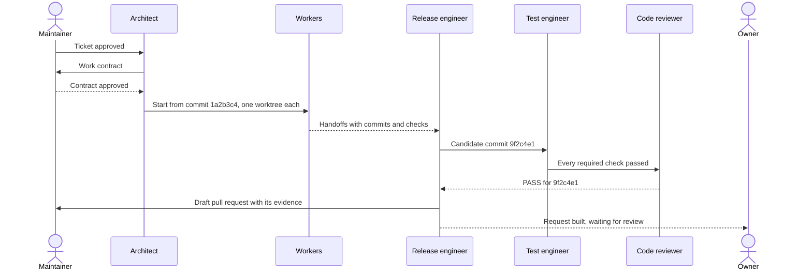

🏠 [Specs](../../../README.md) › 🧩 [Functional capabilities](../../README.md) ›
🤖 [F25 DevOps agents (hosted edition)](../README.md) › 🔀 [Flows](README.md) ›
🔀 FL-F25-08 The agent team builds an approved ticket

# 🔀 FL-F25-08 The agent team builds an approved ticket

**Status:** 🔄 waiting for the owner

## Summary

Once a maintainer has approved a ticket ([FL-F25-02 Feature requests](fl-f25-02-feature-requests.md),
[FL-F25-03 Bugs](fl-f25-03-bugs.md), [BR-F25-07](../business-rules/br-f25-07-approval-before-ready.md)), a team of agent
roles builds it: the architect writes the work contract, which the maintainer approves before any worker starts; each
implementation role works in its own worktree from one starting commit and hands over its result; the release engineer
integrates the commits; the test engineer and the read-only code reviewer verify one candidate commit; at most two
repair cycles follow; a draft pull request carries the evidence; checkpoints let an interrupted run resume. The flow
ends in [FL-F25-04 Approve and govern](fl-f25-04-approve-and-govern.md), where the maintainer still reviews, approves
and merges ([D434](../../../06-decisions/f25-devops-agents/d434-maintainer-approval-label.md)). Every rule F25 already
sets applies to the team
[D567](../../../06-decisions/f25-devops-agents/d567-the-agent-team-roles-contract-worktrees-one-commit-verification.md).

## Personas

- [U47 simple-ERP maintainer](../../../01-users/personas/u47-simple-erp-maintainer.md), who approves the contract,
  receives the blockers and reviews the draft
- [U48 Hosting engineer](../../../01-users/personas/u48-hosting-engineer.md), who runs the runners and resumes
  interrupted runs
- [U13 Owner](../../../01-users/personas/u13-owner.md), who follows the draft of their company's request on a phone

## Flowchart

## Sequence diagram

## Steps

| Step | Persona | Screen | Use case | What happens |
|---|---|---|---|---|
| 1 | [U47](../../../01-users/personas/u47-simple-erp-maintainer.md) | [S-F25-29](../screens/08-team-builds-a-ticket/s-f25-29-work-contract.md) | [UC-F25-29](../use-cases/08-team-builds-a-ticket/uc-f25-29-write-the-work-contract-of-a-ticket.md) | The architect writes the work contract of the approved ticket |
| 2 | [U47](../../../01-users/personas/u47-simple-erp-maintainer.md) | [S-F25-30](../screens/08-team-builds-a-ticket/s-f25-30-contract-approval.md) | [UC-F25-30](../use-cases/08-team-builds-a-ticket/uc-f25-30-approve-the-work-contract.md) | The maintainer approves the contract; no worker starts before |
| 3 | [U47](../../../01-users/personas/u47-simple-erp-maintainer.md) | [S-F25-31](../screens/08-team-builds-a-ticket/s-f25-31-agent-workers.md) | [UC-F25-31](../use-cases/08-team-builds-a-ticket/uc-f25-31-build-in-isolated-worktrees.md) | Each implementation role builds in its own worktree from one starting commit |
| 4 | [U47](../../../01-users/personas/u47-simple-erp-maintainer.md) | [S-F25-32](../screens/08-team-builds-a-ticket/s-f25-32-worker-handoff.md) | [UC-F25-32](../use-cases/08-team-builds-a-ticket/uc-f25-32-hand-over-a-workers-result.md) | Each worker hands over its commits, its checks and its evidence |
| 5 | [U47](../../../01-users/personas/u47-simple-erp-maintainer.md) | [S-F25-33](../screens/08-team-builds-a-ticket/s-f25-33-integration.md) | [UC-F25-33](../use-cases/08-team-builds-a-ticket/uc-f25-33-integrate-the-workers-commits.md) | The release engineer integrates the commits in dependency order into one candidate commit |
| 6 | [U47](../../../01-users/personas/u47-simple-erp-maintainer.md) | [S-F25-34](../screens/08-team-builds-a-ticket/s-f25-34-candidate-verification.md) | [UC-F25-34](../use-cases/08-team-builds-a-ticket/uc-f25-34-verify-the-candidate-commit.md) | The test engineer runs every required check and the code reviewer returns PASS or CHANGES_REQUESTED for that commit |
| 7 | [U47](../../../01-users/personas/u47-simple-erp-maintainer.md) | [S-F25-35](../screens/08-team-builds-a-ticket/s-f25-35-repair-cycles.md) | [UC-F25-35](../use-cases/08-team-builds-a-ticket/uc-f25-35-repair-a-rejected-candidate.md) | A rejected candidate is repaired, at most twice, then the maintainer decides |
| 8 | [U47](../../../01-users/personas/u47-simple-erp-maintainer.md) | [S-F25-36](../screens/08-team-builds-a-ticket/s-f25-36-draft-pull-request.md) | [UC-F25-36](../use-cases/08-team-builds-a-ticket/uc-f25-36-open-the-draft-pull-request-with-its-evidence.md) | A draft pull request on the verified commit carries the evidence; the owner follows it on a phone |
| 9 | [U48](../../../01-users/personas/u48-hosting-engineer.md) | [S-F25-37](../screens/08-team-builds-a-ticket/s-f25-37-run-resume.md) | [UC-F25-37](../use-cases/08-team-builds-a-ticket/uc-f25-37-resume-an-interrupted-run.md) | An interrupted run resumes from its checkpoint, one active run per repository |

### Entities and screens

| Entity | States in this flow | Shown at step and screen | Aggregated view |
|---|---|---|---|
| [E-F25-19 Work contract](../data/e-f25-19-work-contract.md) | Draft, Proposed, Approved, Refused, Closed, Abandoned | 1 [S-F25-29](../screens/08-team-builds-a-ticket/s-f25-29-work-contract.md) | Work contracts |
| [E-F25-20 Agent role](../data/e-f25-20-agent-role.md) | Active, Suspended, Retired | 3 [S-F25-31](../screens/08-team-builds-a-ticket/s-f25-31-agent-workers.md) | Agent roles |
| [E-F25-21 Worker handoff](../data/e-f25-21-worker-handoff.md) | Submitted, Accepted, Refused, Blocked, Integrated, Abandoned | 4 [S-F25-32](../screens/08-team-builds-a-ticket/s-f25-32-worker-handoff.md) | Worker handoffs |
| [E-F25-22 Verification](../data/e-f25-22-verification.md) | Running, Checked, Changes requested, Blocked, Passed, Superseded | 6 [S-F25-34](../screens/08-team-builds-a-ticket/s-f25-34-candidate-verification.md) | Verifications |
| [E-F25-23 Run checkpoint](../data/e-f25-23-run-checkpoint.md) | Queued, Active, Interrupted, Finished, Abandoned | 9 [S-F25-37](../screens/08-team-builds-a-ticket/s-f25-37-run-resume.md) | Run checkpoints |
| [E-F25-05 Agent pull request](../data/e-f25-05-agent-pull-request.md) | In review, Waiting | Shown elsewhere: [S-F25-13 Revisions](../screens/04-approve-and-govern/s-f25-13-revisions.md) | Agent pull requests |
| [E-F25-10 Agent run](../data/e-f25-10-agent-run.md) | Recorded | Shown elsewhere: [S-F25-18 Agent costs](../screens/04-approve-and-govern/s-f25-18-agent-costs.md) | Agent runs |

## Errors

- **E1 The contract is not approved.** No worker starts and no worktree is made; the architect revises the contract or
  the maintainer declines the run
  ([BR-F25-23](../business-rules/br-f25-23-no-worker-starts-before-the-contract-is-approved.md), step 2).

## Images

Every step and error, for each persona taking part, in light and dark mode (D120). Steps are numbered as in the Steps
table; E rows are the error cases.

| Step | Persona | Device | Light | Dark |
|---|---|---|---|---|
| 1 | U47 | desktop | [light](../images/08-team-builds-a-ticket/u47-simple-erp-maintainer/1-work-contract-desktop-light.png) | [dark](../images/08-team-builds-a-ticket/u47-simple-erp-maintainer/1-work-contract-desktop-dark.png) |
| 1 | U47 | phone | [light](../images/08-team-builds-a-ticket/u47-simple-erp-maintainer/1-work-contract-phone-light.png) | [dark](../images/08-team-builds-a-ticket/u47-simple-erp-maintainer/1-work-contract-phone-dark.png) |
| 2 | U47 | desktop | [light](../images/08-team-builds-a-ticket/u47-simple-erp-maintainer/2-contract-approval-desktop-light.png) | [dark](../images/08-team-builds-a-ticket/u47-simple-erp-maintainer/2-contract-approval-desktop-dark.png) |
| 2 | U47 | phone | [light](../images/08-team-builds-a-ticket/u47-simple-erp-maintainer/2-contract-approval-phone-light.png) | [dark](../images/08-team-builds-a-ticket/u47-simple-erp-maintainer/2-contract-approval-phone-dark.png) |
| 3 | U47 | desktop | [light](../images/08-team-builds-a-ticket/u47-simple-erp-maintainer/3-agent-workers-desktop-light.png) | [dark](../images/08-team-builds-a-ticket/u47-simple-erp-maintainer/3-agent-workers-desktop-dark.png) |
| 3 | U48 | desktop | [light](../images/08-team-builds-a-ticket/u48-hosting-engineer/3-agent-workers-desktop-light.png) | [dark](../images/08-team-builds-a-ticket/u48-hosting-engineer/3-agent-workers-desktop-dark.png) |
| 3 | U47 | phone | [light](../images/08-team-builds-a-ticket/u47-simple-erp-maintainer/3-agent-workers-phone-light.png) | [dark](../images/08-team-builds-a-ticket/u47-simple-erp-maintainer/3-agent-workers-phone-dark.png) |
| 4 | U47 | desktop | [light](../images/08-team-builds-a-ticket/u47-simple-erp-maintainer/4-worker-handoff-desktop-light.png) | [dark](../images/08-team-builds-a-ticket/u47-simple-erp-maintainer/4-worker-handoff-desktop-dark.png) |
| 4 | U47 | phone | [light](../images/08-team-builds-a-ticket/u47-simple-erp-maintainer/4-worker-handoff-phone-light.png) | [dark](../images/08-team-builds-a-ticket/u47-simple-erp-maintainer/4-worker-handoff-phone-dark.png) |
| 5 | U47 | desktop | [light](../images/08-team-builds-a-ticket/u47-simple-erp-maintainer/5-integration-desktop-light.png) | [dark](../images/08-team-builds-a-ticket/u47-simple-erp-maintainer/5-integration-desktop-dark.png) |
| 5 | U47 | phone | [light](../images/08-team-builds-a-ticket/u47-simple-erp-maintainer/5-integration-phone-light.png) | [dark](../images/08-team-builds-a-ticket/u47-simple-erp-maintainer/5-integration-phone-dark.png) |
| 6 | U47 | desktop | [light](../images/08-team-builds-a-ticket/u47-simple-erp-maintainer/6-candidate-verification-desktop-light.png) | [dark](../images/08-team-builds-a-ticket/u47-simple-erp-maintainer/6-candidate-verification-desktop-dark.png) |
| 6 | U47 | phone | [light](../images/08-team-builds-a-ticket/u47-simple-erp-maintainer/6-candidate-verification-phone-light.png) | [dark](../images/08-team-builds-a-ticket/u47-simple-erp-maintainer/6-candidate-verification-phone-dark.png) |
| 7 | U47 | desktop | [light](../images/08-team-builds-a-ticket/u47-simple-erp-maintainer/7-repair-cycles-desktop-light.png) | [dark](../images/08-team-builds-a-ticket/u47-simple-erp-maintainer/7-repair-cycles-desktop-dark.png) |
| 7 | U47 | phone | [light](../images/08-team-builds-a-ticket/u47-simple-erp-maintainer/7-repair-cycles-phone-light.png) | [dark](../images/08-team-builds-a-ticket/u47-simple-erp-maintainer/7-repair-cycles-phone-dark.png) |
| 8 | U47 | desktop | [light](../images/08-team-builds-a-ticket/u47-simple-erp-maintainer/8-draft-pull-request-desktop-light.png) | [dark](../images/08-team-builds-a-ticket/u47-simple-erp-maintainer/8-draft-pull-request-desktop-dark.png) |
| 8 | U13 | phone | [light](../images/08-team-builds-a-ticket/u13-owner/8-draft-pull-request-phone-light.png) | [dark](../images/08-team-builds-a-ticket/u13-owner/8-draft-pull-request-phone-dark.png) |
| 8 | U47 | phone | [light](../images/08-team-builds-a-ticket/u47-simple-erp-maintainer/8-draft-pull-request-phone-light.png) | [dark](../images/08-team-builds-a-ticket/u47-simple-erp-maintainer/8-draft-pull-request-phone-dark.png) |
| 9 | U48 | desktop | [light](../images/08-team-builds-a-ticket/u48-hosting-engineer/9-run-resume-desktop-light.png) | [dark](../images/08-team-builds-a-ticket/u48-hosting-engineer/9-run-resume-desktop-dark.png) |
| 9 | U48 | phone | [light](../images/08-team-builds-a-ticket/u48-hosting-engineer/9-run-resume-phone-light.png) | [dark](../images/08-team-builds-a-ticket/u48-hosting-engineer/9-run-resume-phone-dark.png) |
| E1 | U47 | desktop | [light](../images/08-team-builds-a-ticket/u47-simple-erp-maintainer/e1-the-contract-is-not-approved-desktop-light.png) | [dark](../images/08-team-builds-a-ticket/u47-simple-erp-maintainer/e1-the-contract-is-not-approved-desktop-dark.png) |
| E1 | U47 | phone | [light](../images/08-team-builds-a-ticket/u47-simple-erp-maintainer/e1-the-contract-is-not-approved-phone-light.png) | [dark](../images/08-team-builds-a-ticket/u47-simple-erp-maintainer/e1-the-contract-is-not-approved-phone-dark.png) |

## Open questions

None.

---

⬅️ [FL-F25-07 Roadmap, beta, credits and changelog](fl-f25-07-roadmap-beta-and-credits.md) · ⬆️ [Up](README.md)
